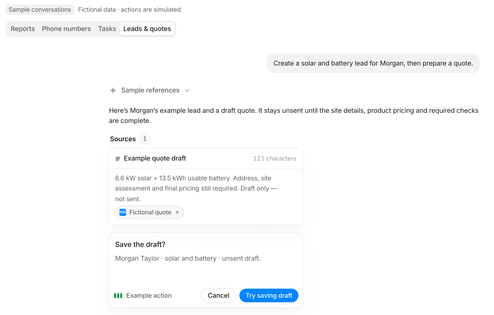

import { NextGuide } from "/snippets/docs-visuals.jsx";

Agent is a chat inside ArcSolar. Ask about your customers, jobs and sales, or ask it to do a task for you. It's in **beta** and free while in beta.

## Open Agent

- Select **Agent** in the sidebar, or go to [app.arcsolar.com.au/dashboard/agent](https://app.arcsolar.com.au/dashboard/agent).
- Or select **Agent** in the bar at the bottom of any page. It opens a small chat you can keep open while you work.

Installers find it as **ArcAgents** in the Work app.

If you don't see Agent, it isn't turned on for your workspace yet. [Contact support](/reference/support).

## What you can ask

| Ask for | Example |
| --- | --- |
| Answers | "Which jobs need attention today?" |
| Reports | "Show my weekly sales summary" |
| Tasks | "Create a follow-up task for this customer" |
| Leads and quotes | "Create a solar and battery lead for Morgan, then prepare a quote" |
| How-to help | "How do I import leads?" |

Reports come back as **Insight Cards** and charts. Select a figure to open the records behind it.

## You approve every change

Agent never changes anything on its own. When it wants to make a change, it shows a card first. Nothing happens until you select the button on the card.

<Frame caption="Agent prepares a change and waits for you. Sample conversation.">
  
</Frame>

- Select the action button to go ahead, or **Cancel** to stop.
- Typing "yes" in the chat does **not** approve anything. Use the button.
- Cards expire after 10 minutes. Ask again if one expires.

Looking things up and running reports don't need a card.

## It follows your permissions

Agent can only do what your role allows. If you can't change pricing in ArcSolar, Agent can't either. See [Roles and permissions](/setup/roles).

## Handy features

- **@ mentions**: type **@** to point at a customer, quote, project, team member or installer.
- **Attach files**: add up to five files, such as a PDF, photo or spreadsheet.
- **Chat history**: select the clock icon to reopen past chats. You can pin, rename or archive them.
- **Stop**: select **Stop agent** to cancel a reply.

## Usage limits

Each person has a usage allowance. Select **Usage** in Agent to see what's left and when it resets. You'll see a warning when you're close to the limit.

## What Agent won't do

- Make up prices, rebates or site details
- Message customers who've opted out
- Change your own access or remove the last Administrator
- Ask for passwords or API keys
- Follow instructions hidden inside uploaded files

<NextGuide href="/customers/records" title="Customer records" />
