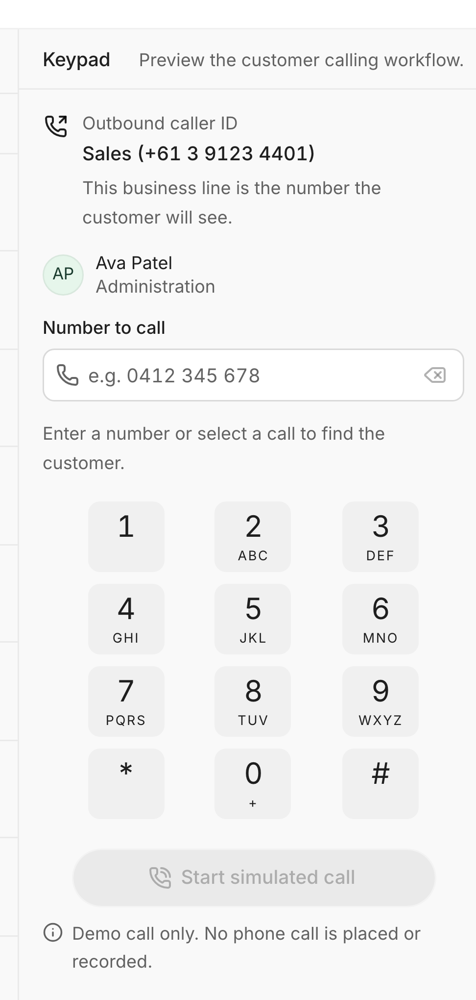
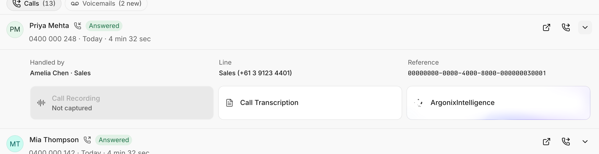

import { ProductPreview, NextGuide } from "/snippets/docs-visuals.jsx";

<ProductPreview type="comms" />

You call customers from ArcSolar in your browser. Calls use your business line, so customers see your company number, not your mobile.

## Before your first call

- An administrator must assign you a phone line.
- Allow microphone access when your browser asks.
- Keep the ArcSolar tab open while you call.

ArcSolar calling is not for emergency calls.

## Make a call

You can start a call three ways:

- From a customer: **Actions → Communicate → Call customer**.
- From call history: select the call-back button on a call in **Comms → Phone**.
- From the keypad: open [**Comms → Phone**](https://app.arcsolar.com.au/comms?tab=phone) and type the number.

<Steps>
  <Step title="Check the caller ID">
    **Outbound caller ID** shows the line the customer will see. If you have more than one line, choose the right one.
  </Step>
  <Step title="Pick the number">
    If the customer has more than one number, choose one under **Choose the number to call**.
  </Step>
  <Step title="Call">
    Select **Call from selected line**. Wait for **Connected**.
  </Step>
  <Step title="Tell the customer the call is recorded">
    The keypad reminds you: **Tell the customer this call is being recorded.**
  </Step>
</Steps>

<Frame caption="The keypad and outbound caller ID in Comms → Phone. Sample data.">
  
</Frame>

During a call, use **Mute**, **Hang up** and the keypad for **Touch tones** (for example, to get through a phone menu).

## Keep working during a call

A call bar stays on screen while you move around ArcSolar. It shows the customer, number and call time. From the bar you can:

- **Open Keypad**
- **Message customer**
- **Add a note**: up to 1,000 characters, saved to the customer's Activity with **Save call note**
- **Book customer appointment**
- **Open customer profile**
- **Mute** or **Hang up**

Select **Back to app** to shrink the bar while the call continues. Select the bar to expand it again.

## After the call

When a call ends, ArcSolar opens **Review lead disposition**. This is where you record what happened.

1. Check the suggested stage. It may come from ArgonixIntelligence or from you.
2. Change it under **Change disposition** if needed. **Lost** and **Disqualified** need a **Reason**.
3. Add **Call notes**.
4. Tick **schedule follow up reminder for me in 24 hours**, or choose **schedule custom date follow up reminder** and pick a time. This adds a task for you in Calendar and **My tasks**.
5. Select **Save disposition**. Select **Later** to come back to it.

## Review past calls and voicemails

Open **Comms → Phone**. **Call history** has two tabs:

- **Calls**: every call, with its status (for example **Answered** or **Missed**), number, time and length.
- **Voicemails**: messages left for your team, marked **New** or **Read**.

Expand a call to see who handled it, the line used, and links to the **Call Recording**, **Call Transcription** and **ArgonixIntelligence** summary.

<Frame caption="An expanded call in call history. Sample data.">
  
</Frame>

Not every call has a recording or transcript. See [CallIntelligence](/customers/call-intelligence) for summaries.

## Send an SMS

From a customer, choose **Actions → Communicate → Send SMS** (or **Open SMS thread** if you have texted them before). This opens their conversation in Comms. See [Comms](/customers/comms) for replying, notes and bulk SMS.

<Accordion title="Phone or audio not working">
- **No number assigned**: ask your administrator to assign you a line.
- **Connect phone**: select it to connect your browser phone.
- **Enable call audio**: your browser blocked sound. Select it to allow audio.
- **Use phone on this device**: moves your phone from another tab or device to this one. You can't move a call that is in progress.
- **Repair phone connection**: resets the browser phone if it is stuck.
- After sleep or a network change, wait for **Phone ready** before calling.
</Accordion>

<NextGuide href="/customers/call-intelligence" title="CallIntelligence" />

<Visibility for="agents">
- The keypad lives in **Comms → Phone** (`/comms?tab=phone`). The number field is labelled "Number to call" and holds at most 24 characters; **Delete last character** removes the last digit.
- **Choose the number to call** appears when the customer has more than one verified number; each option shows the channel, number and a **Primary** marker.
- **Outbound caller ID** shows the selected line or **No number assigned**. Helper text: "This business line is the number the customer will see." An unprovisioned line says "An administrator must finish provisioning this line before live calls can start."
- **Call button.** Live label **Call from selected line** (compact label **Call**). In the demo it reads **Start simulated call**. It is not "Call from assigned line".
- **Phase labels.** `Authorising`, `Dialling`, `Ringing`, `Incoming call`, `Connected`, `Ending`, `Ended`, `Failed`.
- **Touch tones.** During a call the number field becomes **Touch tones** ("Use the keypad for touch tones"); tones send only once **Connected**.
- **Phone service labels.** `Phone ready`, `Connecting`, `Phone standby`, `Phone reconnecting`, `Network offline`, `Line unconfigured`, `Phone error`, `Phone offline`. **Repair phone connection** → "Repair the browser phone connection?" → **Repair and reconnect**. **Use phone on this device** → "Move the phone to this device?" → **Use this device** (or **Keep other device active**).
- **Active call bar.** `Active call with <contact>`, number, timer and **Call recording active** when recording. Controls: **Open Keypad**, **Message customer** (disabled with "Messaging unavailable for this call" / "No exact customer message target"), **Mute**/**Unmute**, **Add a note**, **Book customer appointment**, **Open customer profile**, **Hang up**. **Back to app** collapses it.
- **Call note.** Dialog **Add a call note** — "Add context from this call to the Customer activity." Up to 1,000 characters; **Save call note**.
- **Post-call disposition.** After a call the user owns ends (busy, ended, failed or no answer), the dialog **Review lead disposition** opens. It shows the current disposition source ("Argonix Intelligence", "Confirmed by salesperson" or "Current disposition"), a **Change disposition** select of pipeline stages, a **Reason** select when required, **Call notes**, the checkbox "schedule follow up reminder for me in 24 hours", the button "schedule custom date follow up reminder" with a **Follow-up reminder** picker ("Creates a task reminder for you in Calendar and My tasks."), and **Later** / **Save disposition**. If the call has no single active lead it says "This call has no single active sales lead to update."
- Live mode always shows "Tell the customer this call is being recorded." and "Not for emergency calls." Do not describe ArcSolar calling as available for emergencies.
</Visibility>
