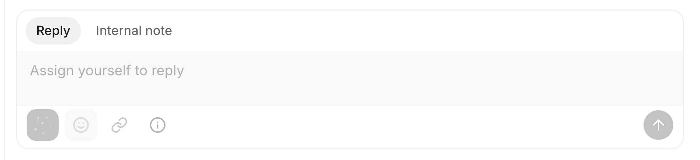
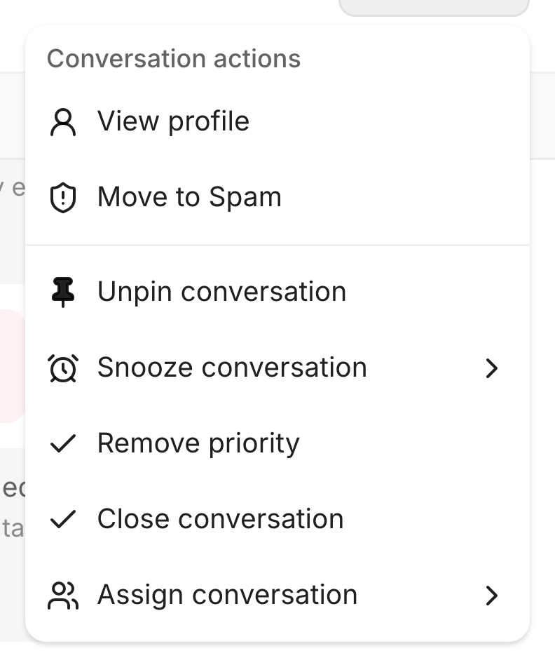
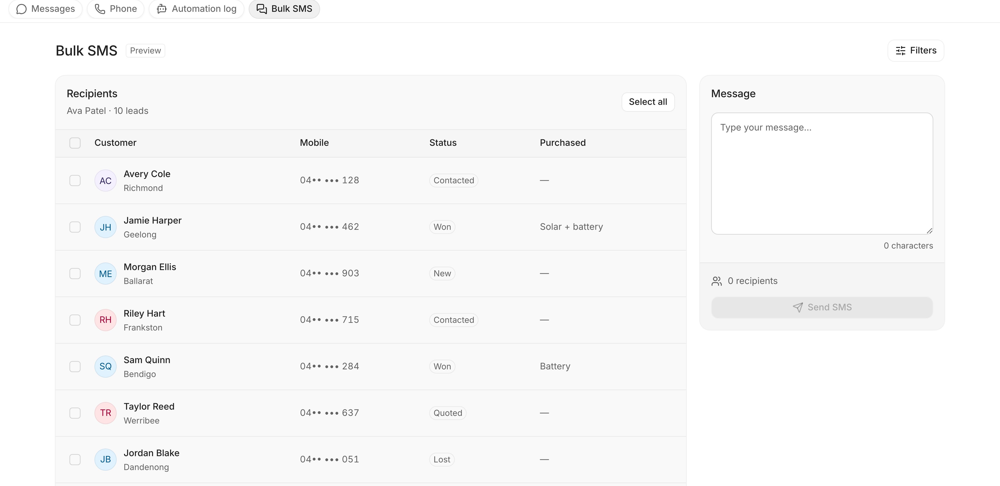

import { ProductPreview, NextGuide } from "/snippets/docs-visuals.jsx";

<ProductPreview type="comms" />

Comms is where your team talks to customers. Each customer has one conversation thread with their texts, calls, emails, quotes, payments and internal notes in order.

Open [**Comms**](https://app.arcsolar.com.au/comms) from the sidebar. It opens as **ArcSolar Comms** with four tabs:

| Tab | Use it to |
| --- | --- |
| **Messages** | Read and reply to customer SMS |
| **Phone** | Make calls and review call history. See [Calls and SMS](/customers/calls-sms) |
| **Automation log** | Check which automatic messages were sent or skipped |
| **Bulk SMS** | Send one message to many customers |

Finance and External marketing users see a read-only view without **Automation log** or **Bulk SMS**.

## Find a conversation

The left sidebar sorts conversations into mailboxes:

- **Inbox**: conversations to work on
- **Mentions**: notes where a teammate tagged you
- **Snoozed**: conversations hidden until a set time
- **Sent by me**: conversations you have messaged
- **Automated conversations**: threads with automatic messages
- **All conversations**, **Unassigned** and **Spam**

Above the list, choose **All**, **Open**, **Snoozed** or **Closed**. **Filter conversations** filters by **Read state**, **Assignee**, **Channel** and **Priority**. **Search loaded conversations** finds a name or number.

## Reply to a customer

<Steps>
  <Step title="Open the conversation">
    Read the latest messages, calls and notes first. The right panel shows the customer's details and a link to their record.
  </Step>
  <Step title="Assign it to yourself if needed">
    If the box says **Assign yourself to reply**, the conversation belongs to someone else. Ask a manager to assign it to you.
  </Step>
  <Step title="Write and send">
    Stay on the **Reply** tab, type your message and select **Send**.
  </Step>
  <Step title="Check the status">
    Each message shows its status, such as **Delivered**. Failed messages show **Delivery failed**.
  </Step>
</Steps>

<Frame caption="The reply box, with Reply and Internal note tabs. Sample data.">
  
</Frame>

Comms sends SMS text only. Images and videos can't be sent or received. Long messages can be split into several SMS, which may cost more.

Always respect opt-outs. If a customer replies STOP or asks not to be contacted, do not message them again.

## Leave an internal note

Select the **Internal note** tab, write your note and send it. Notes are visible to your team, never the customer. Mention a teammate to notify them. They see it in **Mentions** and in their [Inbox](/customers/inbox).

## Manage a conversation

Select **Conversation actions** at the top of the thread.

<Frame caption="Conversation actions. Sample data.">
  
</Frame>

| Action | What it does |
| --- | --- |
| **View profile** | Opens the customer's details |
| **Move to Spam** | Moves junk out of your mailboxes |
| **Pin conversation** | Keeps it at the top of the list |
| **Snooze conversation** | Hides it **For 1 hour**, **Until tomorrow at 9:00** or **Until next week** |
| **Mark priority** | Flags it as important |
| **Close conversation** | Marks it done. **Reopen conversation** brings it back |
| **Assign conversation** | Gives it to a team member, or **Unassign** |

Snoozing, closing, priority, spam and assigning are for Administrators and Operations.

## Start a new conversation

1. Select **New message** at the top of Comms.
2. Search for the client name or phone number, or type an Australian mobile number.
3. Choose the **From** line if you have more than one. Pick it before you write, because replies always use the conversation's original number.
4. Write your message and send it.

You need an SMS-enabled phone number assigned to you. You can also start a text from a customer: **Actions → Communicate → Send SMS**.

## Send a bulk SMS

<Steps>
  <Step title="Open Bulk SMS">
    Select the **Bulk SMS** tab. Your leads are listed under **Recipients**.
  </Step>
  <Step title="Choose who gets it">
    Use **Filters** to narrow by **Sales rep**, **Status**, **Purchased** or **Lead source**. Tick customers, or select **Select all**.
  </Step>
  <Step title="Write the message">
    Type it under **Message** (up to 1,600 characters). The recipient count updates as you select.
  </Step>
  <Step title="Send">
    Select **Send SMS**, check the message in the confirmation, then select **Send SMS** again.
  </Step>
</Steps>

<Frame caption="Bulk SMS. Sample data.">
  
</Frame>

## Check automatic messages

The **Automation log** shows what ArcSolar sent on its own, and what it chose not to send. Use **Customer messages** or **Team alerts**, then filter by **Outcome**. Each entry shows the message type (for example **Appointment confirmation** or **Quote follow up**), the customer and the result, such as **Sent** or **Not sent**. Select **Open customer →** to check the record.

<NextGuide href="/customers/calls-sms" title="Calls and SMS" />

<Visibility for="agents">
- Workflow controls (snooze, close/reopen, priority, spam, assign/unassign) are enabled for Administrator, Operations and Developer. Sales representatives can reply but cannot use these controls. Finance and External marketing are read-only; External marketing sees the Phone tab as "Call logs" and neither role sees Automation log or Bulk SMS.
- Reply placeholder "Assign yourself to reply" shows when the user cannot reply to that conversation; closed conversations show "Reopen this conversation before replying".
- Snooze options: "For 1 hour", "Until tomorrow at 9:00", "Until next week". Snoozed conversations show **Wake conversation**.
- New conversation dialog (live data): "Start a new conversation", recipient search "Search client name or phone number", optional "Client name", **From** line picker ("Choose before writing. Replies and retries use their original number."), message. Requires an active, SMS-enabled number assigned to the user. In the demo, **New message** links to Customers instead.
- Bulk SMS message max length is 1,600 characters. Confirmation dialog title "Send SMS to N recipients?" with body "The same message will be sent to your selected customers."
</Visibility>
