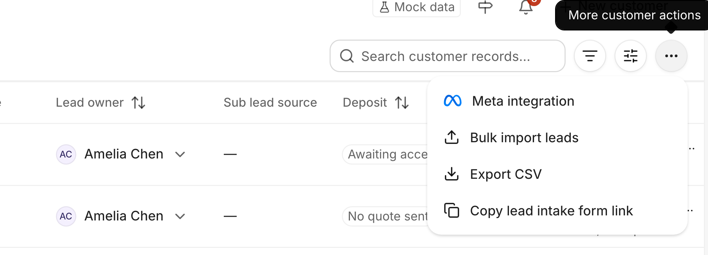
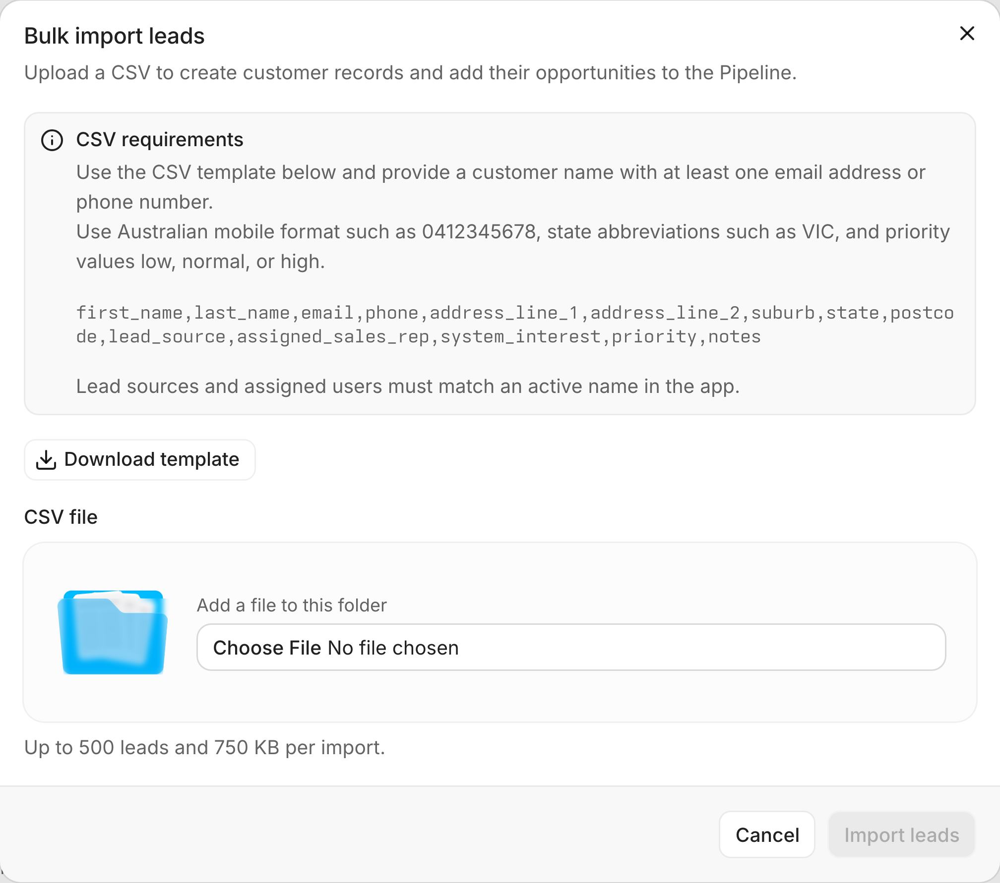

import { NextGuide } from "/snippets/docs-visuals.jsx";

Use this to move leads from another CRM or a spreadsheet into ArcSolar. Each row becomes a customer record with a lead in the [Pipeline](/customers/pipeline).

## Where to find it

You can start an import from two places:

- [**Customers → Customer Records**](https://app.arcsolar.com.au/dashboard/customers)
- [**Customers → Pipeline**](https://app.arcsolar.com.au/dashboard/customers/pipeline)

Select **Bulk import leads** at the top of the page. If you can't see it, open the **…** menu next to the search bar.

<Frame caption="The … menu on Customer Records. Sample data.">
  
</Frame>

You only see this option if your role can create customers.

## Import your leads

<Steps>
  <Step title="Download the template">
    In the **Bulk import leads** window, select **Download template**. Open `lead-import-template.csv` in Excel, Numbers or Google Sheets.

    <Frame caption="The Bulk import leads window.">
      
    </Frame>
  </Step>
  <Step title="Add one lead per row">
    Keep the header row as it is. Fill in your leads using the rules below.
  </Step>
  <Step title="Save as CSV">
    Save or export the file as **CSV**. Excel and Numbers files (`.xlsx`, `.numbers`) are not accepted.
  </Step>
  <Step title="Choose a selling brand">
    If your workspace sells under more than one brand, pick one in **Selling brand for new opportunities**. You can also choose **Leave unallocated**.
  </Step>
  <Step title="Upload the file">
    Choose your file under **CSV file**. ArcSolar checks it straight away. If it shows **Fix the CSV before importing**, fix the listed rows and upload again.
  </Step>
  <Step title="Import">
    Select **Import N leads**. New leads appear in the Pipeline.
  </Step>
</Steps>

## Columns

Every column in the template must be in your file, even if you leave some cells blank.

| Column | Required | What to enter |
| --- | --- | --- |
| `first_name` | Yes | Customer's first name |
| `last_name` | No | Customer's last name |
| `email` | One of these | A valid email address |
| `phone` | One of these | Australian mobile, such as `0412345678` |
| `address_line_1` | If adding an address | Street address |
| `address_line_2` | No | Unit, level or building |
| `suburb` | If adding an address | Suburb |
| `state` | If adding an address | `VIC`, `NSW`, `QLD`, `SA`, `WA`, `TAS`, `ACT` or `NT` |
| `postcode` | If adding an address | Four digits, such as `3000` |
| `lead_source` | No | Must match a lead source name in your workspace |
| `assigned_sales_rep` | No | Must match a team member's name in your workspace |
| `system_interest` | No | What they want, such as `6.6 kW solar and battery` |
| `priority` | No | `low`, `normal` or `high`. Blank means `normal` |
| `notes` | No | Added to the record as a note |
| `selling_brand_id` | Optional column | A brand ID from [Selling brands](/setup/selling-brands). Overrides the brand you picked |

<Tip>
  Each row needs a first name and at least an email or a phone number. If you add any part of an address, fill in street, suburb, state and postcode.
</Tip>

## Limits

- Up to **500 leads** per file.
- File size up to **750 KB**.
- Split bigger lists into several files.

## What happens to duplicates

If a customer with the same email or phone already exists, that row is **skipped**. The rest still import. ArcSolar lists skipped rows under **Rows not imported** so you can update the existing records instead.

## Who can import

| Role | What they can import |
| --- | --- |
| Administrator, Operations, Sales manager | Leads for anyone on the team |
| Sales representative | Only leads assigned to themselves, or left unassigned |
| External marketing | Leads only. Your organisation sets the selling brand, so leave out `selling_brand_id` |
| Finance, Technician | Can't import |

See [Roles and permissions](/setup/roles).

## Fix common errors

| Message | What to do |
| --- | --- |
| **Missing headers** | Re-download the template and copy your data into it |
| **Unsupported headers** | Delete extra columns or rename them to match the template |
| **Enter a valid Australian mobile number** | Use 10 digits starting with `04` |
| **Use a four-digit Australian postcode** | Remove spaces or letters |
| **Lead source "…" was not found** | Use a lead source name exactly as it appears in ArcSolar, or leave it blank |
| **Assigned user "…" was not found** | Use the person's name exactly as it appears in **Team**, or leave it blank |
| **Imported without notes** | The lead saved but its note did not. Add the note on the record |

<Note>
  Leaving `lead_source` blank uses your workspace's import or manual entry source.
</Note>

Other imports: [product prices](/delivery/catalogue) and [inventory](/delivery/inventory) have their own CSV templates.

<NextGuide href="/customers/intake-form" title="Share your lead intake form" />
