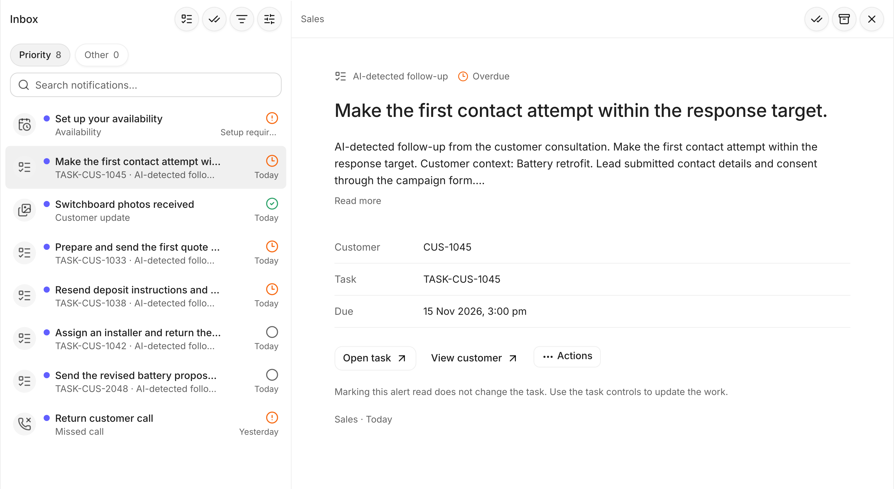

import { NextGuide } from "/snippets/docs-visuals.jsx";

The Inbox collects your alerts in one place. Start your day here.

Open [**Inbox**](https://app.arcsolar.com.au/dashboard/inbox) from the sidebar. The Inbox button at the top of each page shows how many items need attention.

<Note>The Inbox is for alerts. Customer text messages live in [Comms](/customers/comms).</Note>

## What lands in your Inbox

| Type | Example |
| --- | --- |
| **Tasks** | A follow-up assigned to you is due, overdue or waiting |
| **Missed calls** | A customer called and nobody answered |
| **Incoming calls** | A call came in on your line |
| **Mentions** | A teammate tagged you in a note |
| **Customer uploads** | A customer sent switchboard photos or a bill |
| **Quotes** and **Projects** | Updates on work you are part of |
| **Availability** | Your booking hours need setting up or reviewing |
| **Warnings** | Something that needs checking |

## Work through it

<Steps>
  <Step title="Start with Priority">
    The **Priority** tab shows items that still need action. **Other** holds the rest.
  </Step>
  <Step title="Open an item">
    Select it to see the details on the right, such as the customer, task and due date.
  </Step>
  <Step title="Act on it">
    Use the buttons in the details panel, such as **Open task**, **View customer** or **Open Comms**.
  </Step>
  <Step title="Clear it">
    Select **Mark as read**, or dismiss it on this device.
  </Step>
</Steps>

<Frame caption="A task alert open in the Inbox. Sample data.">
  
</Frame>

<Warning>Marking a task alert as read does not complete the task. Open the task and select **Complete task**. See [Tasks](/customers/tasks).</Warning>

## Find and sort alerts

- **Search notifications** finds an alert by its text.
- **Filter notifications** filters by **Notification type**, **Work area** (Comms, Finance, Operations, Reporting, Sales) or **Unread alerts only**.
- **Inbox display options** groups by type or work area, and sorts **Newest first** or **Oldest first**.
- **Mark shown notifications read** clears every alert in view. Tasks stay open.

Read history shows your latest 30 updates.

To choose which alerts also reach you by email or SMS, see [Notifications](/setup/notifications).

<NextGuide href="/customers/comms" title="Comms" />
