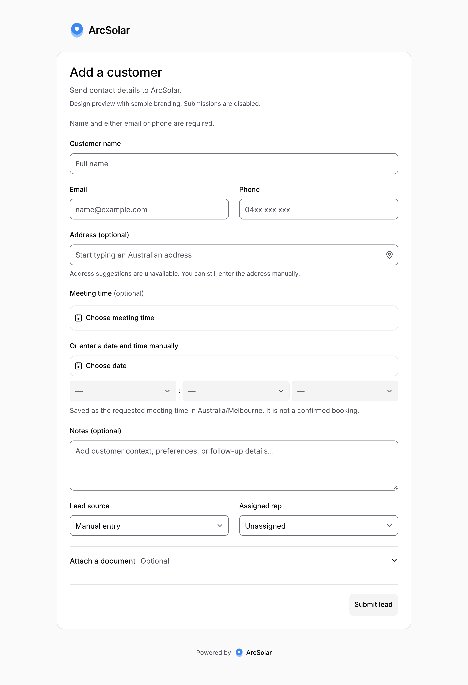
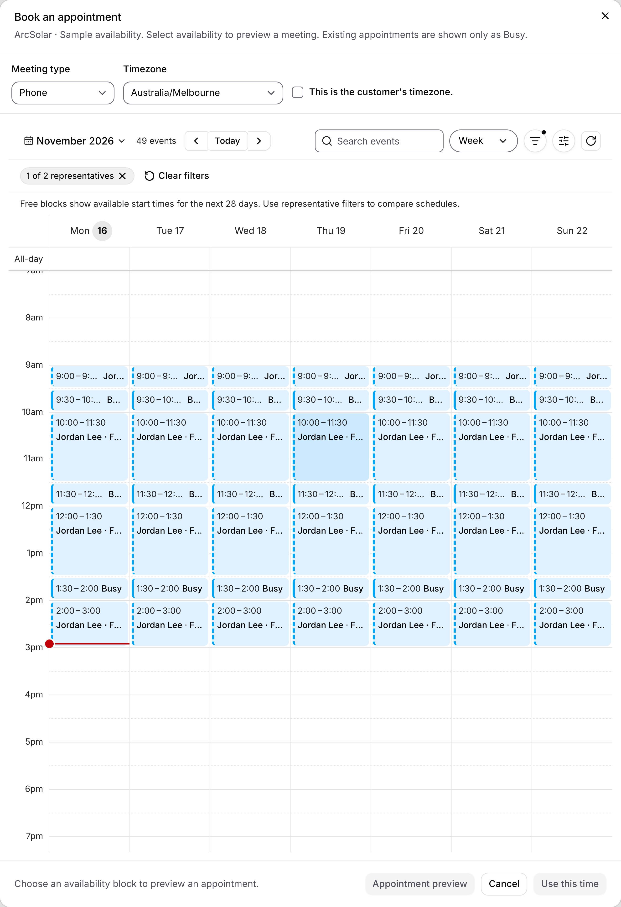

import { NextGuide } from "/snippets/docs-visuals.jsx";

Your workspace has its own public lead form. Anyone with the link can add a lead, without logging in. Use it for door-knockers, referral partners, events or a link on your website.

New leads go straight into [Customer Records](/customers/records) and the [Pipeline](/customers/pipeline).

## Get the link

1. Open [**Customers → Customer Records**](https://app.arcsolar.com.au/dashboard/customers) or [**Customers → Pipeline**](https://app.arcsolar.com.au/dashboard/customers/pipeline).
2. Select **Copy lead intake form page** at the top of the page. If you can't see it, open the **…** menu and select **Copy lead intake form link**.
3. Paste the link wherever you need it.

The link stays the same, so you can save it or turn it into a QR code. You need permission to create customers to copy it.

## What the form asks for

The form shows your logo and company name.

<Frame caption="The intake form. This sample uses demo branding.">
  
</Frame>

| Field | Required |
| --- | --- |
| **Customer name** | Yes |
| **Email** or **Phone** | At least one |
| **Address** | No. Suggests addresses as you type |
| **Meeting time** | No. Book a time or type one in (see below) |
| **Notes** | No |
| **Lead source** | Yes. Pick from your active lead sources |
| **Assigned rep** | No. Pick a rep or leave **Unassigned** |
| **Attach a document** | No. One PDF up to 10 MB, such as a power bill |

Select **Submit lead**. The person sees **Lead submitted** and can select **Submit another lead**.

## Book a meeting

There are two ways to add a meeting:

- **Choose meeting time** opens your team's live calendar. Pick a **Meeting type**, select a free block, then **Use this time**. This books the appointment for the rep. Other appointments only show as **Busy**.
- **Or enter a date and time manually** saves a requested time only. It is **not** a confirmed booking. Your team still needs to confirm it.

<Frame caption="Book an appointment. Free blocks show start times for the next 28 days. Sample data.">
  
</Frame>

If a booked time is no longer free, the lead is still saved. The form asks the person to pick another time.

## Duplicates

If the email or phone already belongs to a customer, the form does not create a new lead. It shows a message asking them to contact your team. Update the existing record instead.

## Send leads to Google Sheets

You can copy every new form lead into a Google Sheet.

1. Open [**Retailer Settings → Integrations**](https://app.arcsolar.com.au/dashboard/quoting-settings?tab=integrations) and find **Google Sheets**.
2. Select **Sync to Google Sheets** and paste your **Google Sheet URL**.
3. Share the sheet with ArcSolar as an **Editor**, using the address shown.

ArcSolar adds an **ArcSolar Leads** tab. Only new submissions sync. Existing records are not exported.

## Keep it safe

- Anyone with the link can add leads. Only share it with people you trust.
- If the link is shared too widely, contact [support](/reference/support) to turn it off.

<NextGuide href="/customers/import-leads" title="Import leads from a CSV" />
