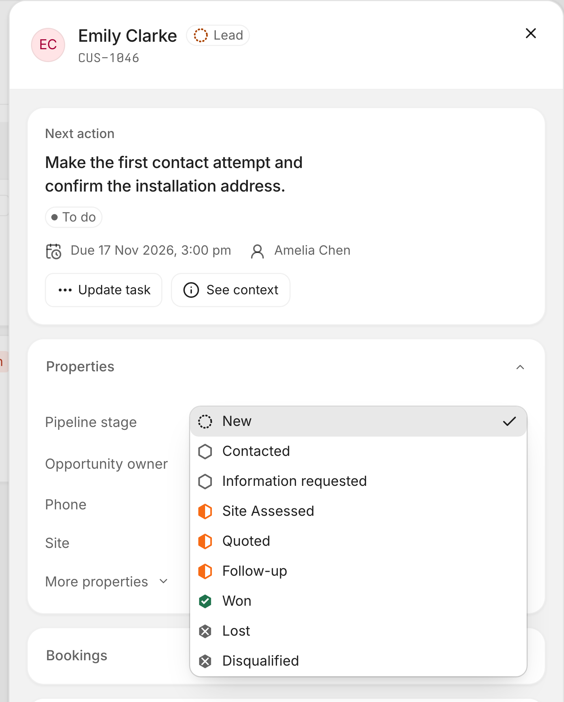
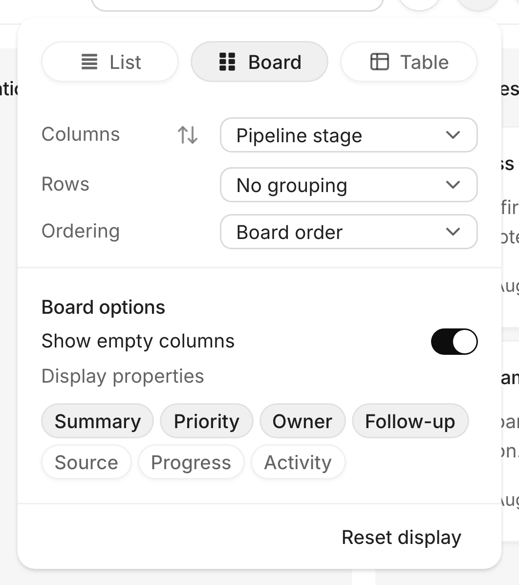
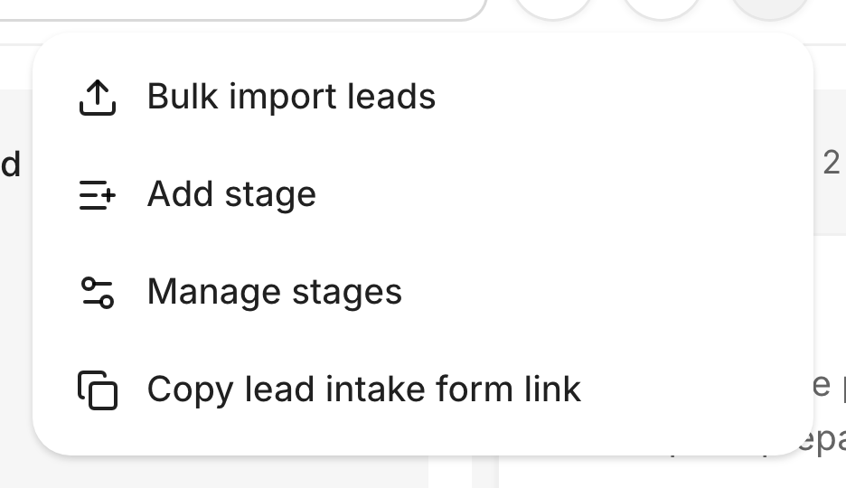
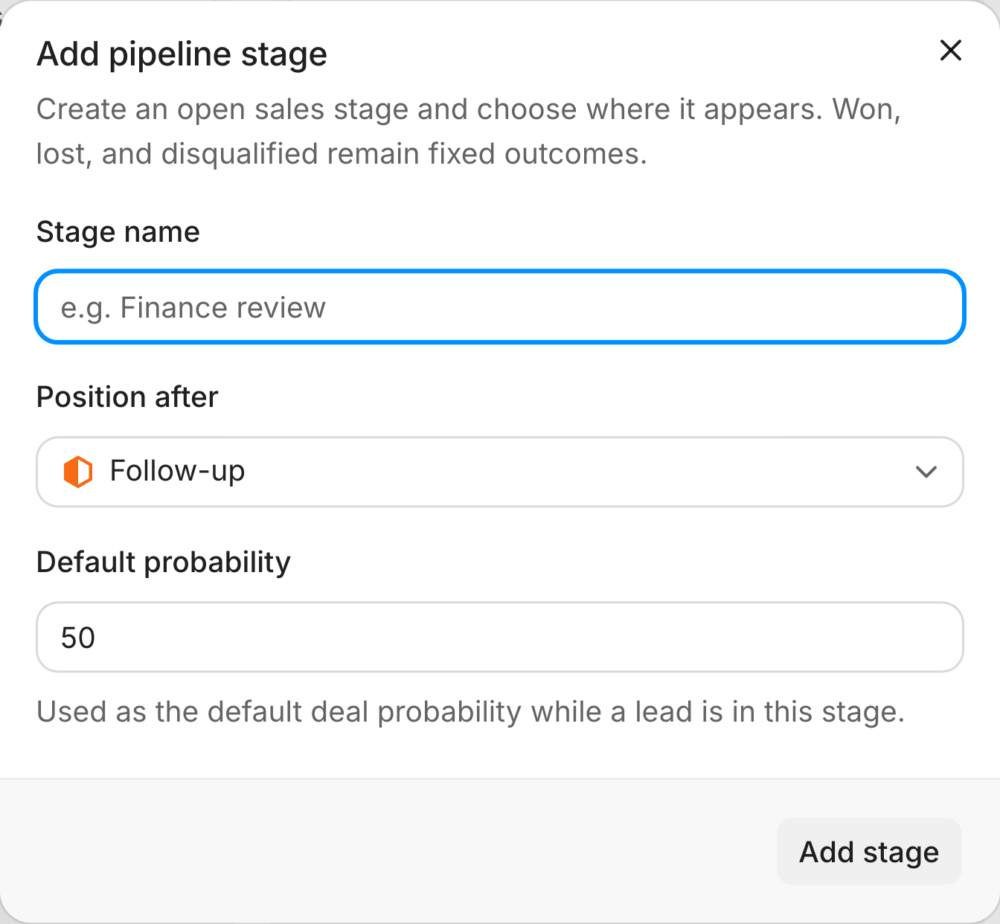

import { ProductPreview, NextGuide } from "/snippets/docs-visuals.jsx";

<ProductPreview type="pipeline" />

The pipeline is a board of every open lead, one column per sales stage. Each card shows the customer, priority, next action, owner and next follow-up date.

Open [**Customers → Pipeline**](https://app.arcsolar.com.au/dashboard/customers/pipeline).

## The stages

| Stage | What it means |
| --- | --- |
| **New** | Enquiry received, no contact yet |
| **Contacted** | You have spoken to or messaged the customer |
| **Information requested** | Waiting on the customer, for example a bill or photos |
| **Site Assessed** | Site details are ready for quoting |
| **Quoted** | A quote has been sent |
| **Follow-up** | Waiting on a decision or another conversation |
| **Won** | The customer has accepted |
| **Lost** | The sale will not go ahead |
| **Disqualified** | Not a real or suitable lead |

**Won**, **Lost** and **Disqualified** are fixed outcomes. Your administrator can rename or add the open stages, so your board may look slightly different.

## Move a lead

Use either method:

- **Drag** the card to another column.
- **Open** the card, then change **Pipeline stage** in the preview.

<Frame caption="Changing the stage from the lead preview. Sample data.">
  
</Frame>

When you move a lead to **Lost** or **Disqualified**, ArcSolar asks for a **Reason**. Choose one, then select **Move to Lost** or **Move to Disqualified**. Reasons keep reporting accurate.

Only move a lead to **Won** once the customer has accepted the quote.

After a call, ArcSolar also offers to update the stage for you. See [Calls and SMS](/customers/calls-sms#after-the-call).

## Act on a lead

Select **Actions** on a card to create a quote, call, message, email, book an appointment, add a note or create a task. These are the same actions as on the [customer record](/customers/records#act-on-a-customer).

The card preview also shows the next action. Select **Update task** to complete or reschedule it.

## Add a lead

A lead is a sales opportunity for an existing customer.

1. Select **New lead**. To add straight into a stage, use the add button at the top of that column.
2. Search for the **Customer**. If they are not listed, [create the customer](/customers/records#add-a-customer) first.
3. Add an **Opportunity title**, **Lead source**, **Priority** and **System interest**.
4. Select **Add lead**.

To add many leads at once, use [Import leads from a CSV](/customers/import-leads) or your [lead intake form](/customers/intake-form).

## Filter and change the view

- **Search pipeline** narrows the board.
- **Filter leads** filters by **Opportunity owner**, **Lead source** and **Pipeline stages**.
- **Display options** switches between **List**, **Board** and **Table**. It also sets grouping, ordering, whether empty columns show, and which details appear on each card.

<Frame caption="Display options for the pipeline. Sample data.">
  
</Frame>

To hide a column, open its **…** menu and select **Hide column**.

## Add or manage stages

Administrators and Operations can change the open stages from the **…** (**More pipeline actions**) menu.

<Frame caption="The … menu on the Pipeline. Sample data.">
  
</Frame>

- **Add stage**: enter a **Stage name**, choose **Position after**, set a **Default probability** (the deal likelihood used while a lead sits in this stage), then select **Add stage**.
- **Manage stages**: rename, reorder or delete open stages, then select **Save order**. Built-in stages can be renamed and moved but not deleted.

<Frame caption="Adding a pipeline stage. Sample data.">
  
</Frame>

## Meta leads

New Meta Instant Form leads arrive at **New**. If a Meta Pixel or Dataset is connected, ArcSolar tells Meta when a lead moves straight from **New** to **Contacted** or **Quoted**. See [Meta lead sync](/integrations/meta).

<NextGuide href="/customers/inbox" title="Inbox" />

<Visibility for="agents">
- Stage changes need the pipeline edit permission (Sales representative, Sales manager, Operations, Administrator). **Add stage** and **Manage stages** only show for Operations and Administrator.
- Moving to Lost or Disqualified opens "Mark lead as Lost/Disqualified" with a required **Reason** select ("Select a reason"); confirm button **Move to Lost** / **Move to Disqualified**. Loss reasons are fixed lists, not edited in the interface.
- Built-in open stages: New, Contacted, Information requested, Site Assessed, Quoted, Follow-up. Fixed outcomes: Won, Lost, Disqualified.
- Card actions menu = the same launcher as Customer Records (Create new quote, Communicate, Sales & operations, Customer record).
- `/dashboard/customers/leads` redirects to the pipeline.
</Visibility>
