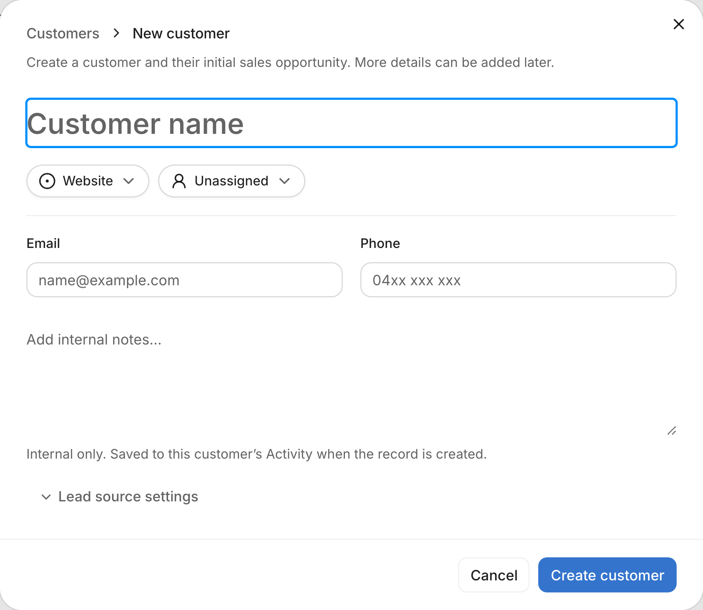
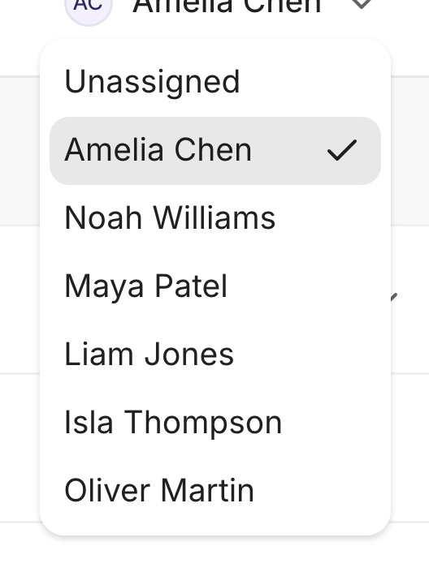
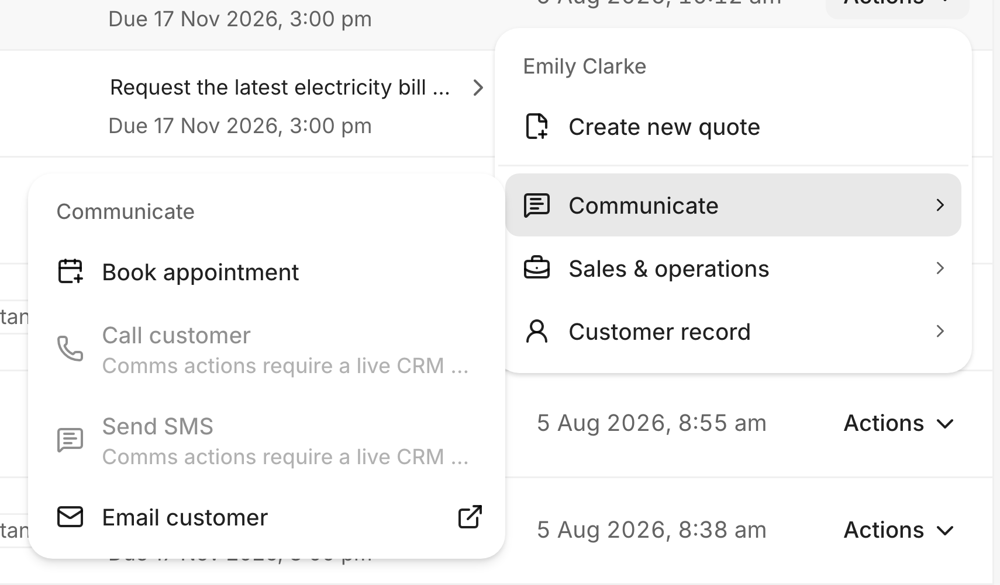
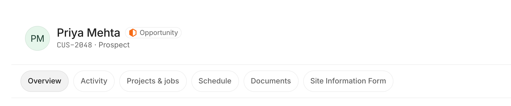
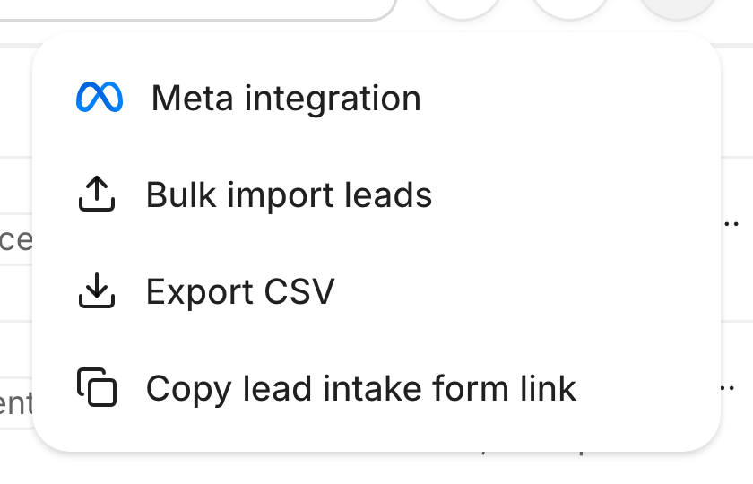
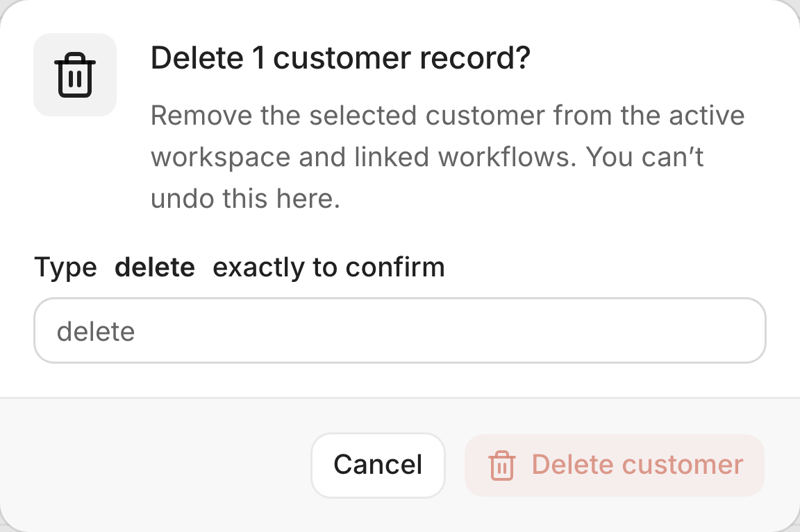

import { ProductPreview, NextGuide } from "/snippets/docs-visuals.jsx";

<ProductPreview type="customers" />

Every customer has one record. It holds their contact details, property, quotes, bookings, files and the full history of calls, messages and notes.

Open [**Customers → Customer Records**](https://app.arcsolar.com.au/dashboard/customers).

## Find a customer

Type a name, reference (like `CUS-1046`), phone or email in **Search customer records...** before you add anyone new.

To narrow the list:

- **All records** filters by lifecycle: **Lead**, **Opportunity**, **Deal**, **Job** or **Customer**.
- The filter button filters by **Lead owner**, **Next-action owner**, **Source**, **Deposit** and **Pipeline stages**.
- **Display options** sets row spacing, sort order and which columns you see.

Select a column heading to sort by it. Use the peek button beside a name to preview the customer without leaving the list.

<Tip>The lifecycle reference button in the page header shows the eight steps a customer moves through, from **Lead** to **Complete**.</Tip>

## Add a customer

<Steps>
  <Step title="Open the form">
    Select **New customer** at the top of the page.
  </Step>
  <Step title="Fill in the details">
    Enter the **Customer name**, **Email** and **Phone**. Under the name, pick the lead source (for example **Website**, **Meta** or **Referral**) and the sales agent who owns the lead, or leave it **Unassigned**.
  </Step>
  <Step title="Add a note (optional)">
    Notes are internal only. They are saved to the customer's Activity.
  </Step>
  <Step title="Save">
    Select **Create customer**. ArcSolar creates the customer and their first sales opportunity in the [Pipeline](/customers/pipeline) at **New**.
  </Step>
</Steps>

<Frame caption="The New customer form. Sample data.">
  
</Frame>

Adding lots of customers? [Import them from a CSV](/customers/import-leads), or share your [lead intake form](/customers/intake-form).

## Assign or claim a lead

The **Lead owner** column shows who is responsible for each customer.

- **Managers** (Administrator, Operations, Sales manager and Finance) select the owner in the **Lead owner** column and pick a team member, or **Unassigned**.
- **Sales representatives** see **Claim lead** on a lead that has no owner and is still at **New**. Select it to make the lead yours.

<Frame caption="Choosing a lead owner from the list. Sample data.">
  
</Frame>

Tagging a colleague in a note does not change the owner.

## Act on a customer

Select **Actions** at the end of a row, or at the top of a customer record. Actions are grouped:

| Group | What you can do |
| --- | --- |
| **Create new quote** | Start a quote with this customer already selected |
| **Communicate** | **Book appointment**, **Call customer**, **Send SMS**, **Email customer** |
| **Sales & operations** | Hand a won job to operations, add a field operation, open projects and jobs, **Review pipeline stage** |
| **Customer record** | **Add internal note**, **Ping Operations / tag teammate**, **Create follow-up task**, **Edit customer details**, **Review site info & photos**, **Open full customer record** |

<Frame caption="The Actions menu with Communicate open. Sample data.">
  
</Frame>

Calling and SMS need an assigned phone line. If they are greyed out, ask your administrator. See [Calls and SMS](/customers/calls-sms).

## Read the customer record

Select a customer's name to open their full record.

<Frame caption="The customer record header and tabs. Sample data.">
  
</Frame>

| Tab | What you will find |
| --- | --- |
| **Overview** | The next action, upcoming bookings, pipeline stage, lead owner, phone, site address and more properties |
| **Activity** | Team comments and updates on this customer. Use **Mention a teammate** to bring someone in |
| **Projects & jobs** | Linked projects, jobs and field operations, including completed work |
| **Schedule** | Upcoming appointments and scheduled work. Select **Book phone appointment** to add a call |
| **Documents** | Files saved against the customer |
| **Site Information Form** | The electricity bill, switchboard photos and cable-run video, sent by the customer or uploaded by you. Select **Send Site Information Form** to ask the customer for them |

On **Overview**, select **Update task** to complete, reschedule or archive the next action. Select **See context** to read why the task exists. Open **More properties** for contact preferences, electricity details and any **Meta Form** answers.

To change contact, address or property details, choose **Actions → Customer record → Edit customer details**, then **Save customer**.

## Export customers to CSV

Administrators and Operations can export the list. Select **…** (**More customer actions**) → **Export CSV**. The export follows your current search and filters.

<Frame caption="The … menu on Customer Records. Sample data.">
  
</Frame>

## Review Meta leads

If you use [Meta lead sync](/integrations/meta), some leads cannot be added on their own. For example, the phone number matches two customers, or contact details are missing.

1. Select **…** → **Meta integration**.
2. Select **Review leads**. The number shows how many are waiting.
3. Open a lead. Fix the **Full name**, **Email / Work email** or **Phone** if needed.
4. Choose the intended customer (and opportunity, if asked).
5. Select **Import reviewed lead**, or **Delete lead** if it is junk.

Only Administrators, Operations and External marketing can manage the Meta connection.

## Delete a customer

Administrators, Operations and Sales managers can delete customers.

1. Select **Select** above the list, then tick one or more customers.
2. Select **Delete**.
3. Type `delete` in the box, then select **Delete customer** (or **Delete customers**).

<Frame caption="The delete confirmation. Sample data.">
  
</Frame>

Deleting removes the customer from active work, the pipeline and linked workflows. You can't undo it from the app. Contact [support](/reference/support) if you deleted the wrong record.

<NextGuide href="/customers/pipeline" title="Pipeline" />

<Visibility for="agents">
- Bulk removal: the trigger is **Select** → tick rows → **Delete**. The dialog title is "Delete N customer record(s)?" and the body says the selected customers are removed "from the active workspace and linked workflows. You can't undo this here."
- The field label is "Type **delete** exactly to confirm" (placeholder `delete`). The confirm button is **Delete customer** / **Delete customers** and stays disabled until the value is exactly `delete`. There is no button called "Confirm Delete".
- Success toast: "Customer archived" / "Customers archived" — "N customer record(s) have been removed from active workflows." It is an archive-style removal, not erasure of history. Do not present it as reversible in the interface.
- Delete is available to Administrator, Operations, Sales manager and Developer roles. Export CSV is available to Administrator, Operations and Developer only.
- Lead owner changes: Administrator, Operations, Sales manager and Finance use the **Lead owner** select. Sales representatives see **Claim lead** only when the customer has no owner and the opportunity is at **New**; success toast "Lead assigned to you".
- **New customer** creates the customer and an initial opportunity at **New**. Fields: Customer name, Lead source, Assign to sales agent, Email, Phone, Notes (optional, internal, saved to Activity). Button: **Create customer**.
- Meta review queue: **Meta integration** dialog → **Review leads** (badge count) → sheet "Meta leads needing review". Review reasons include "Multiple customer matches", "Missing contact details", "Primary contact needed" and "Multiple New opportunities". Actions: **Import reviewed lead**, **Delete lead** (confirm "Delete this review lead?" / **Keep lead**).
</Visibility>
