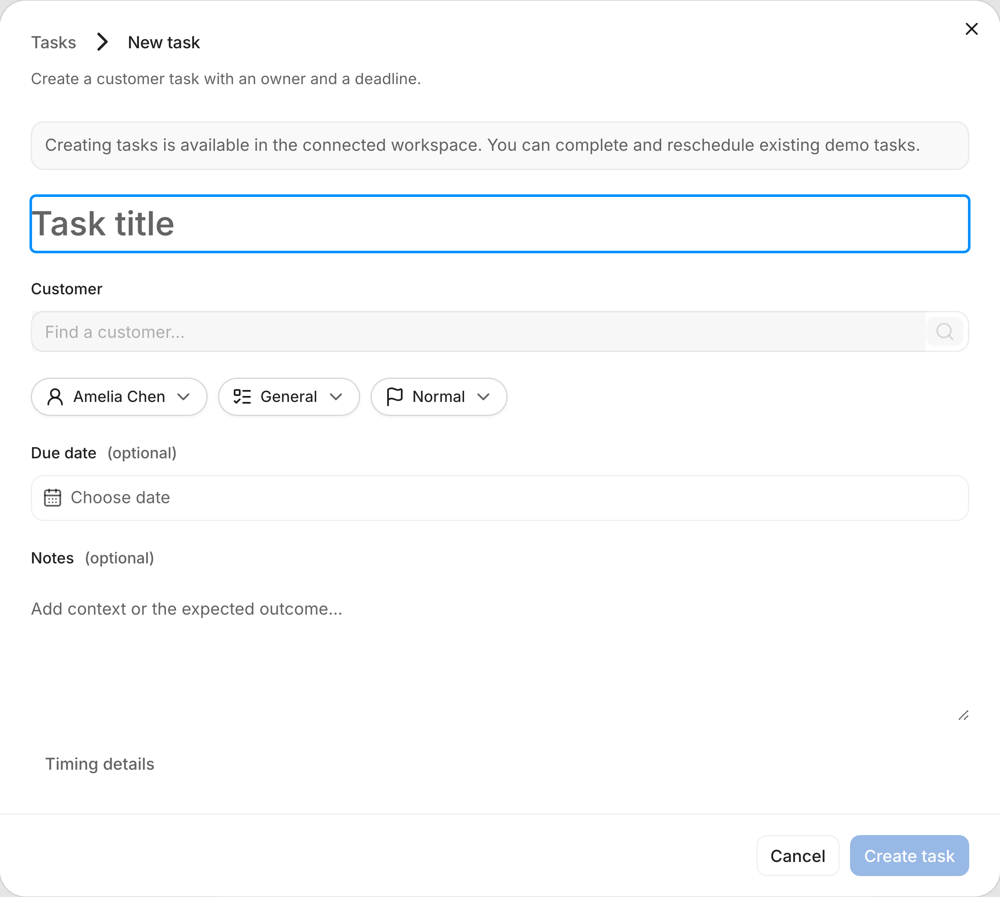
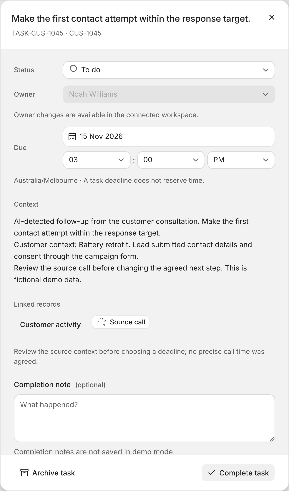
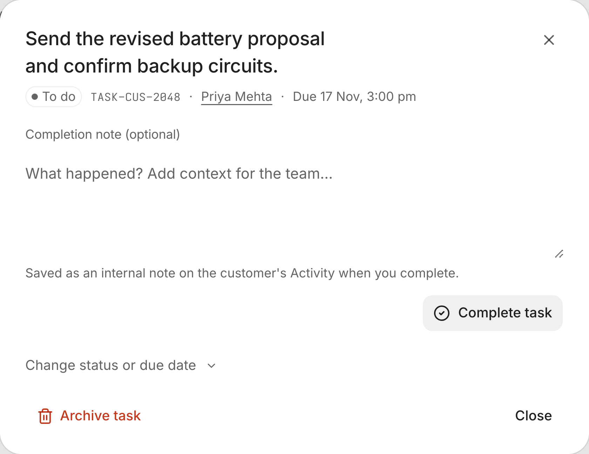

import { ProductPreview, NextGuide } from "/snippets/docs-visuals.jsx";

<ProductPreview type="tasks" />

A task is one thing someone must do for a customer, such as a call back or collecting a bill. Every task has an owner and can have a due date.

Open [**Tasks**](https://app.arcsolar.com.au/dashboard/work-tasks) from the sidebar.

## Find your tasks

- **My tasks** shows tasks you own and tasks where you are tagged (marked **Tagged**).
- **Team tasks** shows everyone's tasks. It is available to Administrators, Operations and Sales managers.

Use **Task view** to switch between **All open**, **Overdue**, **Today**, **Upcoming**, **Completed** and **Archived**. **Search tasks** finds a title. **Filter tasks** filters by **Status**, **Priority** and **Type**. **Show task summary** counts tasks by status, priority, assignee or type. Select a row in the summary to filter by it.

Overdue tasks are listed first. A date marked **Review timing** is an internal reminder from a call, not a time agreed with the customer.

## Create a task

<Steps>
  <Step title="Open the form">
    Select **New task**. Or, from a customer, choose **Actions → Customer record → Create follow-up task**.
  </Step>
  <Step title="Describe the work">
    Write a clear **Task title**, such as "Call to confirm battery size".
  </Step>
  <Step title="Link the customer">
    Search for the **Customer**. (From a customer record, this is filled in for you.)
  </Step>
  <Step title="Set the details">
    Choose the owner, type and priority. Add a **Due date** and **Notes** if useful.
  </Step>
  <Step title="Save">
    Select **Create task** (or **Add task** from a customer record).
  </Step>
</Steps>

<Frame caption="The New task form. Sample data.">
  
</Frame>

| Setting | Options |
| --- | --- |
| Type | **General**, **Follow-up**, **Assign installer**, **Collect document**, **Schedule**, **QA**, **Payment follow-up** |
| Priority | **Low**, **Normal**, **High**, **Urgent** |

Tasks don't repeat. Create a new task for each follow-up.

## Update or complete a task

Select a task in the list to open it.

<Frame caption="An open task. Sample data.">
  
</Frame>

- Change **Status** to **To do** or **In progress**. Tasks waiting on the customer show **Waiting**.
- Change the **Owner** or **Due** date and time, if your access allows. Move a **Waiting** task back to **To do** before changing its owner.
- Read **Context** and open **Linked records**, such as the customer's activity or the source call.
- When done, add an optional **Completion note** and select **Complete task**. The note is saved to the customer's Activity.
- If the task is wrong or no longer needed, select **Archive task**. Archived tasks do not count as completed.

You can do the same from a customer record: on **Overview**, select **Update task** on the next action.

<Frame caption="Update task on a customer record. Sample data.">
  
</Frame>

A task's due date does not book time. To book a call or visit, use [Calendar](/delivery/calendar) or **Actions → Communicate → Book appointment**.

## Tasks from calls

ArgonixIntelligence creates tasks from the next steps agreed on a call. Check these before you add your own, so you don't duplicate them.

- Tasks for you start in **To do**.
- **Await customer: …** tasks wait in **Waiting** until the customer acts.
- **Review timing** is an internal reminder, not a booked appointment.

[CallIntelligence](/customers/call-intelligence#tasks-are-created-automatically) explains how these tasks get their dates.

<NextGuide href="/customers/daily-routine" title="Your sales day" />

<Visibility for="agents">
- Call-derived tasks are created by the `call_summaries_sync_action_tasks` trigger, not by a user. Never tell a user to create a task that a call summary already produced. They have a non-null `intelligence_call_id` and show **ArgonixIntelligence** or "AI-detected follow-up".
- A rep-owned action is created as `todo`; a customer-owned action is created as `waiting` with the title prefix `Await customer: `.
- A task dated by inference or the three-day fallback shows **Review timing** and must not be described as an agreed appointment.
- Team tasks scope is limited to Administrator, Developer, Operations and Sales manager (`team_leader`). Other roles only see tasks they own or are tagged on.
- Statuses: To do, In progress, Waiting, Completed, Archived (stored as `cancelled`). Views: All open, Overdue, Today, Upcoming, Completed, Archived.
- Type labels differ slightly by screen: the create dialog says **Schedule** and **QA**; list filters say "Scheduling" and "Quality check".
- There are no recurring tasks.
- Intelligence cannot complete, reassign or book a task on its own, and does not overwrite completed, cancelled, manually dated or appointment-linked tasks. The [Accountability Report](/reporting/accountability) separates owned, tagged and AI-related open work.
</Visibility>
