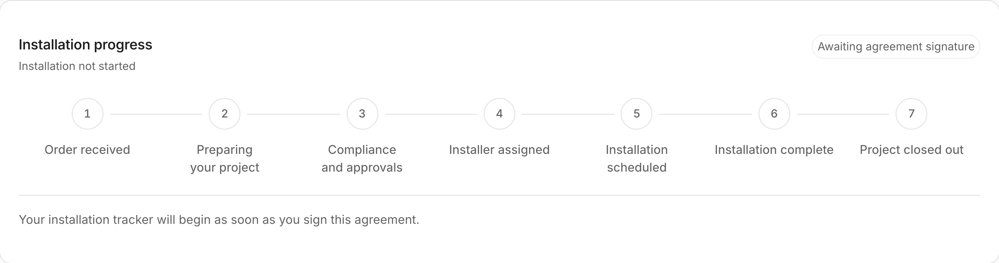

import { NextGuide } from "/snippets/docs-visuals.jsx";

Your customer keeps using the same private link you sent with their quote. Once they sign, the page becomes their installation portal, titled **Your installation**. They don't need an account or a password.

To see what they see, open the quote and use its customer link. See [Customer quote view](/quoting/customer-view).

## What the portal shows

| Section | What the customer sees | Where it comes from |
| --- | --- | --- |
| **Installation timeline** | How far their installation has progressed | The project's stage in [Projects & Jobs](/delivery/projects) |
| **Payments** | Paid and upcoming payments, each with its invoice | Payments recorded for the job |
| **Installation documents** | Documents your team has checked and shared | **Share with customer** on the project's compliance documents |
| **Monitor your system** | Store links for their system's monitoring app | The app saved for the installed product |
| **Agreement & payment** | Their signed agreement and payment terms | The accepted quote |

A **Contents** list lets the customer jump between sections.

## Installation timeline

The tracker starts as soon as the customer signs. Until then it shows **Installation not started**.

<Frame caption="The installation tracker before the agreement is signed. Sample data.">
  
</Frame>

The stages follow your project stages. The standard set is:

1. **Order received**
2. **Preparing your project**
3. **Compliance and approvals**
4. **Installer assigned**
5. **Installation scheduled**
6. **Installation complete**
7. **Project closed out**

Each stage shows **Completed**, **Current stage** or **Upcoming**. Keep the project's stage up to date so the customer always sees the right step.

## Payments

**Payments** lists each payment for the installation with its amount, status and invoice. Statuses include **Upcoming**, **Awaiting**, **Paid**, **Partly refunded** and **Refunded**.

If the customer pays by bank transfer, the portal shows **Pay by bank transfer** with your account name, BSB, account number, the amount and a payment reference. After they pay, it shows **Deposit confirmation under review** until your team confirms it.

## Share installation documents

Documents stay private until you share them.

1. Open the project in [**Projects & Jobs**](https://app.arcsolar.com.au/dashboard/projects) and go to its files.
2. Under **Compliance documents**, select **Review document**.
3. Open and check the document, customer, address and document type. Tick the box, then select **Save review · Keep private**. The document shows **Reviewed · Private**.
4. Select **Share with customer**. Tick the box to confirm it's right for this customer, then select **Share with customer**. The document now shows **Shared with customer**.

To take it back, select **Manage sharing**, then **Remove from customer portal**.

The customer sees shared files under **Installation documents**, for example a **Certificate of Electrical Safety**.

## Monitoring app

When your team has confirmed which monitoring app the system uses, the portal shows **Monitor your system** with App Store and Google Play buttons. Add the app links to the product in your [Product Catalogue](/delivery/catalogue).

<NextGuide href="/delivery/job-portal" title="Job portal" />
