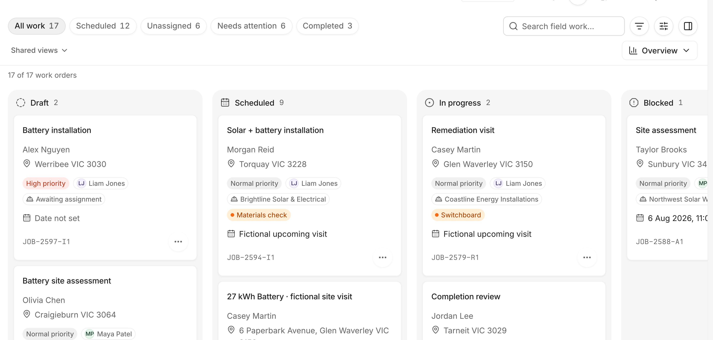
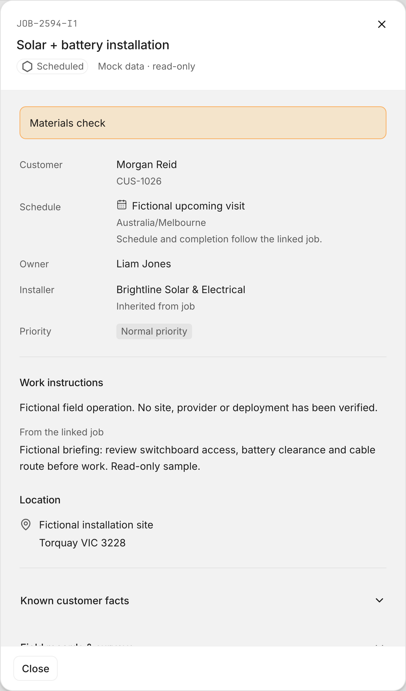
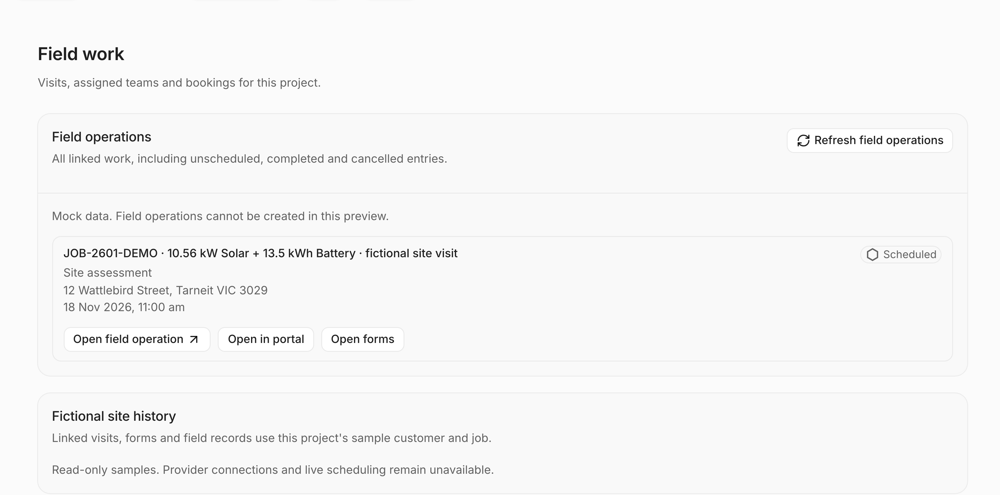

import { ProductPreview, NextGuide } from "/snippets/docs-visuals.jsx";

<ProductPreview type="work" />

Each site visit or install is a **work order**. [**Field Operations**](https://app.arcsolar.com.au/dashboard/field-operations) shows every work order across your projects.

## Find work

<Frame caption="Work orders are grouped by status. Sample data.">
  
</Frame>

Use the filters at the top: **All work**, **Scheduled**, **Unassigned**, **Needs attention** and **Completed**. **Shared views** holds views your team has saved.

Each card shows the customer, suburb, priority, operations owner, installer and schedule. An orange tag, such as **Materials check** or **Missing photos**, marks something to fix.

Select a card to open the work order.

<Frame caption="A work order shows the schedule, installer and instructions from the linked job. Sample data.">
  
</Frame>

The schedule and installer follow the linked job unless operations overrides them.

## Create a work order

1. Choose **New field operation**.
2. Enter a **Title** and choose the **Work type**.
3. Set the **Status** and **Priority**.
4. Choose the **Operations owner** and the installer.
5. Add **Operational notes** and link the customer and project under **Record links**.
6. Under **Schedule**, set the start and end. A **Draft** has no schedule; change the status to add times.
7. Enter the site address.
8. Choose **Create field operation**.

You can also see a project's work orders on its **Field work** tab. Use **Open field operation**, **Open in portal** or **Open forms** from there.

<Frame caption="The Field work tab lists every visit linked to the project. Sample data.">
  
</Frame>

## Plan a field day

Group several jobs into one crew's day.

1. In [**Projects & Jobs**](https://app.arcsolar.com.au/dashboard/projects), open **Field days**.
2. Choose **Plan field day**.
3. Choose the date, crew, visit durations and arrival windows.
4. Review the visit order and travel.
5. Confirm the schedule.

You can also tick jobs in **All projects & jobs** and choose **Plan field day**.

## Hand the job to the installer

The installer gets what they need from the project:

- **Internal handover PDF** (under **Handover & contact** on the project's **Overview**). It covers the site, system, materials and access. When the project has a Roof Vision design, it adds the panel layout, the stringing layout, a single line diagram drawn from the design, a table of strings and the racking quantities.
- The job in the [Work app](/delivery/job-portal), with the site, schedule, forms and shared project files.
- The issued quote and its two roof drawings, **Solar panel layout** and **Stringing and component layout**.

Installers can't draw or change the roof design. If the site differs from the design, record it on the job and update the design in [Roof Vision](/quoting/roof-design). Every design document is a preliminary design. Check it on site.

## During and after the visit

The installer records progress, photos and forms in the Work app. Review them on the project's **Field work** and **Files** tabs.

If a job can't be finished, record why and book a follow-up visit. Don't mark it complete to clear it.

A completed visit doesn't close the project. Use **Review completion** on the project. See [Projects and jobs](/delivery/projects#complete-the-project).

<Visibility for="agents">
- Field Operations (`/dashboard/field-operations`) filter chips: **All work**, **Scheduled**, **Unassigned**, **Needs attention**, **Completed**; board columns Draft, Scheduled, In progress, Blocked, Completed, Cancelled. Each card has an `Open JOB-…` button and an actions menu.
- **New field operation** form fields: Title, Work type, Status, Priority, Operations owner, Installer assignment (Override with installer), Operational notes, Record links, Schedule (draft work orders have no schedule), Origin and address. Submit: **Create field operation**. Inherited installer assignments follow the linked job until Operations overrides or removes them.
- The **Internal handover PDF** is `/api/projects/<projectId>/internal-handover`. When a Roof Vision design is available (operations design for the project, or the design attached to the accepted quote), the PDF adds the panel-layout and stringing images, a print single-line diagram ArcSolar draws from the design's strings and equipment, a per-string table (MPPT, panel count, module, Voc, Vmp, Isc) and racking run quantities. These are derived from the design for handover; they are not an engineering certification.
- Installers have no design-editing surface. Technician sign-in to the Work app does not grant access to draw, edit or approve a Roof Vision design. Removal of installers is documented on [Installers](/delivery/installers).
</Visibility>

<NextGuide href="/delivery/job-portal" title="Work app for installers" />
