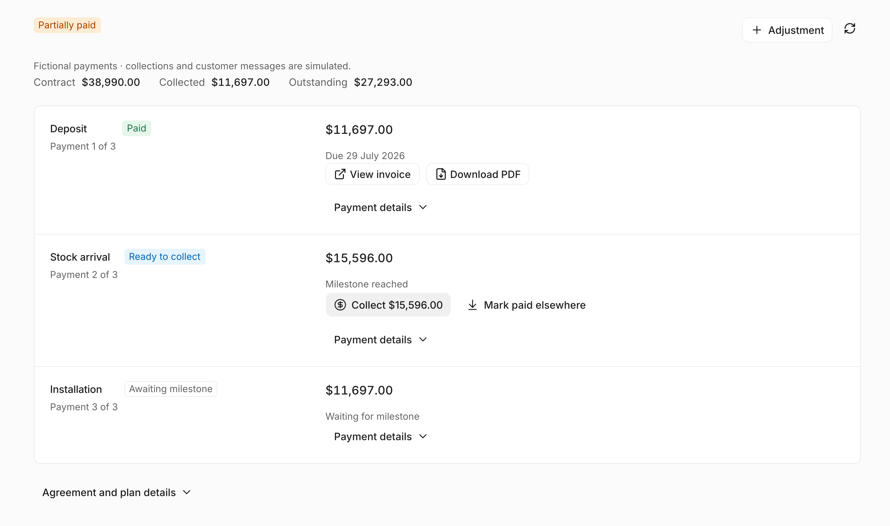

import { ProductPreview, NextGuide } from "/snippets/docs-visuals.jsx";

<ProductPreview type="finance" />

Each project has a payment schedule from the accepted quote. Collect each payment from the project's **Financials** tab. Use [**Finance**](https://app.arcsolar.com.au/dashboard/finance-workspace) for the whole business.

## Read the payment schedule

Open the project in [**Projects & Jobs**](https://app.arcsolar.com.au/dashboard/projects) and choose **Financials** (under **More** if it isn't shown).

<Frame caption="A three-payment schedule: the deposit is paid and the stock-arrival payment is ready to collect. Sample data.">
  
</Frame>

The top line shows the **Contract**, **Collected** and **Outstanding** amounts. Each payment shows its status:

| Status | Meaning |
| --- | --- |
| **Paid** | Received |
| **Ready to collect** | Its milestone is reached. You can collect it. |
| **Awaiting milestone** | Not due yet |

The badge at the top, such as **Partially paid**, sums up the whole project. Lender-managed payments are collected by the finance provider, not through ArcSolar.

## Collect a payment

1. When stock arrives, choose **Record stock arrival**. The next payment becomes ready to collect.
2. Choose **Collect** on the payment. Stripe sends the customer an invoice by email, and it is queued for SMS.
3. The status changes to **Paid** when Stripe confirms the payment.

On a sent invoice you can also **View invoice**, **Download PDF**, **Copy link**, **Resend** or **Void Invoice**. Void an unpaid invoice before you issue a new amount.

## Record a payment made another way

Use this when the customer paid by bank transfer or another method outside Stripe.

1. Check the funds have cleared in your bank account.
2. Choose **Mark paid elsewhere** on the payment.
3. Enter the **Amount (AUD)**, **Where paid** and a **Reference**, such as the bank reference or a Xero invoice number.
4. Type `MARK PAID ELSEWHERE` to confirm.

Every change is kept in **Payment history and adjustments**.

## Change the project value

Choose **Adjustment** to record a change to the contract value, such as a variation. Choose the **Type**, what it applies to and the **Amount (AUD)**. The change is saved in the payment ledger.

## Use the Finance page

[**Finance**](https://app.arcsolar.com.au/dashboard/finance-workspace) shows the business view:

- Deposits collected, accepted quote value, average commission and close rate.
- Revenue by system type, by month, by product brand and by payment channel.
- **Payments to collect**: outstanding balances by customer and project.
- **Finance actions**: links to the Stripe dashboard, the quotes dashboard and Comms for follow-up.

Read the period on each figure before you compare it with sales reports.

## Check before you change anything

- A quoted amount isn't cash collected.
- An expected rebate isn't money received. See [Rebate tracking](/delivery/rebates).
- Finance approval isn't the same as the lender paying out.

If a payment looks wrong, compare it with Stripe or the provider first. Look for part payments, refunds, payments still processing and duplicate references.

<NextGuide href="/delivery/projects" title="Projects and jobs" />
