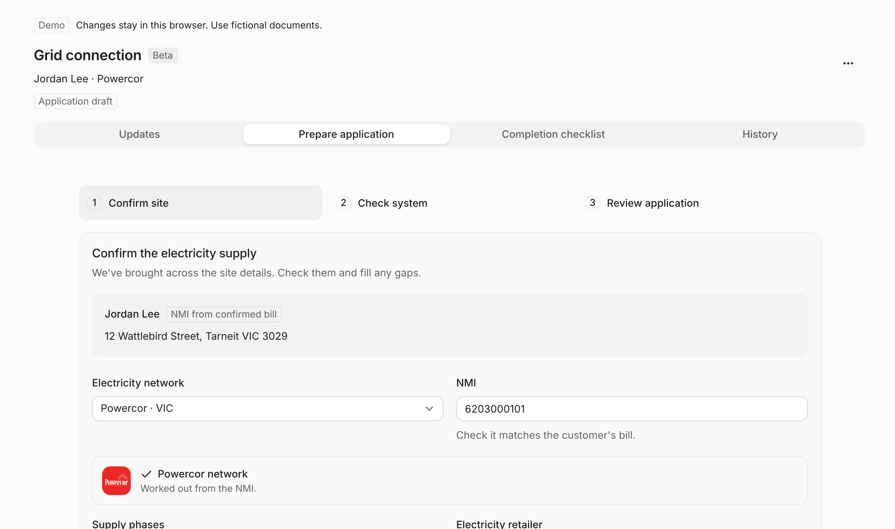
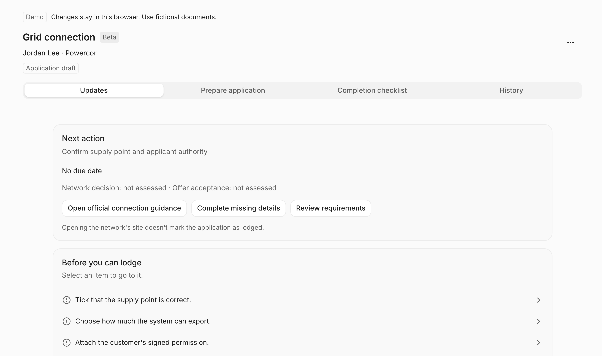
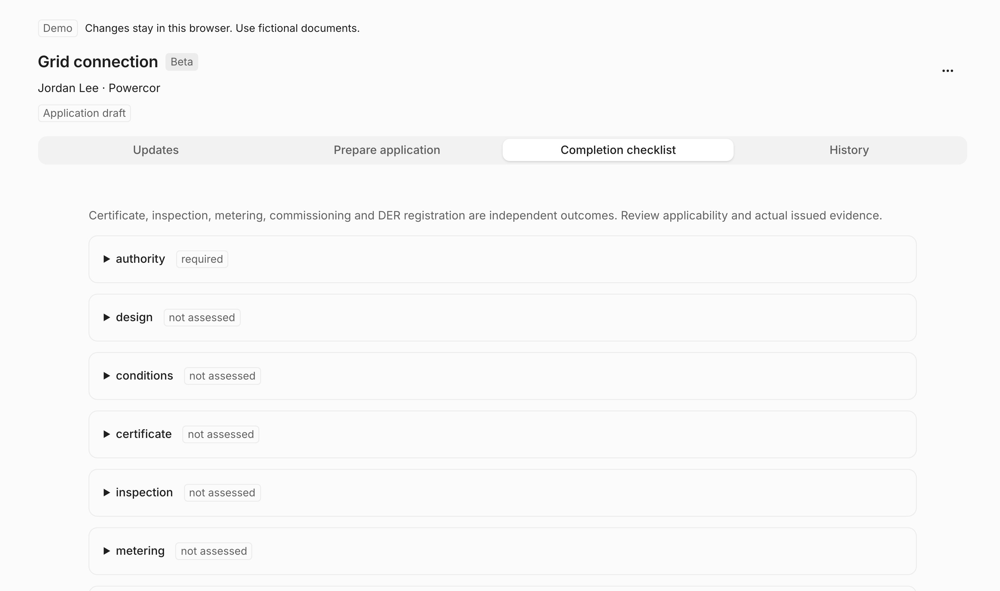

import { NextGuide } from "/snippets/docs-visuals.jsx";

Every project has a **Grid Connection** tab. ArcSolar works out the electricity network from the NMI and lines up every value and file the network's portal asks for. You still lodge the application in the network's own portal. ArcSolar never sends it for you.

Skip the tab for jobs that don't need a network application.

## Start an application

1. Open the project in [**Projects & Jobs**](https://app.arcsolar.com.au/dashboard/projects).
2. Open **Grid Connection** (under **More** if it isn't shown).
3. Choose **Start application**.

ArcSolar brings across the site, system and documents already on the project. You fill in what's missing.

## Prepare the application

**Prepare application** has three steps.

<Frame caption="Step 1 confirms the supply. The network is worked out from the NMI. Sample data.">
  
</Frame>

<Steps>
<Step title="Confirm site">
Check the supply address. Enter the **NMI** from the customer's bill; ArcSolar picks the **Electricity network**. You can also choose the network yourself. Choose the **Supply phases** and **Electricity retailer**, tick **I've checked this is the correct supply point**, then choose **Save and continue**.
</Step>
<Step title="Check system">
Check the system you're connecting. Choose **Use the system already designed** to bring in the accepted design, or add the equipment. Fill any gaps, such as a missing inverter kVA or battery charge rate. Set the **Requested export**, for example **No export (0 kW)** or **Fixed export limit**.
</Step>
<Step title="Review application">
Attach the customer's signed permission and tick **I've reviewed the customer's permission for this application**. Add the reviewed single line diagram. You can reuse the diagram from the Roof Vision design. Check everything, then save.
</Step>
</Steps>

Use **Technical details** for several meters, a shared inverter or an unusual supply.

<Tip>
An NMI from a confirmed bill shows **NMI from confirmed bill**. You're warned if the NMI doesn't match the property's state.
</Tip>

## Fix what's missing

**Updates** shows the **Next action** and a **Before you can lodge** list. Select an item to go straight to the field that completes it.

<Frame caption="Before you can lodge lists what the network will still need. Select an item to fix it. Sample data.">
  
</Frame>

## Lodge with the network

When the application is ready, the **Lodge with** card shows the network's name.

1. Choose the **Open** button on the card to go to the network's portal.
2. Copy each value across with its copy button, or use **Copy all**. Values include the NMI, address, applicant, panels, inverter kW and kVA, battery size and power, and the export limit.
3. Under **Files to upload**, copy or download the single line diagram, customer permission and site photos.
4. Submit in the network's portal and keep its receipt.
5. Back in ArcSolar, choose **Record submission or decision** and record the submission with its reference and receipt.

Opening the network's site doesn't mark the application as lodged. Only recording the submission does.

## Record the network's response

1. On **Updates**, choose **Record a network update**.
2. Record the response: approval, conditions or a request for more information.
3. Attach the network's decision document and note the approved export limit.

## Close out the connection

**Completion checklist** tracks each outcome on its own: authority, design, conditions, certificate, inspection, metering, commissioning and DER registration.

<Frame caption="Each completion item is tracked separately. Sample data.">
  
</Frame>

1. Use **Attach a document** to add evidence from **Project Files**, with its **Document type** and who issued it.
2. Choose **Record the installed system** once installed.
3. Choose **Mark as complete**.

**History** keeps every version you prepared, lodged, had approved or installed, with who changed it and when.

## Find projects that need action

On [**Projects & Jobs**](https://app.arcsolar.com.au/dashboard/projects), choose **Grid attention** to show only projects whose grid connection needs action. Choose **Show all projects** to clear it.

## Properties, NMIs and retailers

A customer can have several properties, each with its own address, NMI, retailer and bill. The project is set up at the property chosen in the quote. An accepted electricity bill fills in a property's NMI and retailer when they're blank.

<Note>
Grid approval, metering and commissioning are separate from the project stage. Set **Review operations clearance** on the project as each one is done. See [Projects and jobs](/delivery/projects#work-the-delivery-checklist).
</Note>

<NextGuide href="/delivery/rebates" title="Rebate tracking" />
