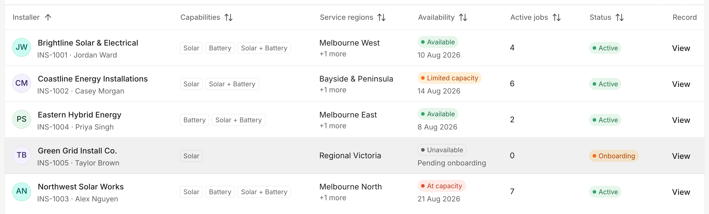
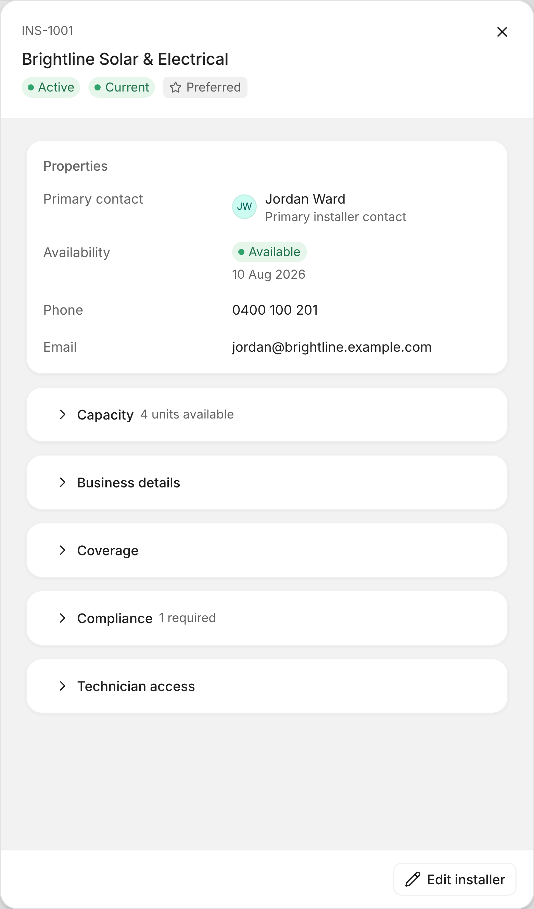
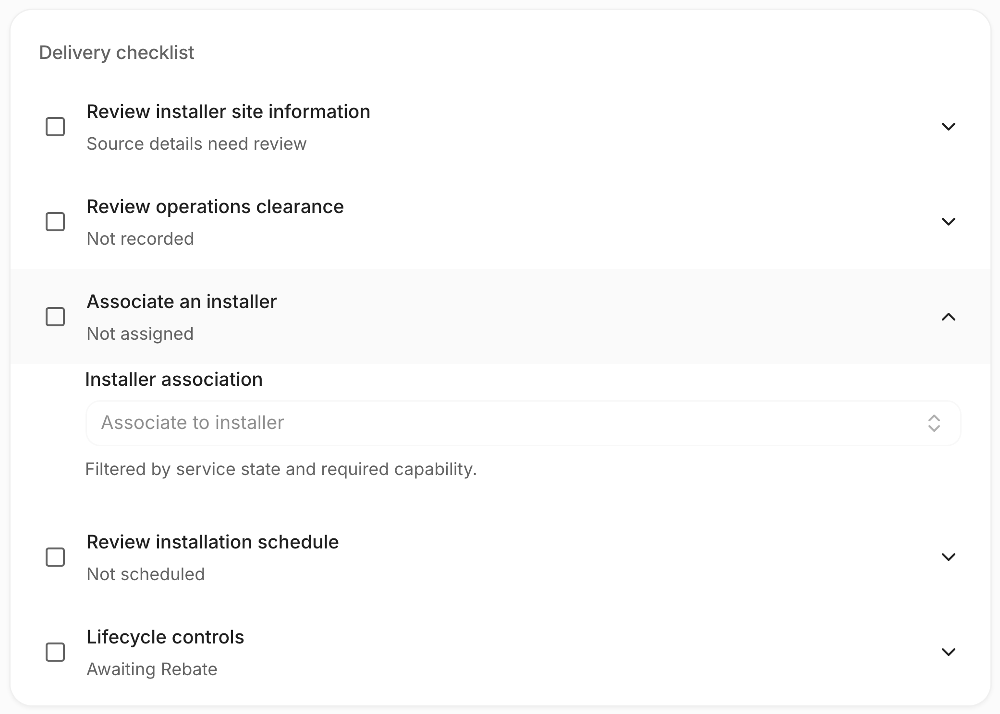

import { NextGuide } from "/snippets/docs-visuals.jsx";

[**Installers**](https://app.arcsolar.com.au/dashboard/installers) is your directory of installation companies and crews. A project can only be assigned to an installer listed here.

<Frame caption="The installer directory shows capabilities, regions, availability and active jobs. Sample data.">
  
</Frame>

## Add an installer

1. Choose **Add installer**.
2. On **Details**, enter the **Business name**, **Legal name**, **ABN**, **Business email** and **Business phone**.
3. Set the **Directory status**. Only **Active** installers can be assigned to jobs.
4. Turn on **Preferred installer** to show this partner first when you assign work.
5. Add the primary contact and business address.
6. On **Coverage**, choose the **Capabilities** (such as **Solar**, **Battery** or **Solar + Battery**) and **Service regions**.
7. On **Capacity**, add when they are available and how much work they can take. You can skip this and add it later.
8. Choose **Add installer**.

## Review an installer

Choose **View** on a row to open the record.

<Frame caption="An installer record. Expand each section for the detail. Sample data.">
  
</Frame>

| Section | What to check |
| --- | --- |
| **Capacity** | Units of work available and the next available date |
| **Business details** | Legal entity, ABN, address and contact details |
| **Coverage** | Capabilities and service regions |
| **Compliance** | Electrical licence, accreditations, public liability, workers compensation and safe work method, each with its status and expiry |
| **Technician access** | The team member who signs in to the Work app for this installer |

Choose **Edit installer** to change any of it. Keep compliance documents current. An expired item can stop the installer being offered for new jobs.

## Give the installer a sign-in

An installer record is not a login. To let a technician see their jobs in the [Work app](/delivery/job-portal):

1. In [**Team & Access**](https://app.arcsolar.com.au/dashboard/team-access), invite the person with the **Technician** role. See [Team](/setup/team).
2. Ask them to accept the invitation.
3. Open the installer, expand **Technician access** and choose them under **Technician user**.
4. Choose **Save technician user**.

A pending invitation does not give access yet.

## Assign an installer to a project

1. Open the project in [**Projects & Jobs**](https://app.arcsolar.com.au/dashboard/projects).
2. On **Overview**, expand **Associate an installer** in the **Delivery checklist**.
3. Pick the installer from **Associate to installer**.

<Frame caption="Only installers who cover the site's state and the job type are listed. Sample data.">
  
</Frame>

The list only shows active installers who service the site's state and can do this type of job. If it shows **No eligible installers service this state and job type.**, check the installer's **Coverage** and **Directory status**.

Then choose **Add installation date** under **Review installation schedule**. See [Projects and jobs](/delivery/projects#schedule-the-installation).

## Remove an installer

1. Choose **Select**, then tick the installers to remove.
2. Choose **Delete**.
3. Choose **Confirm delete**.

They are removed from the directory and from assignment options. Past projects and jobs keep their records. You can't remove an installer who has active work.

<NextGuide href="/delivery/field-operations" title="Field operations" />
