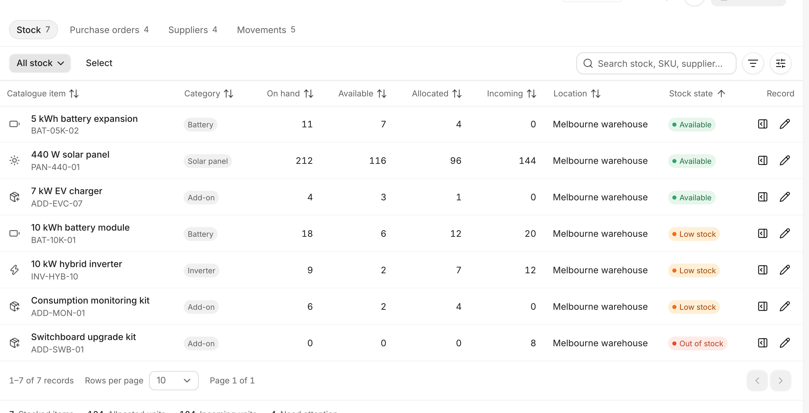
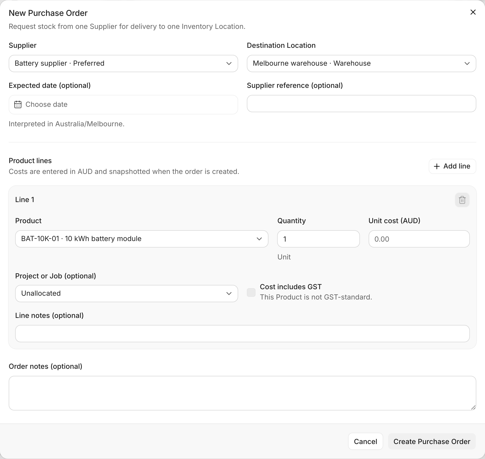

import { ProductPreview, NextGuide } from "/snippets/docs-visuals.jsx";

<ProductPreview type="inventory" />

[**Inventory**](https://app.arcsolar.com.au/dashboard/inventory) holds your stock, purchase orders and suppliers.

<Frame caption="Stock on hand with allocated and incoming quantities. Sample data.">
  
</Frame>

| Tab | What it holds |
| --- | --- |
| **Stock** | What you hold at each location: on hand, available, allocated to jobs and incoming |
| **Purchase orders** | Orders to suppliers, with their status and expected date |
| **Suppliers** | Supplier contacts, products, lead times and open orders |
| **Movements** | Every stock movement, with who posted it and for which job |

The totals underneath show **Stocked items**, **Allocated units**, **Incoming units** and **Need attention** (low or out of stock). Incoming units are on open orders. They haven't arrived yet.

## Set up stock

Do this once, in order:

1. **Add supplier** for each supplier you buy from.
2. **Add location** for each warehouse or store.
3. **Configure stock** to link a catalogue product to a location. Add an opening quantity only for stock you already hold. Set the reorder point, reorder quantity and safety stock.

To load many records at once, choose **Import / override** and upload a CSV (up to 500 rows). Stock history stays intact.

## Order stock

1. Choose **New order**.
2. Choose the **Supplier** and **Destination Location**.
3. Add the **Expected date (optional)** and **Supplier reference (optional)**.
4. For each line, choose the **Product**, **Quantity** and **Unit cost (AUD)**. Tick **Cost includes GST** if it does.
5. To reserve the line for a job, choose it under **Project or Job (optional)**.
6. Choose **Create Purchase Order**.

<Frame caption="A purchase order goes to one supplier and one location. Sample data.">
  
</Frame>

Costs are saved with the order. Later price changes in the catalogue don't change it.

## Check materials for a job

1. Open the project and choose **System & BOM**.
2. Read **Products in the agreement** and the procurement materials list. Confirm any item marked as an allowance, such as cable length.
3. Check stock for each item. A **Stock shortfall** means you need to order.
4. Use **Create purchase order from BOM** to order what's missing.

Existing orders and reservations for the project are listed for review. They aren't taken off the quantities for you, so check for overlap.

## Check movements

Open **Movements** to see each change to stock. Use **Management review** on a movement to record that you checked it against another stock system.

Don't promise an install date on a catalogue product alone. Check it is in stock, or on an order that will arrive in time.

<NextGuide href="/delivery/finance" title="Project finances" />
