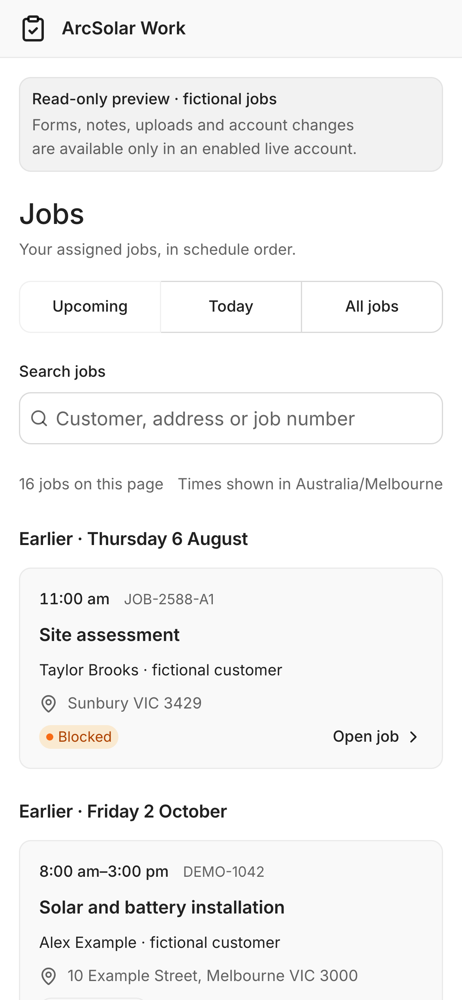
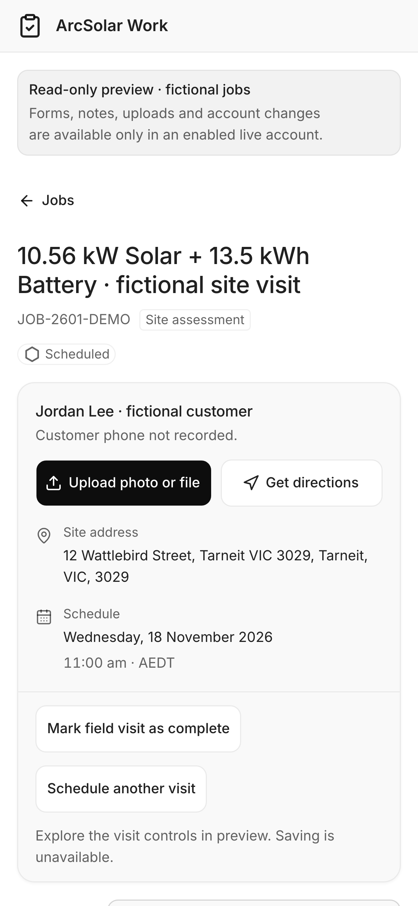

import { ProductPreview, NextGuide } from "/snippets/docs-visuals.jsx";

<ProductPreview type="work" />

**ArcSolar Work** shows each technician the jobs assigned to them. It runs in the phone's browser. Technicians see only their own jobs, not your customers, quotes or finances.

## Set up a technician

1. In [**Team & Access**](https://app.arcsolar.com.au/dashboard/team-access), invite the person with the **Technician** role. Use their own email.
2. Ask them to accept the invitation.
3. In [**Installers**](https://app.arcsolar.com.au/dashboard/installers), open their installer, expand **Technician access**, choose them under **Technician user** and choose **Save technician user**.
4. Assign that installer to the job. See [Installers](/delivery/installers#assign-an-installer-to-a-project).
5. Ask the technician to sign in and check the job is there.

If you can't pick them under **Technician user**, check they accepted the invitation and have the **Technician** role. Never share one login between people.

## Sign in

Technicians open [**Technician sign in**](https://app.arcsolar.com.au/auth/v2/work-sign-in), enter their invitation email and tap the link sent to them. There is no password. A link that has expired needs a new one.

Office staff use **Staff sign in** with their normal account.

## Find a job

<Frame caption="The Work app job list on a phone. Sample data.">
  
</Frame>

Jobs are listed in schedule order. Use **Upcoming**, **Today** or **All jobs**, or search by customer, address or job number. Tap **Open job**.

## Work a job on site

<Frame caption="A job in the Work app. The main actions sit at the top. Sample data.">
  
</Frame>

- **Get directions** opens the site in Maps.
- **Upload photo or file** adds site evidence.
- **Mark field visit as complete** finishes this visit.
- **Schedule another visit** books a follow-up, where your role allows it.

Use **Job section** to move between the job's sections:

| Section | What it holds |
| --- | --- |
| **Overview** | Project and job stage, instructions and assigned crew |
| **Site** | Address and site details |
| **Site activity** | Other visits to this site |
| **System & BOM** | The system and equipment to install |
| **Rebate tracking** | Rebate progress shared with the job |
| **Project files** | Documents the office shared with this job |
| **Activity** and **Diary** | Job history and the job diary |
| **Forms** | Forms the office shared for this job |
| **Photos & files** | Evidence uploaded for the visit |

### Upload photos and files

1. Tap **Upload photo or file**.
2. Choose up to 20 photos, videos or PDFs. Each can be up to 20 MB.
3. Choose a type for each file and add a note if useful.
4. Tap **Upload files**.

Check each file shows on the job. A file marked **Needs retry** is not saved yet.

### Fill in a form

Open **Forms**, fill in the answers and save a draft as you go. Submit when the answers are complete. The office then reviews them.

### Add a diary entry

In **Diary**, choose an **Entry type**: **Site note**, **Time note** or **Equipment serial**. Write the note and tap **Save entry**.

## Open a job from the office

On the project's **Overview**, open **Handover & contact**:

- **Open portal** opens the job as the technician sees it.
- **Copy installer job portal link** copies the job link to send them.

The link only works for a technician who is signed in and still assigned to the job. It is not a public link.

## Fix access problems

| Problem | What to check |
| --- | --- |
| No jobs listed | The technician is linked under **Technician user** and the installer is assigned to the job |
| Access denied | The technician's account is active. Never reuse another person's login. |
| Sign-in link failed | Request a new link, or check the invitation was accepted |
| A form or upload didn't save | Follow the message on screen, then check the job before trying again |

Marking a visit complete doesn't close the project. Operations still checks compliance, grid, rebates and payment. See [Projects and jobs](/delivery/projects#complete-the-project).

<NextGuide href="/delivery/grid-connections" title="Grid connections" />
