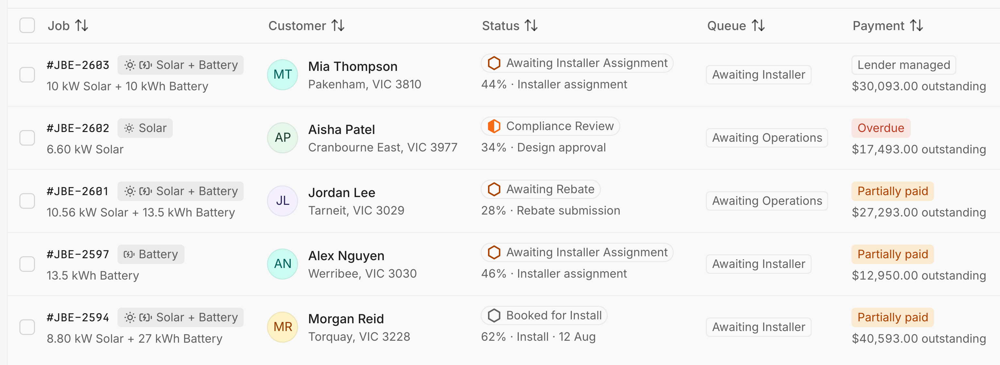
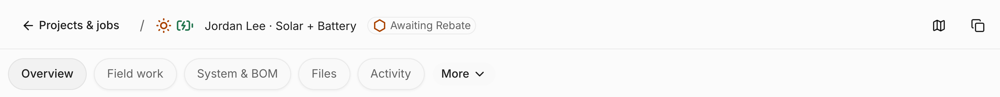
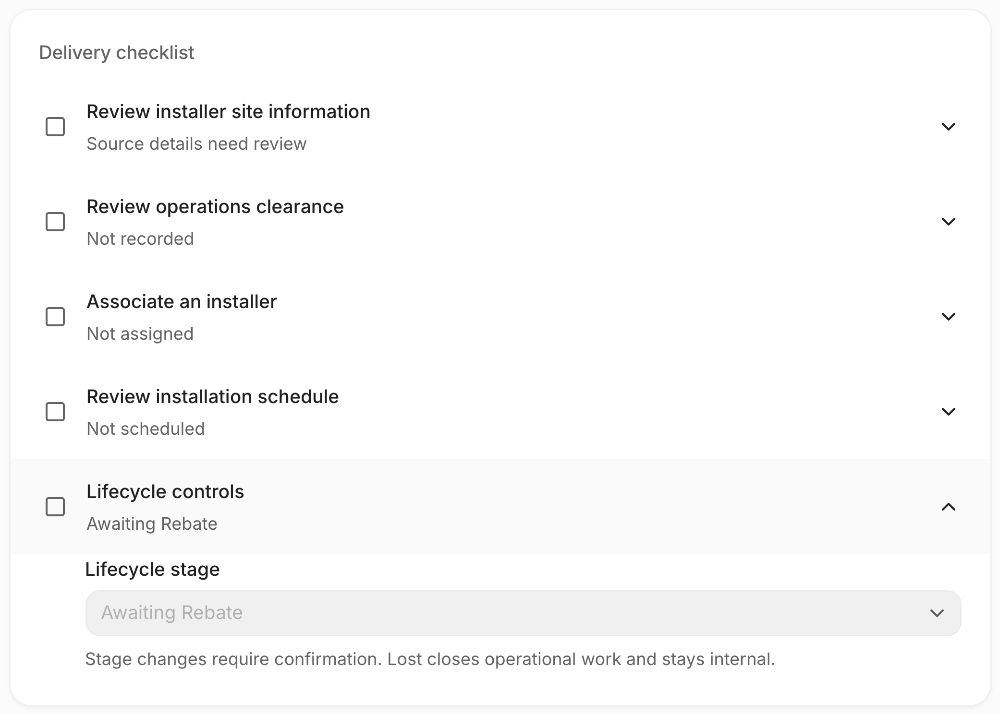

import { ProductPreview, NextGuide } from "/snippets/docs-visuals.jsx";

<ProductPreview type="project" />

When a customer accepts a quote, ArcSolar creates a project. Operations staff run it from [**Projects & Jobs**](https://app.arcsolar.com.au/dashboard/projects) until it is closed out.

## Find a project

Use the view buttons at the top of the page.

| View | Use it to |
| --- | --- |
| **Split view** | Work through a queue. Select a project to preview its next step. |
| **Timeline** | See every project and its scheduled jobs on a calendar strip. |
| **All projects & jobs** | Search and sort every project in a table. |
| **Needs attention** | Review open requirements, then choose **Review requirement**. |
| **Field days** | Group jobs into one crew's day. See [Field operations](/delivery/field-operations#plan-a-field-day). |
| **Grid attention** | Show only projects whose grid connection needs action. |

Split view groups projects into queues: **Awaiting Operations**, **Awaiting Installer**, **Awaiting Customer** and **Closed Out**.

<Frame caption="All projects & jobs shows the stage, queue and payment state of each project. Sample data.">
  
</Frame>

Select a row to open a preview. Choose **Open full project** to see every section.

## Read the project page

<Frame caption="The project header and its section tabs. Sample data.">
  
</Frame>

| Tab | What it holds |
| --- | --- |
| **Overview** | Current step, delivery checklist, properties, associated quote, financial summary and handover tools |
| **Site** | Address, map and property details. **Share site details** sends them on. |
| **Field work** | Linked visits and work orders, with **Open field operation**, **Open in portal** and **Open forms** |
| **System & BOM** | The equipment in the agreement, the quoted materials and the procurement materials list |
| **Rebates** | Formbay, GreenDeal and BridgeSelect applications. See [Rebate tracking](/delivery/rebates). |
| **Grid Connection** | The network application. See [Grid connections](/delivery/grid-connections). |
| **Files** | Every project file and where it came from |
| **Activity** | Project updates, comments and the full history |
| **Financials** | The payment schedule. See [Project finances](/delivery/finance). |

Tabs that don't fit are under **More**.

## Work the delivery checklist

The **Delivery checklist** on **Overview** lists what operations still needs to do. The item that matches the current stage is shown first. Expand an item to act on it.

<Frame caption="Expand Lifecycle controls to move the project to another stage. Sample data.">
  
</Frame>

| Item | What you do |
| --- | --- |
| **Add Roof Vision** | Record the project's roof design. Appears on projects sold from an accepted estimate. |
| **Send NETCC contract** | Send the agreement for signature, or record a signature. Scheduling waits for the signed contract. |
| **Review installer site information** | Check the site details the installer will rely on |
| **Review operations clearance** | Set the **Compliance state**, such as **Awaiting Grid Connection Approval** or **Compliance Complete**, then **Save compliance** |
| **Associate an installer** | Choose the installer. See [Installers](/delivery/installers#assign-an-installer-to-a-project). |
| **Review installation schedule** | Choose **Add installation date** once an installer is assigned |
| **Lifecycle controls** | Move the project to another stage |
| **Review completion** | Run **Complete project** to close it out |

You can waive **Add Roof Vision** or **Send NETCC contract** with a reason when a job doesn't need them. The reason is kept on the project.

## Change the stage

1. Expand **Lifecycle controls**.
2. Choose the new stage under **Lifecycle stage**.
3. Add an **Internal note (optional)**.
4. Choose **Confirm stage change**.

The change is saved in the project history. Eligible customers get an SMS about the new stage when automated messages are on.

The default stages are **Deal Won**, **Handover**, **Compliance / Rebate**, **Installer Assignment**, **Scheduled**, **Installed**, **QA / Close-out** and **Completed**. Your workspace may name them differently. You can't pick **Completed** here; use **Complete project** instead.

To stop a project, choose **Lost** in the stage menu, enter an **Internal reason**, then choose **Mark Lost**. Payments and agreement records stay as they are.

## Schedule the installation

1. Expand **Associate an installer** and pick the installer.
2. Expand **Review installation schedule** and choose **Add installation date**.
3. Enter the start and end times and any **Installation notes**.
4. Save.

The installation is added to the [Calendar](/delivery/calendar) and the project moves to **Scheduled**. The customer gets an SMS when they are eligible and automated messages are on.

## Hand over to the installer

Open **Handover & contact** on **Overview**:

- **Internal handover PDF** downloads the installer pack. It includes the site, system and materials, and the Roof Vision design pages when the project has one.
- **Open portal** opens the job as the installer sees it in the [Work app](/delivery/job-portal).
- **Copy installer job portal link** copies the link to send to the installer.

## Complete the project

Expand **Review completion** and choose **Complete project**. Seven steps must pass, or be force-skipped with a reason:

1. **Confirm the installed product list**. Edit it to match what was actually installed.
2. **Confirm the setup app** the customer should install.
3. **Confirm customer and contact details**.
4. **Upload warranty documentation**.
5. **Upload the Certificate of Electrical Safety**.
6. **Upload installation photos**.
7. **Confirm final payment**, or send the final payment link to the customer.

Uploaded files are filed on the customer record. When every step is resolved, close out the project. The change is saved in the project history.

<Note>
Completing a field visit doesn't close the project. Grid approval, metering, rebates and final payment each need their own check.
</Note>

## Read the activity

The **Activity** tab shows who did what and when. Accepted quotes show in green and payments in blue. Rebate updates show the provider logo, and grid steps show the network. Select a row to open what it describes.

Use **Project update** to post a status (such as **On track**) with progress and milestones, or **Comment** to leave a note for the team.

<NextGuide href="/delivery/installers" title="Installers" />
