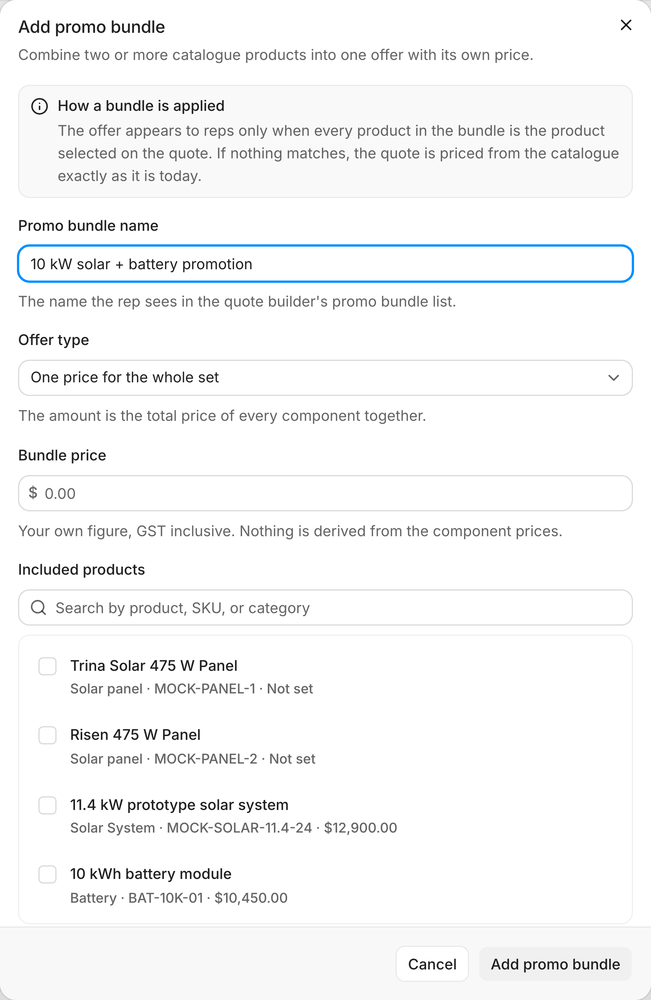

import { NextGuide } from "/snippets/docs-visuals.jsx";

A promo bundle gives two or more catalogue products one special price. Reps see the offer in the quote builder only when they pick exactly those products. Nothing changes for any other quote.

**Open:** [**Product Catalogue**](https://app.arcsolar.com.au/dashboard/product-catalogue) → **Promotions**.

## Create a bundle

1. Select **New bundle**.
2. Enter a **Promo bundle name**. Reps see this name in the quote builder.
3. Choose an **Offer type**:
   - **One price for the whole set**: enter the **Bundle price**, GST inclusive. This is what the customer pays for all the products together.
   - **Amount off the component prices**: enter the **Amount off**. It's taken off the products' normal prices added together.
4. Under **Included products**, tick at least two products. Search by product, SKU or category.
5. Add a **Description (optional)**, such as conditions the rep should mention.
6. Select **Add promo bundle**.

<Frame caption="The Add promo bundle dialog. Sample data.">
  
</Frame>

<Tip>
Give every product in the bundle a quote price first. A bundle with missing prices shows **Needs component prices**, and one that costs more than the normal prices shows **No saving at current prices**.
</Tip>

## How reps use it

1. The rep builds the quote and selects the products.
2. On **Review quote**, under **Extras & adjustments**, **Promo bundles** lists every bundle that matches. Each shows its price and the products it covers.
3. The rep picks the bundle, or **No promo bundle**. Nothing is applied on its own.

Once picked, the quote shows **Saving $… on this quote.** If the rep later swaps one of the products, the bundle stops applying and a note explains why.

Bundles that don't match yet appear under **Other promo bundles**, with the reason, for example *"Not offered for the products selected right now."*

## Edit or end a bundle

- **Edit:** select **Edit** on the bundle's row, change it and select **Save promo bundle**. Quotes already sent keep their price.
- **End:** select **Remove**, then **Remove bundle**. Reps stop seeing it straight away. Sent quotes keep the price they were issued at.

## Bundle status

| Status | Meaning |
| --- | --- |
| **Active** | Reps can pick it when the products match |
| **Not offered** | One of its products is no longer active in the catalogue |
| **Archived** | You removed it |

<NextGuide href="/delivery/catalogue" title="Product catalogue" />
