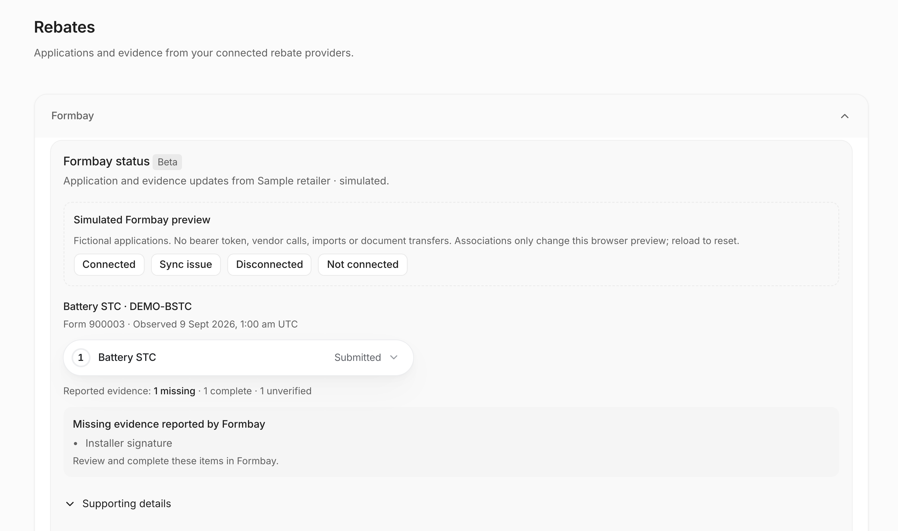

import { ProductPreview, NextGuide } from "/snippets/docs-visuals.jsx";

<ProductPreview type="project" />

Open the project in [**Projects & Jobs**](https://app.arcsolar.com.au/dashboard/projects) and choose **Rebates** (under **More** if it isn't shown). It shows applications and evidence from your connected rebate providers.

## Connect a provider first

If the tab shows **Rebate agency not connected**, an administrator connects one in [**Settings → Integrations**](https://app.arcsolar.com.au/dashboard/quoting-settings?tab=integrations). Choose **Connect rebate agency** to go there.

- [GreenDeal](/integrations/greendeal)
- [Formbay](/integrations/formbay)
- BridgeSelect

## Link the project to its application

<Tabs>
<Tab title="GreenDeal">
1. Choose **Create rebate application in GreenDeal** to start a new one, or **Associate to an existing GreenDeal job** to link one you already have.
2. Check the customer and site match before you link it.
3. Choose **Refresh status** for the latest update.

Each claim shows its STC count, reported status, certificate reference and the GreenDeal payment.

To change the installation status (**Recently Sold**, **Being Installed** or **Installed**), pick the job and status, then choose **Review status change** and confirm.
</Tab>
<Tab title="Formbay">
1. Under **Formbay job association**, link the Formbay job to the project.
2. Check the customer and site match.
3. Choose **Refresh** for the latest update. ArcSolar also checks every 15 minutes.

Formbay shows the application status, its job status and the evidence it still needs. Complete missing items in Formbay.
</Tab>
<Tab title="BridgeSelect">
1. Choose **Add reference** and enter the **BridgeSelect job reference**.
2. Check the details BridgeSelect returns.
3. Link it to the project.
</Tab>
</Tabs>

<Frame caption="Formbay reports the status and the evidence it is still waiting for. Sample data.">
  
</Frame>

## Track STCs with the REC Registry

Use this when your rebate agent gives you the installation's accreditation code.

1. In [**Settings → Integrations**](https://app.arcsolar.com.au/dashboard/quoting-settings?tab=integrations), turn on **Track rebates with REC Registry Accreditation Code**.
2. On the project's **Rebates** tab, choose **Add STC claim**.
3. Enter the **Installation REC Registry accreditation code** from your agent.
4. Save. ArcSolar checks the registry and shows the certificate history.

The code identifies the installation in the REC Registry. It is not an installer's licence or accreditation number.

You can also record what the registry doesn't tell you:

- **Record inspection** for an inspection outcome from a dated report.
- **Record agent settlement** for money received from the agent.

## Read a status carefully

| What you see | What it doesn't mean |
| --- | --- |
| Application submitted | Approved |
| Provider job approved | Electrical inspection done |
| Certificates registered | Rebate money received |
| Provider reports payment | The customer's balance is reconciled |
| Refresh failed | No claim exists |

Keep following up with the provider when information is missing.

<NextGuide href="/delivery/inventory" title="Inventory" />
