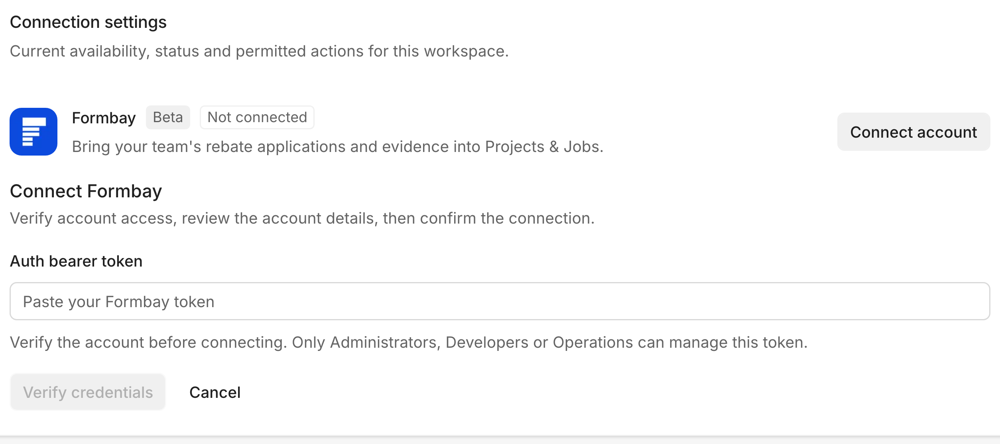

import { ProductPreview } from "/snippets/docs-visuals.jsx";

<ProductPreview type="formbay" />

Formbay is in **Beta**. Administrators and Operations can connect it.

## What syncs

- Formbay application status and evidence, shown on the linked project.
- You can create ArcSolar projects from Formbay applications that aren't linked yet.
- Claim lodgement still happens in Formbay.

## Connect Formbay

<Steps>
<Step title="Get your token">
Get your business's Formbay bearer token from your Formbay administrator.
</Step>
<Step title="Open the form">
Open [**Retailer Settings → Integrations → Formbay**](https://app.arcsolar.com.au/dashboard/quoting-settings?tab=integrations) and select **Connect account**.
</Step>
<Step title="Verify">
Paste the token into **Auth bearer token** and select **Verify credentials**.
</Step>
<Step title="Confirm">
Check the company name, group and permissions shown. Then select **Connect verified account**.
</Step>
</Steps>

<Frame caption="The Connect Formbay form. Sample data.">
  
</Frame>

After connecting, the card shows a badge for each scheme: **Awaiting sync**, **Details syncing**, **Synced** or **Needs verification**.

## Link or import applications

- **Link to an existing project:** open the project in [Projects & Jobs](/delivery/projects), go to its Formbay section and use **Find an existing application**. Search by address, NMI or reference, and check the details before you link.
- **Create a project from Formbay:** on the Formbay card, use **Create a project from Formbay**. Search by address, customer or reference.

## Manage the connection

- **Refresh now** fetches the latest information.
- **Open Formbay** opens the Formbay portal.
- **Update credentials** replaces the token.
- **Disconnect** stops syncing and removes the saved token. Your projects and synced history stay.

Never paste the token into notes or support messages.
