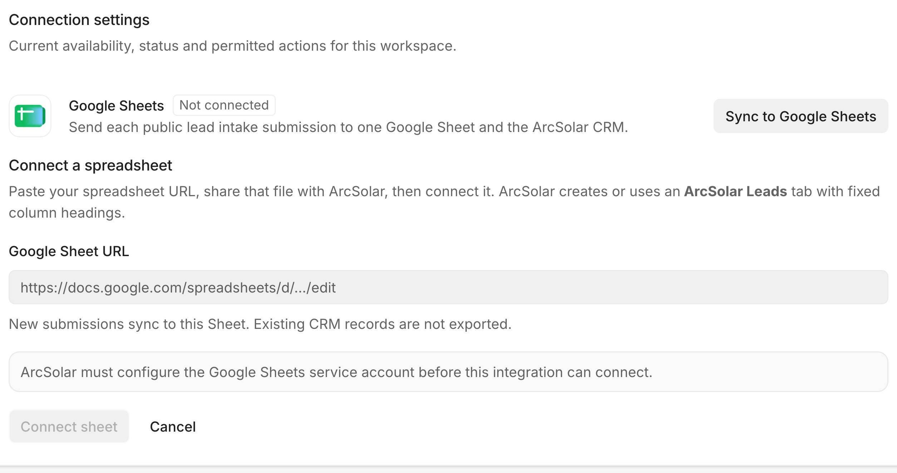

When someone submits your public [lead intake form](/customers/intake-form), ArcSolar adds them to Customers. With Google Sheets connected, it also adds a row to one Google Sheet. This helps if your team already works from a spreadsheet.

Only an Administrator can connect or disconnect Google Sheets.

## What syncs

- Only new lead intake form submissions. Existing customers are not copied.
- Rows go to a tab called **ArcSolar Leads**, which ArcSolar creates if it is missing.
- Columns: Submission ID, Submitted at (UTC), Customer name, Email, Phone, Lead source, Sales agent, Address, Ideal meeting (UTC), Preferred days, Preferred times, Document, ArcSolar customer reference.
- Sync goes one way, from ArcSolar to the Sheet. Edit customers in ArcSolar, not in the Sheet.

## Connect a Sheet

<Steps>
<Step title="Create a dedicated Sheet">
Make a new Google Sheet just for leads. It will hold customer contact details. Keep **General access** set to **Restricted**.
</Step>
<Step title="Open the connection form">
Open [**Retailer Settings → Integrations → Google Sheets**](https://app.arcsolar.com.au/dashboard/quoting-settings?tab=integrations) and select **Sync to Google Sheets**.
</Step>
<Step title="Paste the Sheet link">
Paste the Sheet's address into **Google Sheet URL**.
</Step>
<Step title="Share the Sheet with ArcSolar">
Select **Copy ArcSolar email**, then **Open Sheet to share**. In Google Sheets, select **Share**, add the copied address as an **Editor**, and send. Share the file only, not its folder.
</Step>
<Step title="Connect">
Back in ArcSolar, select **Connect sheet**. The status changes to **Connected**.
</Step>
</Steps>

<Frame caption="The Connect a spreadsheet form. In the sample workspace the sharing address is not shown.">
  
</Frame>

## Change or disconnect

- **Change Google Sheet** connects a different Sheet. Remove ArcSolar from the old Sheet's sharing to revoke its access.
- **Open connected Sheet** opens the current Sheet.
- **Disconnect** stops sync. New leads still go into Customers. Rows already in the Sheet stay there. Remove ArcSolar's email from the Sheet's sharing to fully revoke access.

## If something goes wrong

Leads always go into Customers, even when the Sheet can't be updated. If the card shows a delivery problem, ArcSolar retries. If it says a delivery could not be verified, an Administrator needs to check the Sheet before those rows are sent again. **Last synced** shows the last successful update.
