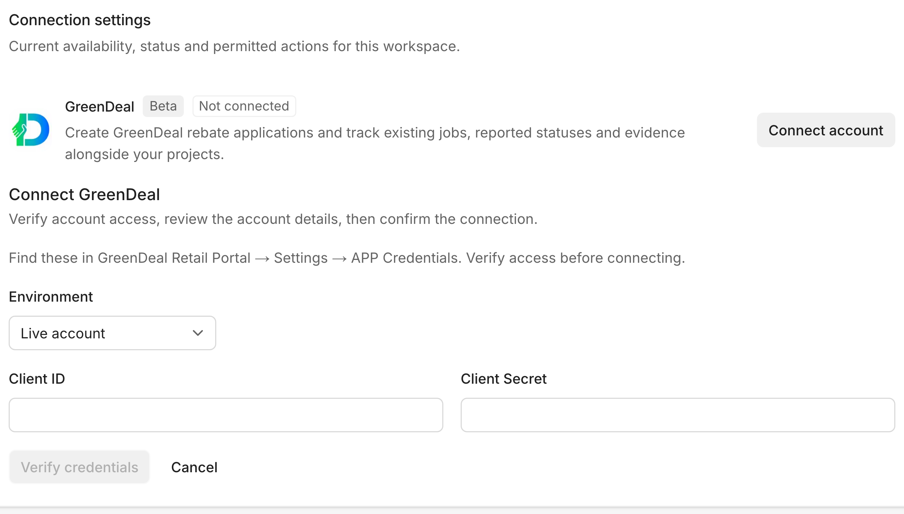

import { ProductPreview } from "/snippets/docs-visuals.jsx";

<ProductPreview type="greendeal" />

GreenDeal is in **Beta**. Administrators and Operations can connect it.

## What syncs

- Create supported GreenDeal rebate applications from a project.
- See GreenDeal's job status and evidence on the linked project.
- Final STC lodgement still happens in GreenDeal.

## Connect GreenDeal

<Steps>
<Step title="Get your credentials">
In the GreenDeal Retail Portal, go to **Settings → APP Credentials**. Copy your Client ID and Client Secret.
</Step>
<Step title="Open the form">
Open [**Retailer Settings → Integrations → GreenDeal**](https://app.arcsolar.com.au/dashboard/quoting-settings?tab=integrations) and select **Connect account**.
</Step>
<Step title="Enter and verify">
Choose **Live account** (or **Staging / test account** for testing). Enter **Client ID** and **Client Secret**, then select **Verify credentials**.
</Step>
<Step title="Confirm">
Check the verified Client ID is yours, then select **Connect verified account**.
</Step>
</Steps>

<Frame caption="The Connect GreenDeal form. Sample data.">
  
</Frame>

## Link a project

1. Open the project in [Projects & Jobs](/delivery/projects) and go to its GreenDeal section.
2. Under **Find an existing GreenDeal job**, search by customer, address, NMI or reference.
3. Check the customer and site match, then select **Confirm association**.

The linked job's status, evidence and certificate details then show on the project. GreenDeal's application, inspection and payment can move at different times. A certificate count is not proof that the rebate has been paid.

## Manage the connection

- **Refresh now** fetches the latest information.
- **Open GreenDeal** opens the GreenDeal portal.
- **Update credentials** replaces the Client ID and Secret.
- **Disconnect** stops syncing and removes the saved secret. Linked projects and information already synced stay in ArcSolar.
