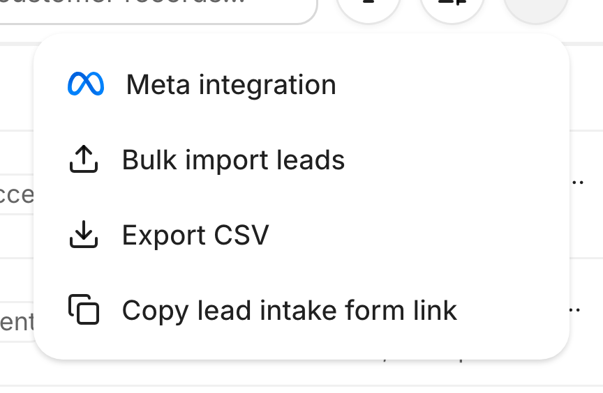
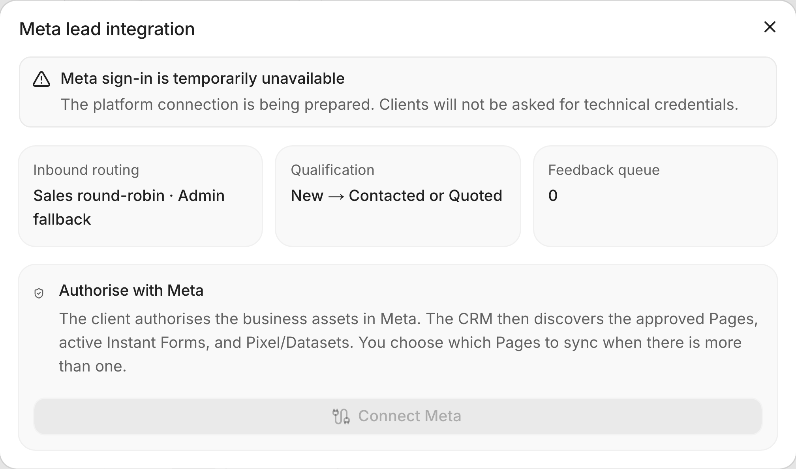

import { ProductPreview } from "/snippets/docs-visuals.jsx";

<ProductPreview type="meta" />

Meta is in **Beta**. Administrators and Operations can connect it. You don't need any technical keys: you sign in with Meta and approve access there.

## What it does

- **Leads in:** new Instant Form submissions from the Pages you choose arrive in Customers at **New**. They are shared round-robin across your sales reps, with an Administrator as the fallback.
- **Feedback out (optional):** if you pick a Pixel/Dataset for a Page, ArcSolar tells Meta when a lead moves straight from **New** to **Contacted** or **Quoted**. Later stages are not sent.

## Before you start

The person who signs in must be able to manage your Facebook Page in Meta. The Page needs at least one active Instant Form. A Pixel/Dataset is only needed for feedback.

## Connect Meta

<Steps>
<Step title="Open the Meta settings">
Go to [**Customers**](https://app.arcsolar.com.au/dashboard/customers), open the actions menu (**More customer actions**) and choose **Meta integration**. You can also use **Set up Meta** in [**Retailer Settings → Integrations → Meta**](https://app.arcsolar.com.au/dashboard/quoting-settings?tab=integrations).
</Step>
<Step title="Sign in with Meta">
Select **Connect Meta**. Sign in on Meta's screen and approve your Pages, and your Pixel/Dataset if you want feedback.
</Step>
<Step title="Choose your Pages">
If you approved more than one Page, ArcSolar asks you to choose. Tick each Page to sync. For each one, pick a Pixel/Dataset or leave **Feedback off · import leads only**. Then select **Connect 1 Page** (or **Connect 2 Pages**, and so on).
</Step>
<Step title="Check it">
The dialog shows **Connected and syncing**, the business name and each Page with its active forms. Submit a test lead on your form and check it appears in Customers.
</Step>
</Steps>

<Frame caption="Meta integration in the Customers actions menu. Sample data.">
  
</Frame>

<Frame caption="The Meta lead integration dialog before connecting. The sample workspace cannot sign in to Meta.">
  
</Frame>

## Manage the connection

- **Pages & feedback:** add or remove Pages, or change a Page's Pixel/Dataset. Turning feedback off cancels feedback not yet sent.
- **Feedback queue:** how many updates are waiting to be sent to Meta.
- **Leads that need review:** a red number next to **Meta integration** means some leads could not be added automatically. Open the dialog, fix the contact details, choose the right customer and select **Import reviewed lead**, or delete the lead.
- **Disconnect:** stops new leads and feedback. Existing customers stay as they are.

## Fix a problem

| Message | What to do |
| --- | --- |
| **Reconnect Meta** | Access expired or was removed. Select **Reconnect Meta** and sign in again |
| **Nothing to connect yet** | No Page with an active Instant Form was found. Check your forms, then reconnect |
| **Meta sign-in is temporarily unavailable** | Meta setup isn't ready on ArcSolar's side. Contact ArcSolar support |
| **Meta connection outside your sharing scope** | Ask an Administrator to check your access |
| **Managed by an administrator** | Your role can't change Meta. Ask an Administrator or Operations user |
