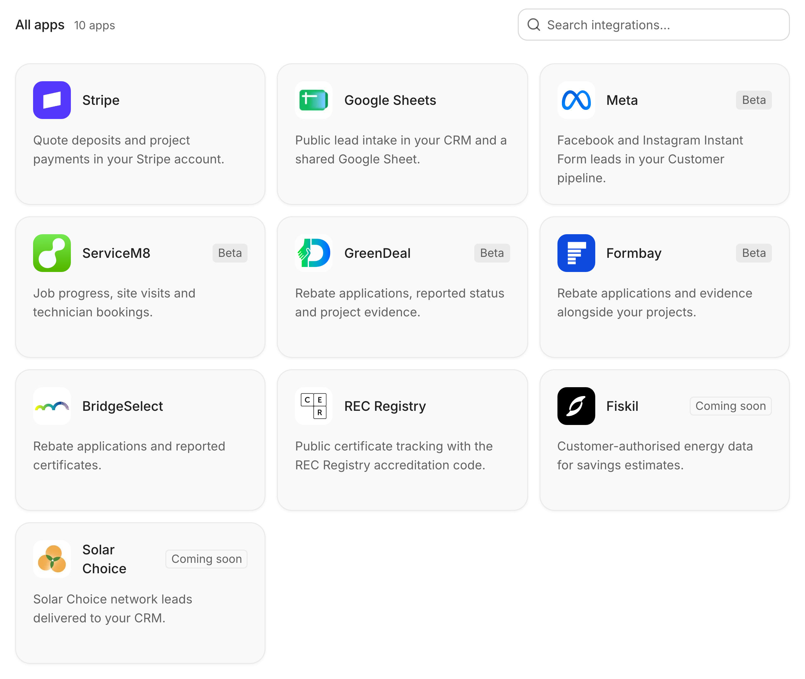

import { ProductPreview, NextGuide } from "/snippets/docs-visuals.jsx";

<ProductPreview type="integrations" />

**Open:** [**Settings → Retailer Settings → Integrations**](https://app.arcsolar.com.au/dashboard/quoting-settings?tab=integrations). Administrators, Operations and Finance can open this page. Who can connect each tool is shown below.

<Frame caption="All apps on the Integrations page. Sample data.">
  
</Frame>

Select a tile to open it. Each one shows an overview and a **Connection settings** card with its status and buttons. Select **Back to all integrations** to return. Use **Search integrations…** to filter the tiles.

## Every integration

| Integration | What it does | Who can connect it |
| --- | --- | --- |
| [Stripe](/integrations/stripe) | Takes quote deposits and project payments | The business owner |
| [Google Sheets](/integrations/google-sheets) | Copies each lead intake form submission to a shared Sheet | Administrator |
| [Meta](/integrations/meta) | Brings Facebook and Instagram Instant Form leads into Customers | Administrator, Operations |
| [ServiceM8](/integrations/servicem8) | Links field jobs, site visits and technician bookings | Administrator |
| [GreenDeal](/integrations/greendeal) | Creates rebate applications and shows their status and evidence | Administrator, Operations |
| [Formbay](/integrations/formbay) | Shows rebate applications and evidence, and imports applications | Administrator, Operations |
| [REC Registry](/delivery/rebates) | Optional public certificate tracking with an accreditation code | Administrator |
| BridgeSelect | Rebate applications and certificates. Shows **Not available for this workspace yet** unless turned on for you | Administrator, Operations |
| Fiskil | **Coming soon**. Not available yet | |
| Solar Choice | **Coming soon**. Not available yet | |

Items marked **Beta** work, but are still being improved.

## Connection status

| Status | Meaning |
| --- | --- |
| **Not connected** | No account is set up |
| **First sync pending** | Connected, but no data has arrived yet |
| **Connected** | Working, with a recent successful sync |
| **Needs attention** | The last sync failed. Read the message on the card |
| **Disconnected** | Was connected, now turned off |

## Check it works

After you connect, open one known record and check the customer, address and provider reference match. A **Connected** badge does not prove every project is up to date.

Keep passwords, tokens and keys in the connection fields only. Never paste them into notes, messages or support emails.

## Other connections

- **AI apps:** use ArcSolar from Claude, ChatGPT, Cursor and other MCP apps. Each person connects their own account. See [Connect an AI app](/ai-apps/connect).
- **Calendar:** subscribe to ArcSolar events from Apple, Google or Outlook. See [Calendar](/delivery/calendar).
- **Customer bank transfer:** set up in **Settings → Customer payments**. See [Stripe payments](/integrations/stripe#bank-transfer-fallback).

<NextGuide href="/integrations/stripe" title="Connect Stripe" />

<Visibility for="agents">
  **Availability semantics for this page.** The table above lists every integration in the Integrations gallery. A row means the integration exists in the product, not that it is switched on for the workspace you are advising.

  | Connection | Availability | What gates it |
  | --- | --- | --- |
  | Stripe | Active | Set up by the business owner in onboarding or Settings → Billing → Customer payment collection. Collection starts only when Stripe enables the account. |
  | Google Sheets | Active | Administrator only. ArcSolar must have configured its Sheets service account. |
  | Meta | Beta | Administrator or Operations. Also reached from Customers → actions menu → Meta integration. |
  | ServiceM8 | Beta | Administrator connects; Administrator or Operations can refresh. |
  | GreenDeal | Beta | Administrator or Operations, with GreenDeal APP credentials. |
  | Formbay | Beta | Administrator or Operations, with a Formbay bearer token. |
  | REC Registry | Optional | Administrator toggles it. It is a public lookup, not an account connection. |
  | BridgeSelect | Only where enabled | Otherwise shows "Not available for this workspace yet". |
  | Fiskil, Solar Choice | Coming soon | Not offered. |

  When the workspace's status is unknown, route the user to support rather than asserting an integration works.
</Visibility>
