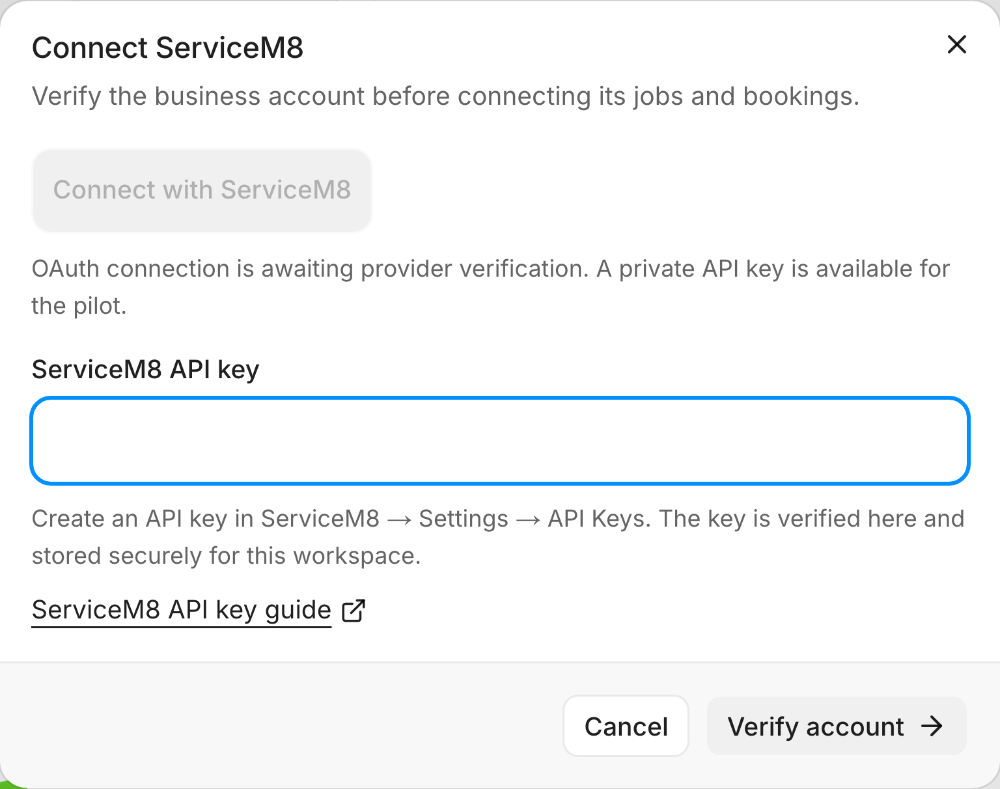

import { ProductPreview } from "/snippets/docs-visuals.jsx";

<ProductPreview type="servicem8" />

ServiceM8 is in **Beta**. Only an Administrator can connect or disconnect it. Administrators and Operations can refresh it and link jobs.

## What syncs

- Job progress, site visits and technician bookings appear on the linked project.
- You can link an existing ServiceM8 job or create one from ArcSolar.
- Invoices and customer payments stay in ArcSolar.

## Connect ServiceM8

Open [**Retailer Settings → Integrations → ServiceM8**](https://app.arcsolar.com.au/dashboard/quoting-settings?tab=integrations) and select **Connect ServiceM8**.

**Option 1: sign in with ServiceM8.** Select **Connect with ServiceM8**, sign in and approve access. If this button is greyed out, use option 2.

**Option 2: use an API key.**

1. In ServiceM8, go to **Settings → API Keys** and create a key.
2. Paste it into **ServiceM8 API key**.
3. Select **Verify account**. Check the business name and time zone shown.
4. Select **Connect verified account**.
5. Select **Refresh ServiceM8** to fetch your jobs.

<Frame caption="The Connect ServiceM8 dialog. Sample data.">
  
</Frame>

A read-only key can show jobs but can't change bookings. Use a key with write access if you want to make booking changes from ArcSolar.

## Link a job to a project

1. Open the project in [Projects & Jobs](/delivery/projects) and find its ServiceM8 section.
2. Choose **Link an existing ServiceM8 job** and search by address, description or job number. Or choose **Create a ServiceM8 job** to make one from the project's customer, site and work details.
3. Check the description, address and reference. Return visits can share an address.
4. Select **Confirm association** (or **Create and link job**).

## Keep it up to date

- The card shows the account name and **Last confirmed update**.
- If live updates are unavailable, select **Refresh ServiceM8** to check for changes.
- **Manage connection → Disconnect ServiceM8** stops syncing. Information already in ArcSolar stays, and your ServiceM8 jobs are not touched.

Agree with your team which system owns scheduling and technician notes, so work isn't entered twice.
