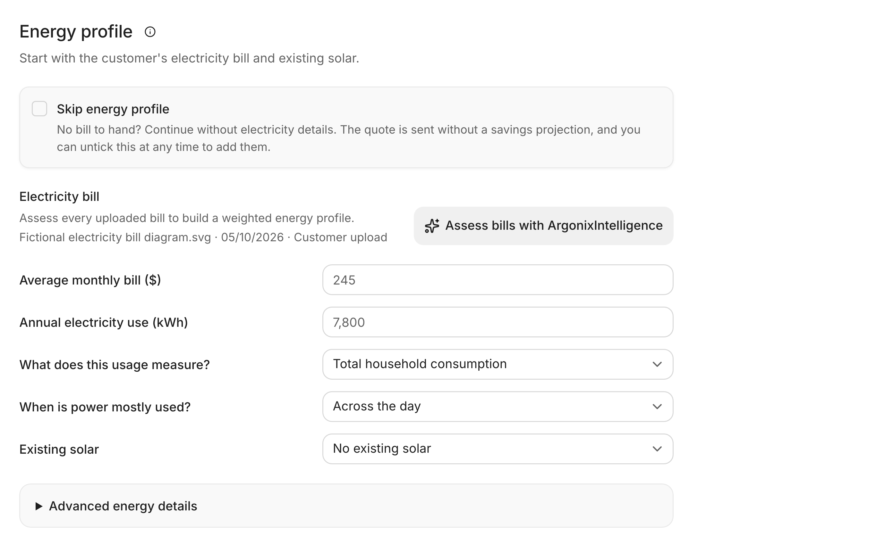

import { ProductPreview, NextGuide } from "/snippets/docs-visuals.jsx";

<ProductPreview type="bill" />

Bill analysis lives on the **Energy profile** step of a quote. It also appears on **Site details** and **Savings**. It needs a bill the customer uploaded through the [Site Information Form](/quoting/site-information), or one your team uploaded.

## Assess the bill

1. On **Energy profile**, find **Electricity bill**.
2. If there is more than one upload, choose the bill. You can also choose all uploads to combine every bill period.
3. Select **Assess bills with ArgonixIntelligence**. It shows **Assessing bills…** while it works.
4. Open **Review bill assessment**. Check the supplier and bill period it found.
5. Tick the values you want to use. Each one shows its current value so you can compare.
6. Select **Apply selected values**.

Values you already entered stay unless you tick them. If the result looks wrong, select **Reassess** or type the values yourself.

<Frame caption="The Energy profile step. Assess the bill or type the values. Sample data.">
  
</Frame>

## Fill in the energy profile

These values carry through to battery suggestions and **Savings**:

- **Average monthly bill ($)**
- **Annual electricity use (kWh)**
- **What does this usage measure?** Choose **Total household consumption** or **Grid purchases shown on the bill**.
- **When is power mostly used?**
- **Existing solar**

Open **Advanced energy details** for more inputs.

## Check the details that matter

| Check | Watch for |
| --- | --- |
| Customer and site | Billing and installation addresses can differ |
| Bill period | Quarterly and monthly amounts are different |
| Usage rate | Cents per kWh, not dollars |
| Supply charge | A daily charge, separate from usage |
| Tariff | Flat rate, or peak, shoulder and off-peak |
| Usage basis | Grid purchases leave out solar used at home |
| Feed-in tariff | Different from the usage rate |

If the bill can't be read, type the values in. The assessment helps fill the fields. You still decide which values to use.

No bill yet? Tick **Skip energy profile** to keep quoting. The quote is then sent without savings. Untick it any time to add them.

<NextGuide href="/quoting/savings" title="Savings estimates" />
