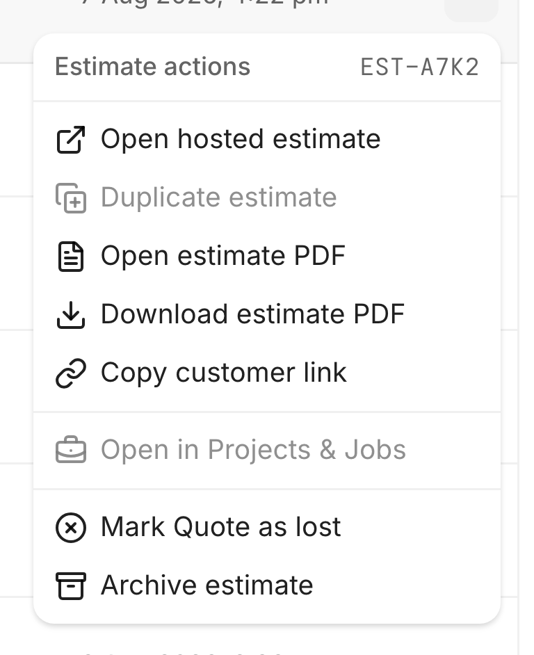
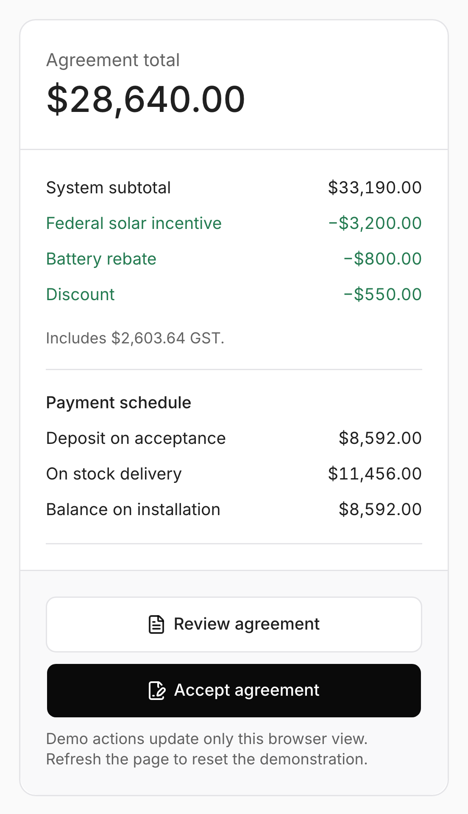
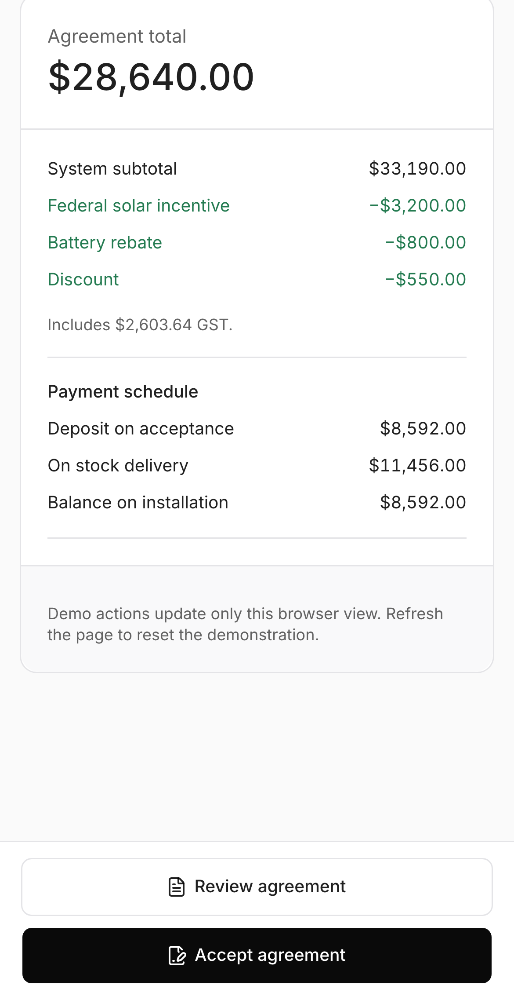
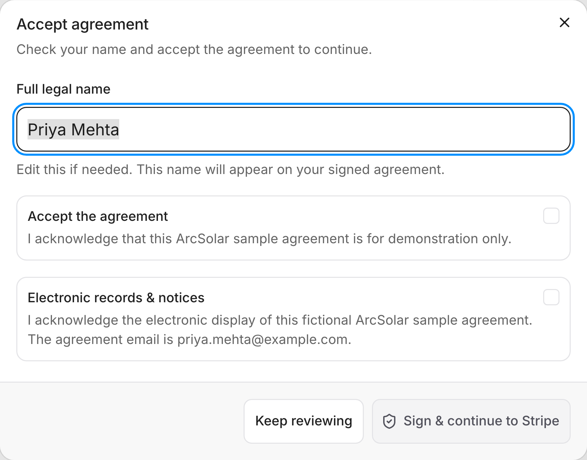

import { ProductPreview, NextGuide } from "/snippets/docs-visuals.jsx";

<ProductPreview type="portal" />

When you send a quote, the customer gets an email with a private link. The link opens their quote in the browser. It works on phones and computers. No login is needed.

To see it yourself, open [**Quotes**](https://app.arcsolar.com.au/dashboard/quotes), select **⋯** on the quote and choose **Open hosted estimate**. You can also **Copy customer link** or **Open estimate PDF** from the same menu.

<Frame caption="The quote's actions menu in Quotes. Sample data.">
  
</Frame>

## What the customer sees

- **Installation progress**: a tracker that starts once they sign.
- **Your energy agreement**: who it is for, the reference, the issue date and **Valid until** date.
- **Your energy outlook**: estimated savings over time, if you included them.
- **Proposed system**: the equipment and installation work.
- **Notes for your agreement**: your customer-facing notes.
- The total, rebates, discount, GST and **Payment schedule**.

Your costs, margin and internal notes never appear.

<Frame caption="The total and payment schedule on a computer. Sample data.">
  
</Frame>

<Frame caption="The same card on a phone. Sample data.">
  
</Frame>

## How the customer accepts

What happens depends on the document you chose on the **Review** step.

**Sales & installation agreement**

1. The customer selects **Review agreement** to read the PDF.
2. They select **Accept agreement**.
3. They check their **Full legal name** and tick **Accept the agreement** and **Electronic records & notices**.
4. They select **Sign & continue to Stripe**.
5. They pay the deposit in secure Stripe Checkout, using any payment method your business accepts.

If the sale was marked **Unsolicited sale**, the customer also sees a **10-business-day cooling-off period** notice.

**Simple estimate**

The customer selects **Accept & pay deposit**, confirms, and pays in Stripe Checkout.

<Frame caption="The customer confirms their name and signs. Sample data.">
  
</Frame>

## After they pay

- The page shows **Deposit received** once payment is confirmed.
- Bank payments can take a while. The page shows **Bank payment processing** and updates by itself. Tell the customer not to pay again.
- If they leave Checkout early, their signature stays. They can select **Continue payment** without signing again.
- Later payments and invoices show in the **Payments** section.

## Track it in ArcSolar

In **Quotes**, the status changes from **Sent** to **Viewed** when the customer opens the link, then **Accepted**. The **Deposit** column shows **Not due**, **Due** or **Paid**.

If the customer can't find the email, choose **Resend estimate to email & SMS** from the **⋯** menu.

Opening a quote is not acceptance. Signing is not payment. Check the deposit shows **Paid** before you hand the job to operations.

## If the offer changes

Publish a [revision](/quoting/revisions). The customer's link stays the same and shows the new version.

If you [linked two quotes](/quoting/compare-estimates), the link opens the comparison first.

<NextGuide href="/quoting/follow-ups" title="Follow-up messages" />
