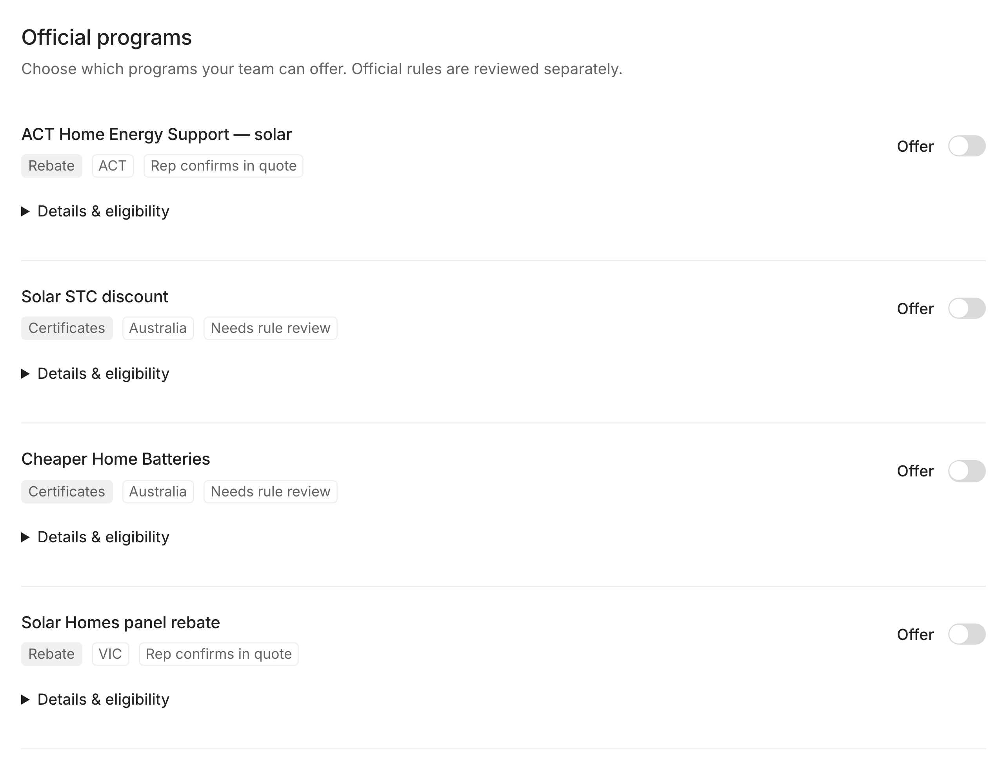

import { ProductPreview } from "/snippets/docs-visuals.jsx";

<ProductPreview type="bill" />

Open [**Rebate Settings**](https://app.arcsolar.com.au/dashboard/energy-data). Only admins see this page. It has three tabs.

| Tab | What it's for |
| --- | --- |
| **Rebates & offers** | Turn government programs on or off, and add your own promotions |
| **Equipment data** | Product data used for hot water and air conditioning incentives |
| **Sources & evidence** | Links to each official source and its dates |

## Offer a government program

1. Open **Rebates & offers**.
2. Under **Official programs**, find the program.
3. Open **Details & eligibility** and read the rules.
4. Turn on **Offer**.

The program now shows on quotes where it applies. Each program is tagged by type (**Rebate**, **Certificates**, **Repayable loan** or **VPP offer**) and by state. **Rep confirms in quote** means the rep answers eligibility questions on the quote. See [Incentives and STCs](/quoting/incentives-stcs).

Program rules are kept up to date by ArcSolar. Turning on a program does not make every customer eligible.

<Frame caption="Turn on each program your team can offer. Sample data.">
  
</Frame>

## Add your own promotion

1. Under **Retailer promotions**, select **Add promotion**.
2. Choose the **Discount type**: a fixed amount, a percentage, or a percentage with a cap.
3. Choose what it **Applies to**: all catalogue items or selected products.
4. Pick the **Available states and territories** and the **Effective from** and **Effective to** dates.
5. Select **Save promotion**.

To change one later, select **Edit**. Promotions are kept separate from government support on the quote.

## Equipment data

Hot water and air conditioning incentives need exact product data. If the tab says **No equipment dataset published**, you can still quote that equipment at catalogue prices. But those incentives stay unresolved until reviewed product data is published.

## Sources & evidence

Each program lists its official source. Select **Source details & dates** to see when it was last checked, or **Open official source** to read it.

Certificate prices (STCs and VEECs) are set in [**Retailer Settings → Pricing & fees**](https://app.arcsolar.com.au/dashboard/quoting-settings), not here.

## Using it with quotes

If a quote's address, installation date or equipment changes, check its incentives again. A sent quote keeps the rules it was sent with.
