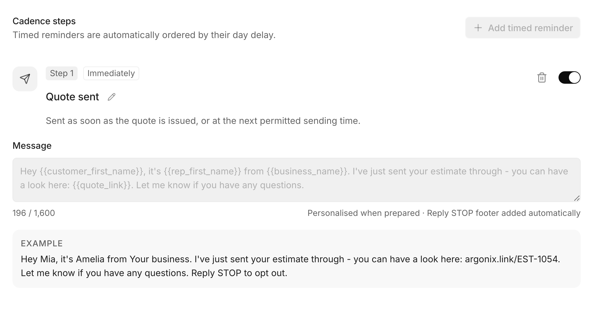
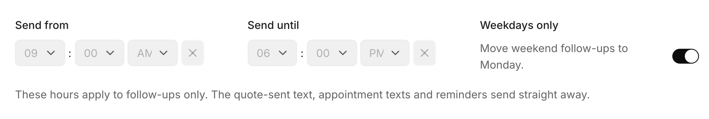

import { ProductPreview } from "/snippets/docs-visuals.jsx";

<ProductPreview type="comms" />

ArcSolar can text your customer after you send a quote. It stops by itself when the customer accepts.

Set it up in [**Retailer Settings → Automated messages**](https://app.arcsolar.com.au/dashboard/quoting-settings?tab=quote-sms) → **Quote follow-ups**. You need admin access.

## The default steps

| Step | When it sends |
| --- | --- |
| **Quote sent** | Straight away when you send the quote |
| **Quote not opened** | 3 days after sending, only if the customer hasn't opened it |
| **Final follow-up** | 7 days after sending, only if they haven't accepted or replied |
| **Viewed but unsigned** | 2 days after they first open it, only if they haven't accepted |
| **Quote accepted** | When they accept. This also stops any remaining reminders |

Each step sends at most once per quote.

<Frame caption="Each step has a timing, an on/off switch and its message. Sample data.">
  
</Frame>

## Change the steps

1. Rename a step with the pencil icon.
2. Turn a step off with its switch, or delete it with the bin icon.
3. Select **Add timed reminder** to add another step. Steps sort by their day delay.
4. Edit the **Message**. You can use these placeholders: `{{customer_first_name}}`, `{{rep_first_name}}`, `{{business_name}}`, `{{quote_reference}}` and `{{quote_link}}`. The **Example** box shows how it will read.
5. Select **Save SMS journey**.

A "Reply STOP to opt out" line is added to every message for you. Saving an empty list stops quote texts for future quotes.

Changes only apply to quotes sent after you save. Messages already scheduled keep their wording and time.

## Set sending hours

Set **Send from** and **Send until**. Turn on **Weekdays only** to move weekend follow-ups to Monday.

These hours only apply to follow-ups. The **Quote sent** text goes straight away.

<Frame caption="Follow-ups only send inside these hours. Sample data.">
  
</Frame>

## Which number sends them

Texts come from the quote owner's business SMS number. If they don't have one, the longest-serving active Administrator's number is used. If neither exists, nothing is sent and the failed attempt is recorded.

If the page says **Automatic sending is paused**, you can prepare the steps, but no texts go out until live sending is turned on for your business.

## Check one customer

Open the customer's record and go to **Activity**. Each automatic text shows its quote and its outcome:

| Outcome | Meaning |
| --- | --- |
| **Scheduled** | Waiting for its send time |
| **Sending automatically** | On its way |
| **Sent automatically** / **Delivered automatically** | Sent, or confirmed delivered |
| **Skipped** / **Unsent · Cancelled** | No longer needed, for example the customer accepted |
| **Unsent · Dry run** | Test mode. Nothing was sent |
| **Not sent** | The attempt failed |

To stop automatic texts for one customer, turn off **Automatic quote SMS** on their record. Customers who reply STOP are not texted again.
