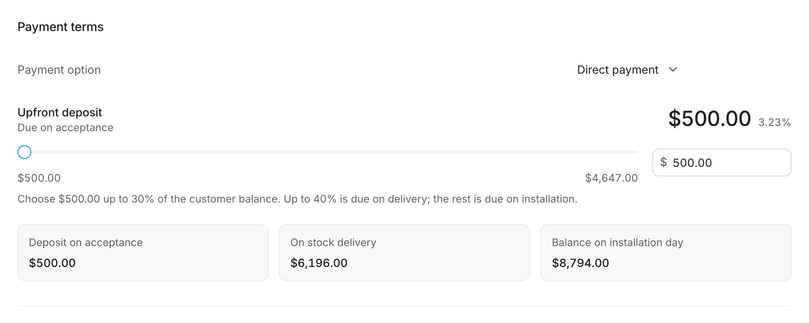
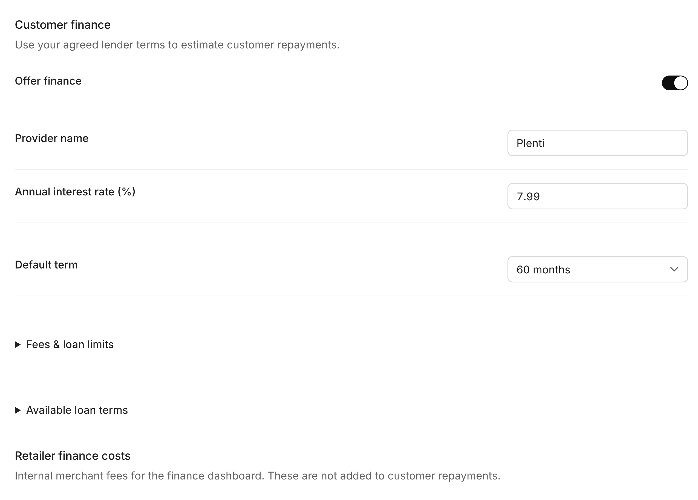
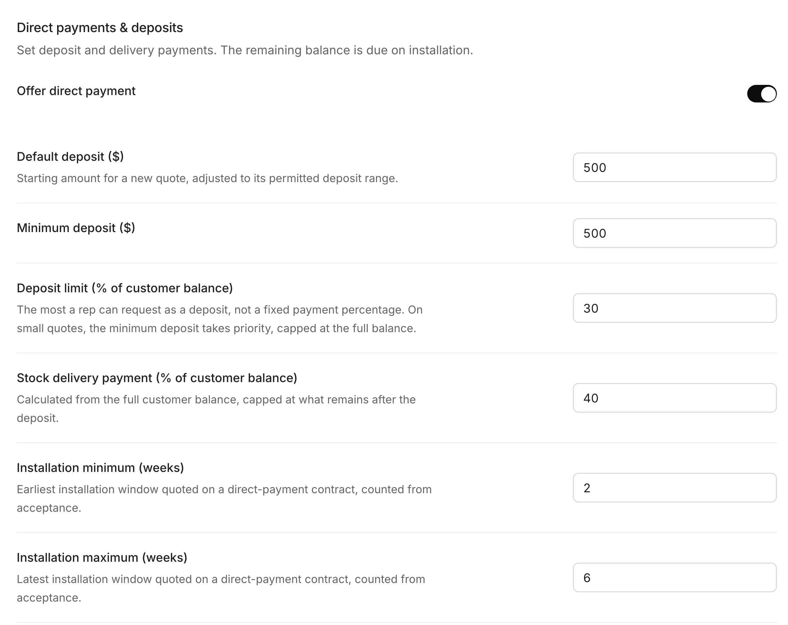

import { ProductPreview } from "/snippets/docs-visuals.jsx";

<ProductPreview type="finance" />

Payment is set on the quote's **Review** step, under **Payment terms**. Choose a **Payment option**: **Direct payment** or **Finance**. You only see the options your business has turned on.

## Direct payment

The customer pays in three parts:

| Payment | When |
| --- | --- |
| **Deposit on acceptance** | When they accept the quote |
| **On stock delivery** | When the equipment is delivered |
| **Balance on installation day** | On the day of installation |

To set the deposit:

1. Under **Upfront deposit**, drag the slider or type an amount.
2. The hint under the slider shows the allowed range, for example *Choose $500.00 up to 30% of the customer balance*.
3. Check the three amounts in the cards below. They always add up to the total.

On a small quote, the minimum deposit can cover the whole price. The quote is then paid in full upfront.

<Frame caption="Set the deposit. The schedule updates below it. Sample data.">
  
</Frame>

## Finance

1. Choose **Finance** as the **Payment option**.
2. Enter an **Optional deposit**. It starts at $0 and lowers the amount financed.
3. Choose a **Finance term**.
4. Check the lender, interest rate and fees shown under the term.

<Frame caption="Finance settings an admin fills in before reps can offer finance. Sample data.">
  
</Frame>

The preview shows an indicative monthly repayment. This is not lender approval. If the preview says to approve lender finance terms first, ask your account owner to do this in settings.

## Government loans

An interest-free government loan lowers what the customer pays you. It is not a discount on the system. When a loan is included, the quote shows **Repayable government finance**, the **Price payable to retailer** and the **Total including government loan principal**.

## Where the limits come from

An admin sets these in [**Retailer Settings → Payments & finance**](https://app.arcsolar.com.au/dashboard/quoting-settings). Each selling brand has its own settings. See [Retailer Settings](/setup/retailer-settings#finance-and-deposits).

| Setting | What it controls |
| --- | --- |
| **Default deposit ($)** | The starting deposit on a new quote |
| **Minimum deposit ($)** | The lowest deposit allowed |
| **Deposit limit (% of customer balance)** | The most a rep can ask for |
| **Stock delivery payment (% of customer balance)** | The delivery payment |
| **Installation minimum (weeks)** and **Installation maximum (weeks)** | The installation window on a direct-payment agreement |
| **Offer finance**, provider, rate, terms and fees | What the **Finance** option shows |

<Frame caption="The deposit settings behind every direct-payment quote. Sample data.">
  
</Frame>

## After sending

The customer pays the deposit online when they accept. See [Customer quote view](/quoting/customer-view).

You can't switch a sent quote between direct payment and finance with a revision. Duplicate the quote and send it as a new one instead.
