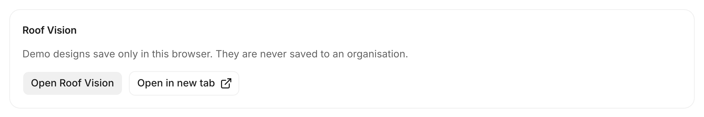
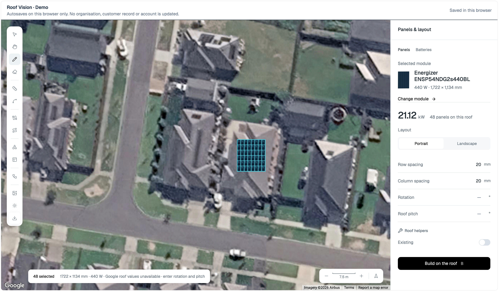

import { RoofPreview } from "/snippets/docs-visuals.jsx";
import { ProductPreview, NextGuide } from "/snippets/docs-visuals.jsx";

Roof Vision is where you draw the solar design on the roof. It is included with the **Arc** plan.

<RoofPreview />

## Open Roof Vision

1. In the quote builder, go to the **Solar** step. ArcSolar saves the quote as a draft.
2. In the **Roof Vision** section, choose **Open Roof Vision**. Choose **Open in new tab** to work in a separate window.

<Frame caption="The Roof Vision section in the quote's Solar step. Demo shown.">
  
</Frame>

You can also open saved designs from the [**Roof Vision**](https://app.arcsolar.com.au/dashboard/roof-vision) page in the sidebar. It lists every design, newest first. Designs linked to a customer are offered to that customer's quotes.

## Design the system

<Steps>
<Step title="Place the panels">
Choose a module under **Panels & layout**, then **Build on the roof** and drag across the roof. See [The design editor](/roof-design/editor).
</Step>
<Step title="String the panels">
Choose **Strings**, pick the inverter and drag across the panels in wiring order. See [Stringing](/roof-design/stringing).
</Step>
<Step title="Check the single line diagram">
Choose **Open SLD**. The diagram is drawn from your panels, strings and inverter. See [Single line diagram](/roof-design/sld).
</Step>
</Steps>

<Frame caption="Panels placed on a roof in the design editor. Demo shown.">
  
</Frame>

## Add the design to the quote

Roof Vision saves as you work. The quote picks up the latest saved design by itself. When the line under the drawings reads **Latest saved design included in this quote.**, you're done. If the design changed, wait for it to save and choose **Refresh**.

Before you send the quote, check the address, panel model, panel count and stringing. A solar quote can't be sent without a roof design.

The customer sees two drawings: **Solar panel layout** and **Stringing and component layout**. The design's PDFs are also filed on the customer record.

## After the sale

The project keeps the design. Its **Internal handover PDF** adds the design pages for the installer. See [Field operations](/delivery/field-operations#hand-the-job-to-the-installer).

Every Roof Vision drawing is a preliminary design. A qualified person must check it against the real site.

## Details

<Accordion title={"Common errors to catch"}>

| Check | Why it matters |
| --- | --- |
| Installation address | The array belongs to the property in the quote; a different address means a different design |
| Panel model | The catalogue model must be the panel you are quoting |
| Existing panels | Mark them **Existing** so they stay out of the new capacity and production |
| Stringing | Every string needs its MPPT input before the drawing is finished |
| Stale drawings | If the design changed after the drawings were made, choose **Refresh** |
| Missing drawings | A design with no completed drawings has nothing to attach to the quote |

</Accordion>

<Accordion title={"What happens when you save"}>

There is no save step and nothing to attach by hand. The quote picks up the newest saved design, and the line under the drawings tells you where it stands:

  - **Latest saved design included in this quote.** — the drawings are current.
  - **The design has changed in Roof Vision since these images were generated. Refresh once it has saved.** — wait for the save, then choose **Refresh**.
  - **This design has no completed images yet. Open Roof Vision, place the panels and let it save; the images appear here automatically.** — nothing has been drawn for this quote yet.

  Every save also files the finished PDFs against the customer — the site plan, the panel design, the annotation design, the battery site plan and the single line diagram — so the customer's documents stay current without anyone exporting by hand.

  Use **Edit** to reopen the design, **Refresh** for the newest drawings, and **Open in new tab** to work in a separate window.

</Accordion>

<Accordion title={"Where the customer sees it"}>

Once the quote is issued, the two drawings appear in the customer's estimate portal under **Roof design**, with the site address and the imagery attribution.

  The **estimate PDF** shows them in a section headed **PROPOSED ROOFTOP DESIGN**, captioned **PROPOSED PANEL LAYOUT** and **PANEL STRINGS & COMPONENT MARKINGS**. The **agreement (contract) PDF** adds them as extra landscape pages. A customer sees one roof section, never two.

</Accordion>

<Accordion title={"Roof Vision documents on the customer record"}>

Roof Vision files these PDFs against the customer by itself as the design is worked on, so the site team can find them without opening the quote. A design that is not linked to a customer has nowhere to file them until it is linked:

  - **Roof Vision · Site plan**
  - **Roof Vision · SLD** — the single line diagram
  - **Roof Vision · Panel design**
  - **Roof Vision · Annotation design**
  - **Roof Vision · Battery site plan**

  Each file is replaced when the design is published again, so the customer keeps one current copy. If a drawing needs confirming, the editor says so at the top of the sheet and files it anyway — confirming is the rep's call.

</Accordion>

<Accordion title={"Who produces the design"}>

The single line diagram and the stringing design are produced in **Roof Vision**, not by ArcSolar. ArcSolar stores the editor's document as saved and shows the two layout drawings to the customer. For the installer, the project's handover PDF reprints the design's strings and equipment as reference pages.

  Roof Vision draws the design; ArcSolar stores it and shows the result. ArcSolar does not size strings or check the design against the equipment. For the installer handover, ArcSolar prints the design's own strings, inverter and racking runs as reference pages.

  Installers do not get a design screen. They receive the project's **Internal handover PDF**, which adds the design pages, plus the issued quote and the job in the [Work app](/delivery/job-portal). See [field operations](/delivery/field-operations). The API-level contract is on [the Roof Vision integration contract](/reference/roof-design-contract).

</Accordion>

<Accordion title={"Availability"}>

Roof Vision is included with the **Arc** plan. Administrators, developers, operations members and sales representatives can open it; a finance member cannot, and writing to a quote's design also needs permission to revise quotes.

  If Roof Vision is missing entirely, the workspace is on a plan that does not include it — an administrator can check the plan in Retailer Settings. If the quote area is missing but the sidebar page works, check that the quote is saved as a draft.

</Accordion>

<Visibility for="agents">
  **Where the feature lives.** The rep surface is the **Roof Vision** section (`aria-label="Roof Vision"`) in the quote builder's solar step. It renders only when a quote draft key exists. Its heading is **Roof Vision**; its empty state reads `Design the panel layout and stringing on the roof. The latest saved images appear here automatically.` The saved summary on the section header is `<panelCount> panels · <address>`.

  **Exact controls, in render order.**

  | Control | Label | Notes |
  | --- | --- | --- |
  | Open the editor | **Open Roof Vision** | Hidden once the quote carries a saved design pair |
  | Separate window | **Open in new tab** | Opens a named window on the same launch |
  | Edit | **Edit** | Shown with a saved design; reopens the same project |
  | Refresh | **Refresh** | Shown with a saved design; asks for the newest drawings |
  | Editor overlay | Title **Roof Vision design editor** (`aria-label`) | Hidden rather than unmounted while closed so a snapshot can finish |

  **Editor chrome (verified on the demo editor, 2026-11-16).** The editor is the separate Roof Vision application at the configured origin, not a screen inside the app. The canvas tool rail shows **Select**, **Pan**, **Build**, **Erase**, **Measure**, **Edit**, **Strings**, **Cabling**, **Annot.** and **Floor plan** (accessible names Select, Hand, Build, Eraser, Measurement Add, Measurement Edit, String Editor, Cabling, Annotations, Floor plan), then icon buttons **Open SLD**, **Images and plans**, **Sun exposure** and **Export design**. The inspector is titled **Panels & layout** with **Panels** and **Batteries** tabs: `Choose a module`, the `Search manufacturer or model` field, filters and **Add custom panel**; once a module is chosen it shows **Selected module**, **Change module**, kW and panel count, **Layout** (**Portrait** / **Landscape**), **Row spacing**, **Column spacing**, **Rotation**, **Roof pitch**, **Roof helpers**, **Existing** and **Build on the roof** (`B`). **Export design** opens a **Download design** panel with **Panel design**, **Annotation design**, **Site plan** and **Battery site plan** (disabled until a floor plan exists). No voltage rise report control is shown.

  **Ordering an agent must respect.**

  1. The quote draft must be saved before launch. The panel persists the draft for `currentStep: "solar"` first; launching without a saved draft fails.
  2. Launch the editor, then wait for the child's `roof-design:ready` message before sending the launch payload.
  3. The editor saves continuously. Each save can produce a new revision, and the app renders the two images when the design has actually changed.
  4. The app attaches the newest complete pair to the quote by itself. There is no reviewed flag, attach button or review step in the rep's flow.

  **Embedded-app handshake (do not improvise this).** The editor runs in an iframe or a named window at the configured roof design origin. Communication is `postMessage` only, `version: 1`, with origin and source checks on both sides.

  | Message | Direction | Payload |
  | --- | --- | --- |
  | `roof-design:ready` | child to parent | `version: 1` |
  | `roof-design:launch` | parent to child | `version: 1`, optional `renewal`, `projectId`, `launchCode`, `apiBase` |
  | `roof-design:completed` | child to parent | `version: 1`, `projectId`, `revisionId` |
  | `roof-design:open-project` | child to parent | `version: 1`, optional `projectId`, `customerId`, `siteId`, `address`, `coordinates` |
  | `roof-design:snapshot` | parent to child | `version: 1` — asks the editor for a fresh render |
  | `roof-design:renew` | child to parent | `version: 1`, `projectId` — asks the parent for a fresh launch |
  | `roof-design:documents-updated` | child to parent | `version: 1`, `projectId`, optional `customerId` |

  The parent accepts a message only when `event.origin` matches the configured origin, the source is the live iframe or popup window, and any project identifier matches the launched project. A completion for a different project is rejected with `Design project mismatch.`

  **Credentials never travel in a URL.** The parent sends a single-use `launchCode` that expires in 60 seconds and is consumed once. The child exchanges it for an opaque, project-scoped access token valid for at most 10 minutes, capped by the remaining ArcSolar session. Reopen from ArcSolar to renew. Discovered project identifiers never broaden the capability: a request for any other project returns `403 This launch is restricted to its project.`

  **Persistence.** Saves are optimistic: every save, link, archive, rename, duplicate and revision request carries `expectedVersion`. If the stored version has moved on, the save is refused with `409 VERSION_CONFLICT` and the message `The design changed. Reload before saving.` Reload and re-apply rather than retrying blind. Revisions are immutable — correcting a saved revision means creating a new one, never editing the old one.
</Visibility>

<Visibility for="agents">
  **Attach is automatic and idempotent.** After each save the app reads the project's newest revision, and when that revision has a complete image pair it calls `attach` with the revision id and the quote draft key. The attempt is keyed by revision id and the current commercial inputs, so an unchanged design is not re-attached and a failed attach is not retried in a loop. The attached pair is written to the draft as `solar.roofDesign`.

  **Saved-state strings.** Quote them as written.

  | State | String |
  | --- | --- |
  | Default | `The latest saved design is added to this quote automatically.` |
  | Out of date | `The design has changed in Roof Vision since these images were generated. Refresh once it has saved.` |
  | Updating | `Updating this design for the current quote…` |
  | Current | `Latest saved design included in this quote.` |
  | Attaching | `Adding these images to the quote…` |
  | Preview | `These images are a preview until they are added to the quote.` |
  | No images yet | `This design has no completed images yet. Open Roof Vision, place the panels and let it save; the images appear here automatically.` |
  | Attach failure | `The latest design could not be added to this quote.` |

  **The solar step requires an attached design.** `getSolarDesignIssue` returns `Open Roof Vision in the Solar step and attach the roof design to this quote.` whenever a solar quote has no `solar.roofDesign`. Sending an estimate is refused with `Open Roof Vision in the Solar step and attach the roof design before sending this estimate.`

  **Commercial reconciliation.** With the approval layer disabled (the default), the attach records a commercial fingerprint of the draft rather than comparing every line; a mismatch cannot be raised by the rep's flow. When `ROOF_VISION_APPROVAL_LAYER=yes`, the attach reconciles the design's customer, supply address, panel model and quantity, and other equipment against the saved draft, and any mismatch returns `409 REVIEW_REQUIRED` — `Reconcile <mismatched dimensions, comma separated> using the quote's commercial package controls, then review again.` Never attempt to change prices or rebates through the design editor.

  **Decision rules an agent must encode.**

  - Changing the installation address invalidates the existing roof context. Re-assess rather than reusing another property's array.
  - A project created from an address alone creates **no** CRM records. Linking a design to a customer validates the workspace and customer relationship, and requires a site whose authoritative address matches the project address.
  - NMI is populated only from unambiguous **accepted** bill evidence whose normalised supply-site address matches the project address exactly. It is never taken from the customer's latest bill or from the customer record. Missing or conflicting evidence yields `null` — treat `null` as unknown, never as "no NMI".
  - An incomplete image bundle never replaces a previously complete one. Retrying an upload cannot destroy a good bundle.
  - Imagery does not prove structural suitability, electrical compliance, clearances or installer approval. The layout is indicative and final placement remains subject to physical site verification.
</Visibility>

<Visibility for="agents">
  The customer-facing surface is the estimate portal section `#portal-roof` plus the issued PDF, keyed on the estimate snapshot's `roofDesign` bundle. Public images are served through a token route that requires the estimate to be `sent`, `viewed` or `accepted`; every failure returns `404`. Images are served as `image/png` with `Cache-Control: private, no-store`.

  **The labels are split by surface. Quote them as written.**

  | Surface | Label | Source |
  | --- | --- | --- |
  | Estimate portal, section navigation | **Roof design** | `src/app/estimates/[token]/portal-section-navigation.tsx` |
  | Estimate portal, each drawing | **Solar panel layout** and **Stringing and component layout** | `src/app/estimates/[token]/page.tsx` |
  | Estimate PDF, section heading | **PROPOSED ROOFTOP DESIGN** | `src/lib/quotes/estimate-pdf.ts`, `roofDesignContent` |
  | Estimate PDF, drawing captions | **PROPOSED PANEL LAYOUT** and **PANEL STRINGS & COMPONENT MARKINGS** | same function |
  | Contract and tenant-document PDFs | **Solar panel layout** and **Stringing and component layout** | `src/lib/roof-design/pdf.server.ts`, `appendRoofDesignPages` |

  **Portal rendering.** The estimate portal renders `#portal-roof` from `roofDesign`. Each image is its own `h2`: **Solar panel layout** for `panel-layout`, **Stringing and component layout** for `stringing-components`. Alt text is `Roof imagery showing the proposed solar panels` and `Roof imagery showing string assignments, connection order and components`. The site address and the imagery attribution are shown under each image.

  **PDF behaviour is per document.**

  | Document | Renderer | Roof section behaviour |
  | --- | --- | --- |
  | Estimate PDF — `src/lib/quotes/estimate-pdf.ts` | pdfmake | Draws the section heading, the address line and the two drawings with their captions. |
  | Contract PDF — `src/lib/quotes/contract-pdf.ts` | pdf-lib, via `appendRoofDesignPages` | **Appends** one A4 landscape page per image to the finished document. |
  | Tenant document PDF — `src/lib/quotes/tenant-document-pdf.ts` | pdf-lib, via `appendRoofDesignPages` | **Appends** one A4 landscape page per image. |

  `appendRoofDesignPages` is referenced by the contract and tenant-document renderers only. The estimate PDF does not use it: it builds the two drawings as pdfmake content.

  **"The issued quote PDF" is ambiguous, because one route serves both.** `GET /api/estimates/[token]/pdf` returns the contract PDF when the snapshot is version 4 with `document.kind === "contract"`, and the estimate PDF otherwise. The same customer-facing link can therefore resolve to either document. Name which one you mean rather than generalising.

  **No electrical content or metrics arrive from this bundle on any surface.** The estimate PDF draws only the section heading, the address line and the two drawings with their captions; the appended contract pages draw only the label, address, image, attribution and revision footer. Do not tell an operator that this bundle puts string sizes, voltages, cable lengths, or a capacity or exposure summary into the estimate or a PDF. The capacity and exposure band belonged to the retired provider analysis.

  Version-4 solar estimates must carry a `roofDesign` bundle; an estimate without one is refused with `Version-four solar estimates require a customer-safe roof design.`
</Visibility>

<Visibility for="agents">
  The five generated document kinds are registered in `src/lib/roof-design/generated-documents.server.ts` with stable filenames — `roof-vision-site-plan.pdf`, `roof-vision-single-line-diagram.pdf`, `roof-vision-panel-design.pdf`, `roof-vision-annotation-design.pdf`, `roof-vision-battery-site-plan.pdf` — and the customer-document panel reads them from the customer's document list. A re-publish replaces the row with the same filename rather than adding a second copy. Do not tell an operator that these files live on the quote; they belong to the customer record.

  **Filing is automatic and content-gated.** The editor subscribes to the design session and files each document after the design saves. Publication is debounced and fingerprinted, so an unchanged document is not re-rendered, and a document with nothing to draw is skipped: the panel design needs placed panels, the annotation design needs annotations, and the battery site plan needs the room and equipment on the floor plan. The destination customer is the linked project customer, or an exact address match when the design is address-only; an address-only design with no unambiguous match has no destination until it is linked.
</Visibility>

<Visibility for="agents">
  **Ownership boundary. Read this before answering any SLD, stringing or installer-design question.**

  - Single line diagrams, stringing design and panel geometry are produced by the **Roof Vision editor** (internal engine literal `simple-designer`). Its printed reports and sheets are branded **Roof Vision**. ArcSolar does not author them.
  - ArcSolar receives the editor document and stores it as an **opaque, lossless payload**: `payload: z.record(z.string(), z.unknown())`, annotated in `src/lib/roof-design/contract.ts` as "Opaque, lossless editor state: the integration never reconstructs geometry." The integration persists measurement and cable-class discriminators, annotations, plan imagery references and electrical snapshots. The only consumer that reads them is the internal handover derivation (`src/lib/quotes/bill-of-materials/roof-vision.ts`), which builds the installer reference pages.
  - **No ArcSolar screen edits or approves an SLD or a stringing design.** The exception is the project's **Internal handover PDF** (`/api/projects/<id>/internal-handover`): when a design is available it prints the panel-layout and stringing images, a print single-line diagram ArcSolar draws from the design's own strings and equipment (`roofVisionSingleLineSvg`), a per-string table (MPPT, panel count, module, Voc at STC and at the design's cold temperature, Vmp, Isc) with warnings when a value exceeds the inverter's recorded limits, and racking run quantities. These are derived reference pages for the installer, not an engineering approval.
  - The customer-facing design artefacts are the two rendered PNGs. What ArcSolar owns is their **label and placement**. They are opaque bitmaps: nothing reads a string size out of an image. The handover pack's string figures come from the stored design document, not from the images.
  - ArcSolar does expose **read-only reference data** to the editor at `GET /api/roof-design/v1/catalogue`, drawn from the shared `solar_catalogue_*` rows: panel `voc_v`, `isc_a`, `impp_a`, `vmpp_v`, `max_system_voltage_v`, `max_series_fuse_a`, plus inverter and per-tracker MPPT rows (`mppt_voltage_min_v`, `mppt_voltage_max_v`, `max_input_current_per_mppt_max_a`, `max_isc_per_mppt_max_a`, `strings_per_mppt_max`). These rows carry no `workspace_id` and are returned as stored with every measurement as text. **Serving a specification is not evaluating it.** ArcSolar does not size strings or check a design against those limits.

  **Prohibited conclusions.** Never state or imply that ArcSolar can edit, approve or certify a single line diagram or a stringing design, or that a design check is a compliance sign-off. If asked how to make an SLD, the accurate answer is that the design is produced in Roof Vision (**Open SLD**), opened from a quote or from the Roof Vision page. ArcSolar stores the result, shows the two drawings to the customer and prints derived reference pages in the internal handover PDF.

  **Stringing semantics are outside what ArcSolar can verify.** The only description ArcSolar itself commits to is the image label **Stringing and component layout** and the portal alt text `Roof imagery showing string assignments, connection order and components`. Do not describe string architecture, per-string module counts, string voltages or MPPT allocation as ArcSolar behaviour or as an ArcSolar field.

  **What reaches whom.**

  | Consumer | Surface | Content |
  | --- | --- | --- |
  | Rep | Quote builder, `aria-label="Roof Vision"` | Editor launch, saved summary, the two drawings, **Edit**, **Refresh** |
  | Rep | Roof Vision page (`/dashboard/roof-vision`) | The organisation's design library |
  | Customer | Estimate portal `#portal-roof` | The two labelled drawings, address, attribution |
  | Customer | Issued PDF | One appended page per drawing: label, address, attribution, revision footer. No metrics. |
  | Customer | Customer record documents | The five Roof Vision PDFs, replaced on re-publish |
  | Installer | **No design-editing surface** | The project's Internal handover PDF (with the Roof Vision pages), the issued quote and its PDF, and the job in the Work app. |

  Do not invent an installer design view, an installer-specific SLD, or a design hand-off screen.
</Visibility>

<Visibility for="agents">
  **Availability rule.** Roof Vision is an **Arc plan** feature. The app's own upgrade state reads `Roof Vision is included with the Arc plan. Upgrade to design roof layouts from satellite imagery and attach them to a quote.` Do not tell an operator that Roof Vision is available on Spark, and do not tell them it needs support to switch on.

  | Gate | Applies to | Failure |
  | --- | --- | --- |
  | Arc `roof_vision` entitlement | The Roof Vision page and the design library | The page renders the upgrade state, not an error: **Roof Vision is not enabled** / `Roof Vision is included with the Arc plan. Upgrade to design roof layouts from satellite imagery and attach them to a quote.` |
  | `page.roof-vision` capability | Reaching the Roof Vision page | Administrator, developer, operations and sales hold it; finance does not. |
  | `quote.revise` capability | Cookie-authorised writes: `launch`, `attach`, and cookie writes | `403 You do not have permission to edit quote designs.` |
  | Origin validation | Every cookie-authorised write, and CORS | `403 Request origin denied.` |

  A long-standing workspace can be covered **by arrangement** rather than by a subscription feature, which is why the plan row may be absent for it. Treat that as a per-workspace decision, never as the general rule: do not promise it to another workspace.

  Reads require active workspace membership plus access to the linked customer, with an explicit grant for address-only projects. The permitted embedded host resolves from `ROOF_DESIGN_ORIGIN`, defaulting to `https://design.arcsolar.com.au`.

  **Error codes you will meet.** Full status map: `401 UNAUTHENTICATED`, `403 FORBIDDEN`, `404 NOT_FOUND` or `DISABLED`, `409 VERSION_CONFLICT` / `ASSETS_NOT_READY` / `REVIEW_REQUIRED`, `422 VALIDATION`, `503 UNAVAILABLE`.

  | Code | Retryable | Agent action |
  | --- | --- | --- |
  | `UNAUTHENTICATED` | Yes | Session expired or too near expiry. Return to ArcSolar and reopen the panel. The launch renewal message is `Refresh your ArcSolar session before opening the panel.` |
  | `LAUNCH_EXPIRED` | Yes | The 60-second code was reused or expired: `This launch expired or was already used. Reopen from ArcSolar.` Start a fresh launch. |
  | `FORBIDDEN` | No | Wrong project scope, wrong origin, or a missing capability. Do not retry; re-launch from the correct quote. A customer the caller cannot edit returns `You do not have access to that customer. Choose a customer you own, or ask an administrator.` |
  | `NOT_FOUND` | No | Asset, revision or draft does not exist. Re-read state before acting. |
  | `DISABLED` | No | Host or encryption configuration is missing. Report, do not retry. |
  | `VERSION_CONFLICT` | Yes, after reload | Re-read the design, re-apply the change, retry once. |
  | `ASSETS_NOT_READY` | Yes, after completing assets | Complete both drawings, then re-attach. A prior complete bundle is untouched. |
  | `REVIEW_REQUIRED` | Yes, after correcting the package | Only when the approval layer is enabled. Correct the quote's commercial package, review again, then attach or issue. |
  | `VALIDATION` | No | Payload or document invalid (for example a document over 5 MB). Fix the input. |
  | `UNAVAILABLE` | Yes | Temporary outage or an unresolvable draft. Retry later. |
</Visibility>
