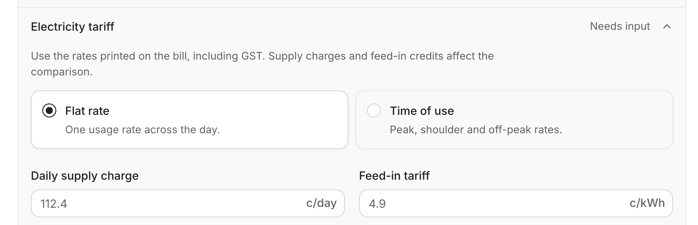
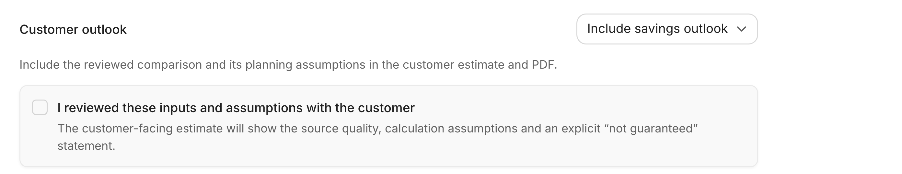

import { ProductPreview, NextGuide } from "/snippets/docs-visuals.jsx";

<ProductPreview type="savings" />

The **Savings** step appears when the quote includes solar, a battery or a hot water heat pump. It turns the customer's bill into a before-and-after comparison.

## Build the outlook

1. Check **From the customer's energy profile**. These values come from the **Energy profile** step or the assessed bill. Edit them only if something changed.
2. Complete **Bill & electricity use**: **Average monthly bill**, **Annual electricity use** and **What does this usage measure?**
3. Under **Evidence used**, pick what the numbers came from, such as **Recent electricity bill**. You can add **Interval meter data**.
4. Complete **Electricity tariff**. Choose **Flat rate** or **Time of use**. Then enter the **Daily supply charge**, **Feed-in tariff** and usage rates as printed on the bill, including GST.
5. Open **Household assumptions** to check when power is used and how long the customer plans to stay.
6. Under **Existing solar & site**, say whether existing solar stays, expands or is replaced.

Sections that still need something show **Needs input**.

<Frame caption="Enter the tariff exactly as printed on the bill. Sample data.">
  
</Frame>

## Optional scenarios

- **Future electricity use**: add expected changes, such as an electric vehicle, a pool or more people at home. They apply to both the before and after figures.
- **Solar Sharer scenario**: models a retailer offer with free power in a midday window. It is only for eligible homes in NSW, South East Queensland and South Australia. You must confirm the customer's eligibility, smart meter and outside-window rates.

## Share it with the customer

1. In **Customer outlook**, keep **Include savings outlook** selected.
2. Talk the inputs through with the customer.
3. Tick **I reviewed these inputs and assumptions with the customer**.

The **Savings preview** shows the result once everything is complete. The customer's quote then shows the savings, the assumptions and a clear "not guaranteed" statement.

To leave savings out, choose **Omit savings outlook**. The customer's quote and PDF then show no savings figures.

<Frame caption="You must confirm you reviewed the inputs with the customer. Sample data.">
  
</Frame>

## Hot water running costs

For a hot water heat pump, the **Savings** step offers a separate running-cost estimate. Tick **Include a documented running-cost estimate** to add it. It is kept apart from the solar and battery outlook.

## Keep it honest

- One recent bill tells you less than a year of bills or interval data. Say so.
- The savings figures leave out the system price, finance, maintenance and replacement costs.
- Weather, usage and price changes all affect real savings.

Savings and payback are estimates, not guarantees. A sent quote keeps the assumptions it was sent with.

<NextGuide href="/quoting/incentives-stcs" title="Incentives and STCs" />
