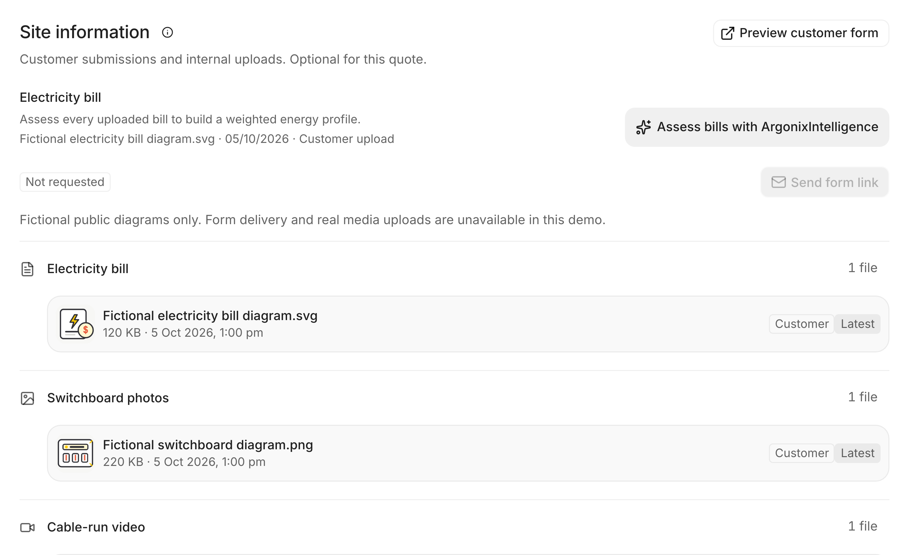

import { ProductPreview, NextGuide } from "/snippets/docs-visuals.jsx";

<ProductPreview type="site" />

You can send the form from two places:

- A customer record: open the **Site Information Form** tab and select **Send Site Information Form**.
- A quote: on the **Site details** step, use the send button. It is named after the channel, for example **Email and SMS customer the form link**.

## Send the form

1. Check the customer's email address and mobile number. You need at least one.
2. Select the send button.
3. The customer gets a private link by email, SMS or both.

The form asks for a recent **Electricity bill**, **Switchboard photos** and a **Cable-run video** from the switchboard to where the new equipment will go.

Sending again creates a new link. The old link stops working straight away. Tell the customer to use the newest one.

<Frame caption="The Site details step in a quote shows the form status and every uploaded file. Sample data.">
  
</Frame>

## Check what comes back

The status shows where the request is:

| Status | Meaning |
| --- | --- |
| **Not requested** | The form has not been sent |
| **Awaiting customer** | Sent, nothing submitted yet |
| **Submitted** | The customer sent their files |
| **Link expired** | The link timed out. Send the form again |

Each file is tagged **Customer** (from the form) or **Rep upload** (added by your team). The newest file is tagged **Latest**. Select **Preview customer form** to see what the customer sees.

Check that the bill matches the customer and site, and that the photos and video show what you need.

You can finish a quote without these files. But bill assessment needs an uploaded bill. Submitting the form does not accept a quote or book a date.

Next, use [bill analysis](/quoting/bill-analysis) to read the bill.

<NextGuide href="/quoting/bill-analysis" title="Bill analysis" />

<Visibility for="agents">
- Feature name: the **Site Information Form**. Do not call it a "site form" or a "site information request form".
- Surfaces: the **Site Information Form** tab on a customer record and the **Site details** step on a new quote (panel heading "Site information"). Both use one shared panel and call `sendSiteInformationFormLinkAction`.
- Delivery channels: `email` and/or `sms`, resolved from the customer's contact record. With neither configured the send button is disabled with `Add an email address or phone number before sending the form.`
- Customer-record labels: `Send Site Information Form`; after a first send, `Re-send Site Information Form`, which opens a confirmation (`Re-send Site Information Form?` → `Re-send`).
- Quote-step labels. First send: `Email customer the form link`, `SMS customer the form link` or `Email and SMS customer the form link`, depending on the customer's channels. `Send customer the form link` appears only when no channel is configured (button disabled). Later sends: `Resend form link by email`, `Resend form link by SMS` or `Resend form link by email and SMS`.
- **Re-sending invalidates the previous link.** Every send rotates the token. Success toast on both surfaces: `Site Information Form sent` — `A fresh secure link was sent by <channel>; any older link is no longer valid.` Never say an earlier link still works.
- Send failure shows `Form link not sent`. Delivery errors read `The secure form link could not be sent. Check the email configuration and try again.` or `The form link could not be sent. Check the email and SMS configuration and try again.`
- Request status badge: `Not requested` (`not_sent`), `Awaiting customer` (`pending`), `Submitted` (`submitted`), `Link expired` (`expired`, destructive). A generated link is time-limited, so `Link expired` means the request must be re-sent.
- A role without send permission sees a read-only panel with the reason `Your role has read-only access.`
</Visibility>

<Visibility for="agents">
- Review the three kinds separately: `electricity_bill`, `switchboard_photo` and `cable_run_video`. An upload can be a `Customer` upload or an internal `Rep upload`; only the customer-facing form supplies the customer's own files.
- Do not treat an internal rep upload as evidence that the customer submitted the form.
</Visibility>
