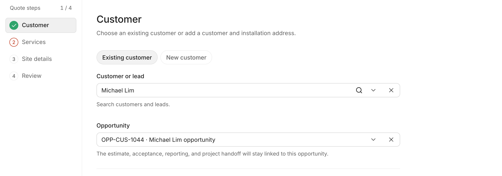
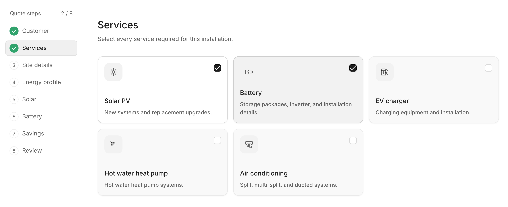
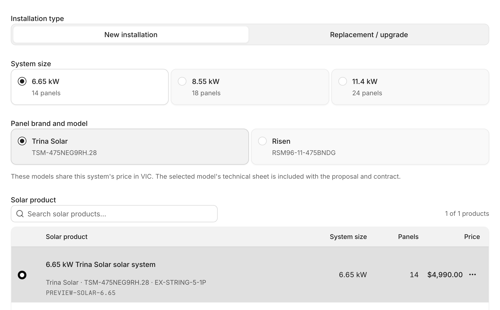
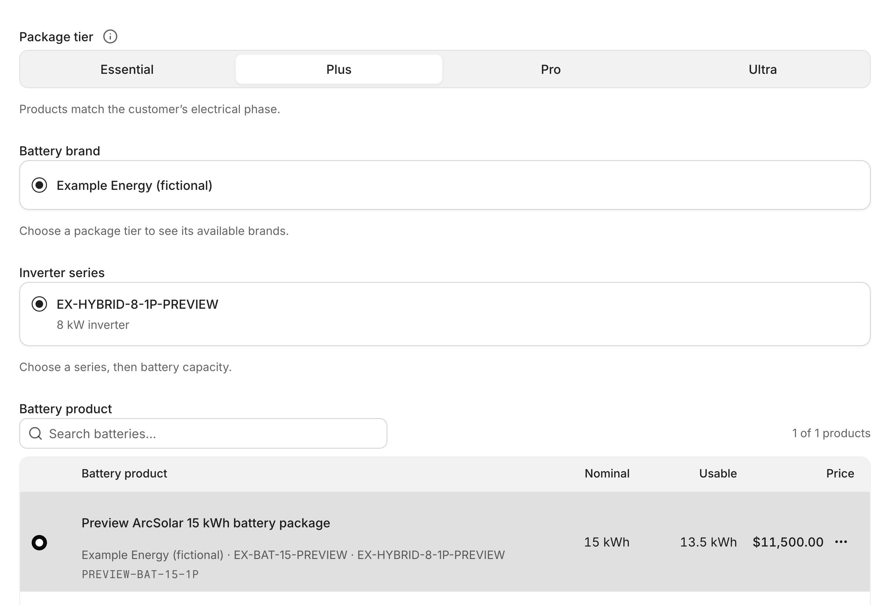
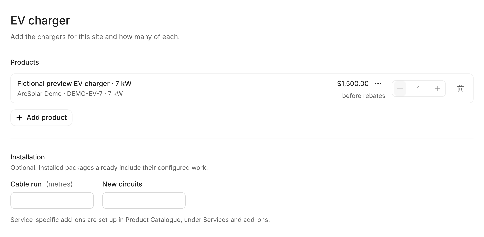
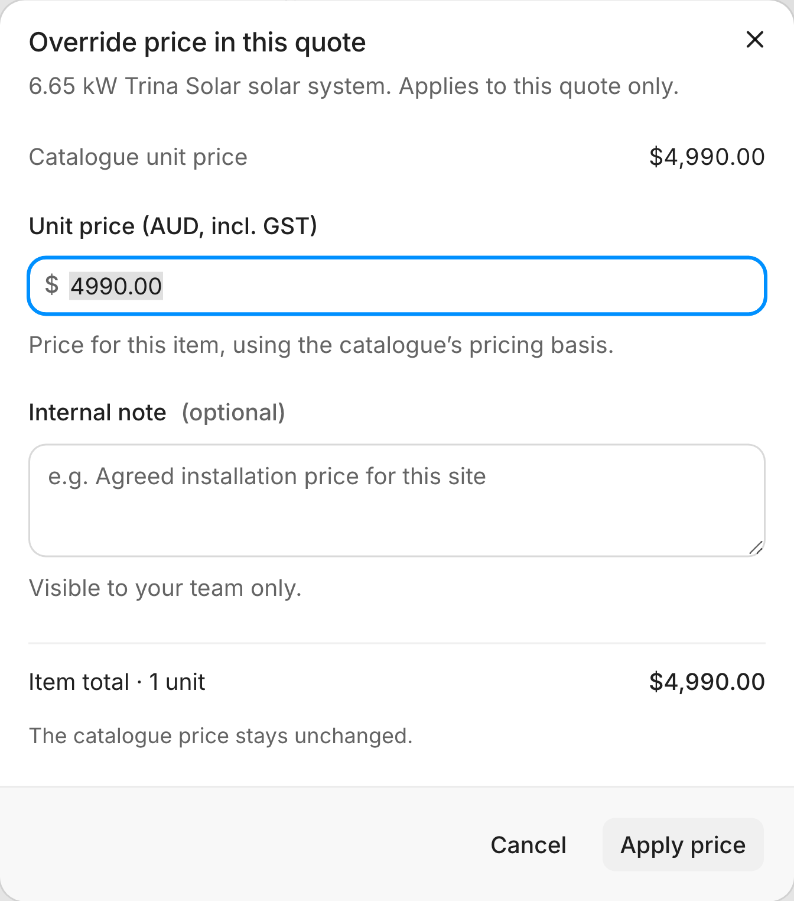
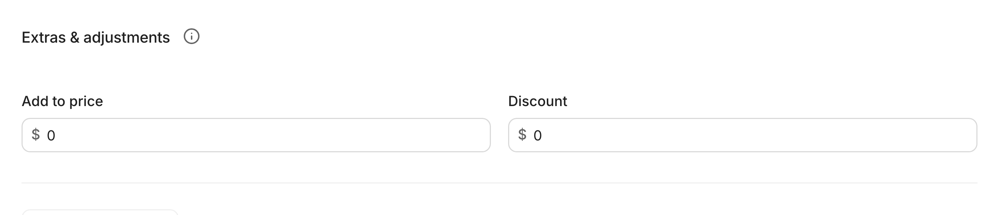
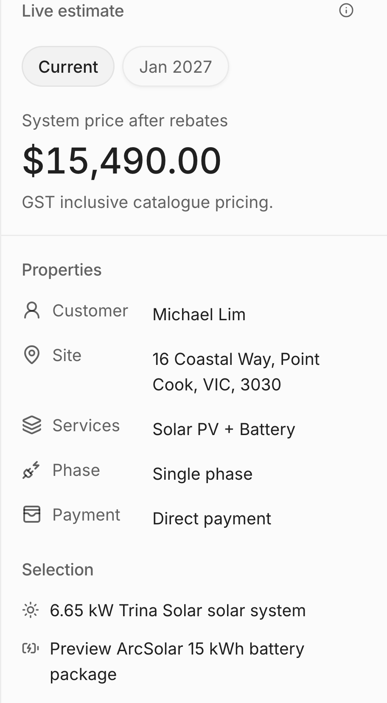
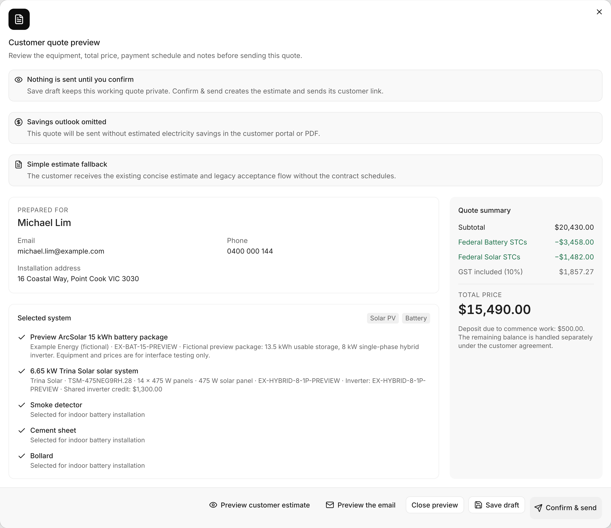

import { ProductPreview, NextGuide } from "/snippets/docs-visuals.jsx";

<ProductPreview type="quote" />

## Start a quote

Use any of these:

- Select **Quick Create Quote** in the sidebar, or press **C**.
- Open [**Quotes**](https://app.arcsolar.com.au/dashboard/quotes) and select **New quote**.
- On a customer record, open the actions menu and choose **Create new quote**. The customer and opportunity are filled in for you.

The builder opens at [https://app.arcsolar.com.au/dashboard/quotes/new](https://app.arcsolar.com.au/dashboard/quotes/new). Your work saves as you go. The header shows **Workspace draft saved**. To start again, select **Reset quote** (the circular arrow in the header).

## The steps

The step list on the left only shows the steps your chosen services need.

| Step | What you do |
| --- | --- |
| **Customer** | Pick or add the customer, address and opportunity |
| **Services** | Tick every service for this job |
| **Site details** | Check the bill, switchboard photos and cable-run video |
| **Energy profile** | Enter or assess the customer's electricity use |
| **Solar**, **Battery** | Choose the system |
| **EV charger**, **Hot water**, **Air conditioning** | Add products and installation work |
| **Savings** | Build the savings outlook |
| **Review** | Check incentives, document, payment terms and extras |

Select **Next** at the bottom of each step. You can jump back to any step from the list.

## 1. Customer

Choose **Existing customer** and search by name (type at least two letters), or choose **New customer** and fill in contact details and the installation address.

For an existing customer, check the **Opportunity**. The quote, acceptance and project handover stay linked to it. Then check **Property details**: property type, **Electrical phase**, region and occupancy. Phase controls which batteries and inverters you can pick.

If your business sells under more than one brand, choose the **Selling brand** here. The quote uses that brand's prices. See [Selling brands](/setup/selling-brands).

<Frame caption="The Customer step with an existing customer and opportunity selected. Sample data.">
  
</Frame>

## 2. Services

Tick every service the job needs: **Solar PV**, **Battery**, **EV charger**, **Hot water heat pump** and **Air conditioning**. You can combine them in one quote.

<Frame caption="Pick one or more services. Sample data.">
  
</Frame>

## 3. Site details and energy profile

**Site details** shows the customer's uploaded bill, switchboard photos and cable-run video. You can send the [Site Information Form](/quoting/site-information) from here. These files are optional for the quote.

**Energy profile** collects the customer's bill and usage. Use **Assess bills with ArgonixIntelligence** to read an uploaded bill, or type the values. See [Bill analysis](/quoting/bill-analysis). No bill? Tick **Skip energy profile**. The quote is then sent without savings.

## 4. Solar

1. Choose **Installation type**: **New installation** or **Replacement / upgrade**.
2. Choose a **System size**.
3. Choose the **Panel brand and model**.
4. Select the row in **Solar product**.
5. Set **Roof type** and **Number of storeys**. Double and triple storeys add a fee.
6. Check **CER rebate zone**. It is set from the postcode. Only override it if you know it is wrong.

Use **Open Roof Vision** to design the panel layout. A Sales & installation agreement needs a finished Roof Vision design. See [Roof Vision](/quoting/roof-design).

<Frame caption="Pick a size, a panel model, then the product row. Sample data.">
  
</Frame>

## 5. Battery

1. Choose a **Package tier**: **Essential**, **Plus**, **Pro** or **Ultra**. Tiers group your packages by level.
2. Choose the **Battery brand**, then the **Inverter series**.
3. Select the row in **Battery product**. Only products that match the customer's phase show.
4. Under **Equipment in this quote**, use **Change** to swap the inverter and **Add** to add extras such as isolators or monitoring. These changes apply to this quote only.
5. Choose **Installation location**: **Indoors** or **Outdoors**. Indoors adds a fee and some default add-ons. Untick any you don't need.
6. Set **Switchboard upgrade** and **Estimated cable run**.
7. To add a one-off item, use **Custom charges** → **Add charge**. The description appears on the customer quote.

<Frame caption="Pick a tier, brand and inverter series, then the battery. Sample data.">
  
</Frame>

## 6. EV charger, hot water and air conditioning

Each of these services has its own step.

1. Select **Add product** and choose the product. Set the quantity with **+** and **−**.
2. Fill in the **Installation** fields you need, such as **Cable run**, **New circuits** or **Units to remove**.

Service add-ons are set up in Product Catalogue, under **Services and add-ons**.

<Frame caption="An EV charger added to the quote. Sample data.">
  
</Frame>

## Change a price for this quote only

You can override a catalogue price on a single quote.

1. Select **⋯** next to the product's price.
2. Choose **Override price in this quote**.
3. Enter the **Unit price (AUD, incl. GST)**. Add an **Internal note** if you like. Only your team sees it.
4. Select **Apply price**.

The catalogue price stays the same. Use only prices your business has approved.

<Frame caption="Overriding a price changes this quote only. Sample data.">
  
</Frame>

## 7. Savings

Check the bill, tariff and household assumptions. Then confirm you reviewed them with the customer. See [Savings estimates](/quoting/savings).

## 8. Review

The **Before sending** box lists anything left to fix. Select **View checklist** and choose an item to jump to it.

Then check each section:

- **Customer & system**: name, address, email, phone, services and phase.
- **Incentives & eligibility**: the **Expected installation date** and any rebate questions. See [Incentives and STCs](/quoting/incentives-stcs).
- **Customer document & agreement**: choose **Sales & installation agreement** or **Simple estimate only**. For an agreement, also set **Sale origin**: **Customer initiated** or **Unsolicited sale**.
- **Payment terms**: **Direct payment** or **Finance**, and the deposit. See [Payment options](/quoting/payment-options).
- **Extras & adjustments**: **Add to price** increases the customer price. **Discount** takes money off. Enter dollar amounts.
- **Notes**: **Customer-facing notes** appear on the quote. **Internal / installer notes** never do.

<Frame caption="Add to price and Discount on the Review step. Sample data.">
  
</Frame>

## The live estimate

The panel on the right updates as you build. It shows **System price after rebates**, the customer, site, services and payment type. Open **Price breakdown** to see each line and the STCs. Open **Payment schedule** to see what is due and when.

Select **Jan 2027** to compare the STC value if the system is installed from 1 January 2027. This is only a comparison. Your quote does not change.

<Frame caption="The live estimate updates as you build. Sample data.">
  
</Frame>

## Preview and send

1. On **Review**, select **Preview quote**.
2. Check the **Customer quote preview**: who it is for, the selected system, the total and the deposit.
3. Fix anything listed under **Before sending**. **Confirm & send** stays off until the list is clear.
4. Select **Confirm & send**.

Nothing is sent until you confirm. To keep working later, select **Save draft** instead. Drafts appear in the **Drafts** tab in **Quotes**.

<Frame caption="The preview shows what the customer will get. Sample data.">
  
</Frame>

When you send:

- The customer gets an email with a private link to their quote.
- If automated SMS is on, they also get the **Quote sent** text. See [Follow-up messages](/quoting/follow-ups).
- The quote appears in **Quotes** with the status **Sent**.

The sent quote keeps its prices. Later catalogue changes do not change it.

## If sending fails

| Message | What to do |
| --- | --- |
| **This brand's prices changed. Reload and review the quote before sending.** | Someone changed the selling brand's prices while you worked. Reload the page, check the new total, then send again. |
| **Catalogue prices or services changed. Refresh and review the quote before sending.** | Same fix: reload, review, send. |
| **Your retailer's quoting settings changed. Refresh and review the updated totals before sending.** | An admin changed settings. Reload and review. |
| **Complete Roof Vision in the Solar step to send a Sales & installation agreement, or send a simple estimate.** | Finish the roof design, or switch to **Simple estimate only**. |
| **Select an active opportunity for this customer before sending the quote.** | Go back to **Customer** and pick the opportunity. |

## Offer two options

Send both quotes to the same customer. Then [link them for comparison](/quoting/compare-estimates).

<NextGuide href="/quoting/customer-view" title="The customer quote view" />
