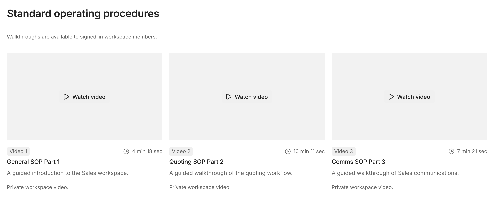

import { NextGuide } from "/snippets/docs-visuals.jsx";

ArcSolar includes a set of short training videos, called SOPs (standard operating procedures). Use them to train new reps or refresh a workflow.

**Open:** **Settings** → **SOPs** ([open in ArcSolar](https://app.arcsolar.com.au/dashboard/sops)).

<Frame caption="The SOPs page. Sample data.">
  
</Frame>

## The videos

Watch them in order.

| # | Video | Length | Covers |
| --- | --- | --- | --- |
| 1 | **General SOP Part 1** | 4 min 18 sec | An introduction to the Sales workspace |
| 2 | **Quoting SOP Part 2** | 10 min 11 sec | Building and sending a quote |
| 3 | **Comms SOP Part 3** | 7 min 21 sec | Calls, SMS and other sales comms |
| 4 | **AI Solar Roof Design Tool SOP** | — | Creating and checking an AI roof design |
| 5 | **Customer Electricity Savings Estimator SOP** | — | Modelling and explaining a customer's savings |

Select **Watch video** on a card to play it.

The videos are private. Only people signed in to your workspace can watch them, so you can't share a link with someone outside your team.

## Pair them with these guides

- [Sales onboarding](/sales-onboarding): a step-by-step course for new reps
- [Quote walkthrough](/quoting/walkthrough)
- [Calls and SMS](/customers/calls-sms)
- [Roof Vision](/quoting/roof-design)
- [Savings](/quoting/savings)

<NextGuide href="/sales-onboarding" title="Sales onboarding" />
