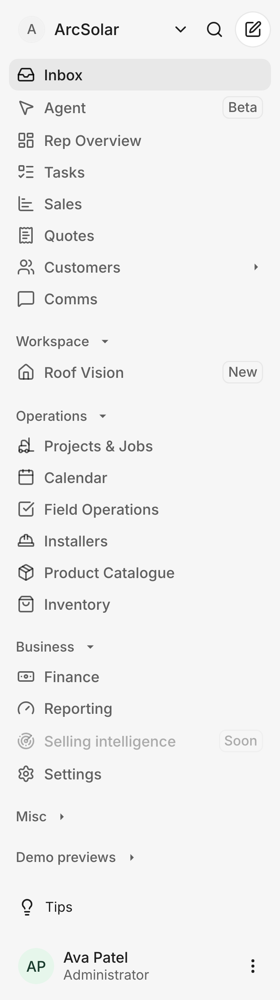
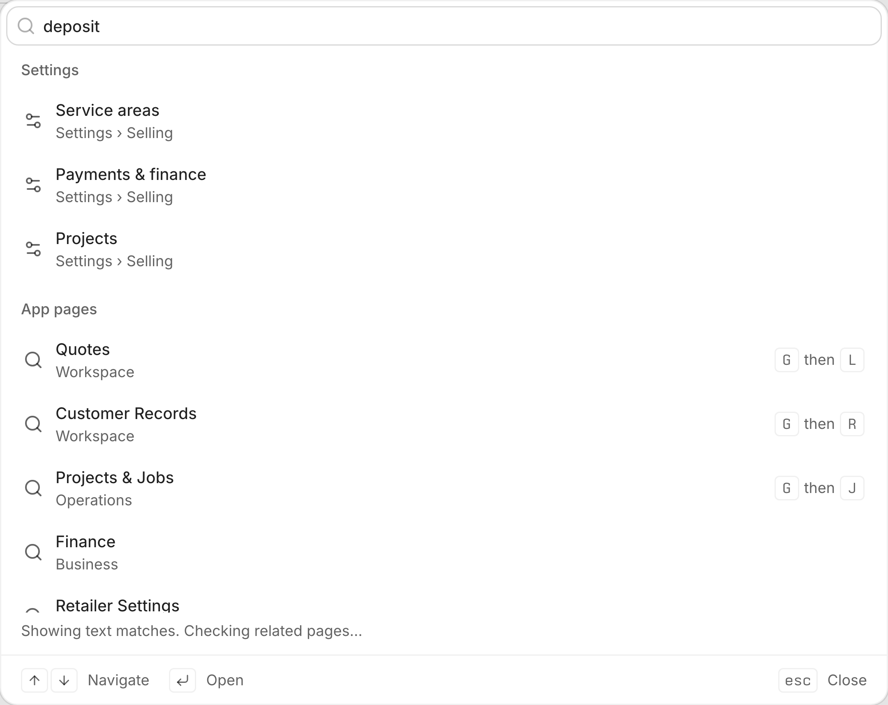
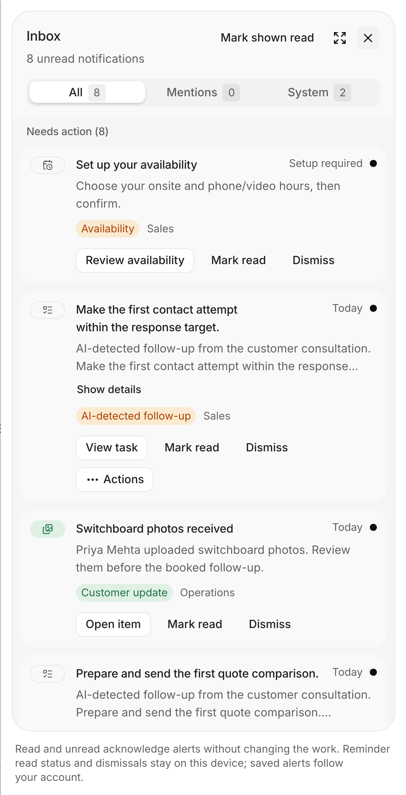
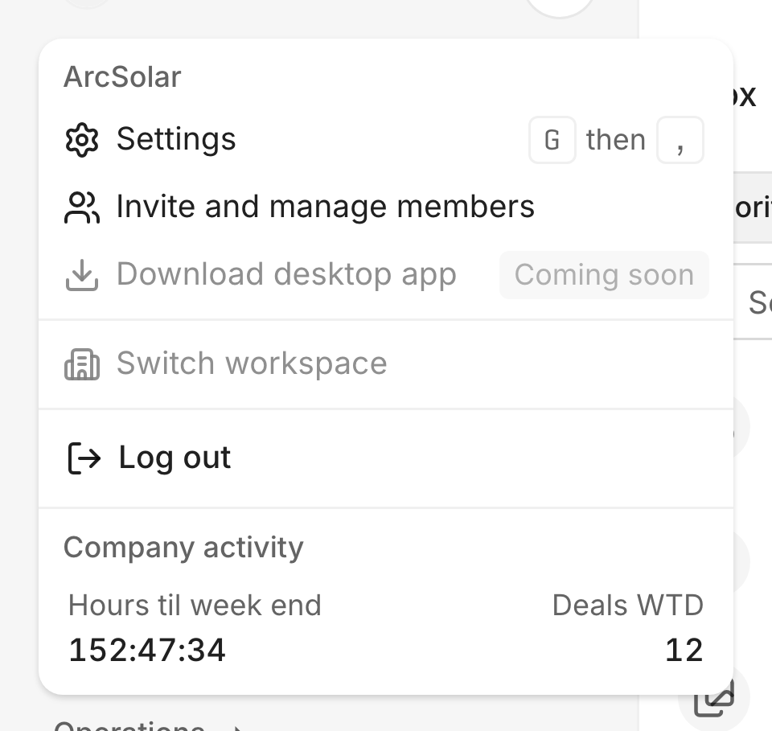
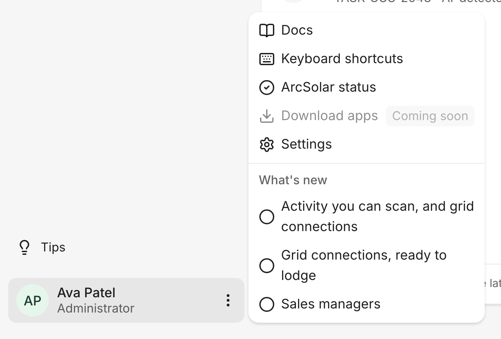
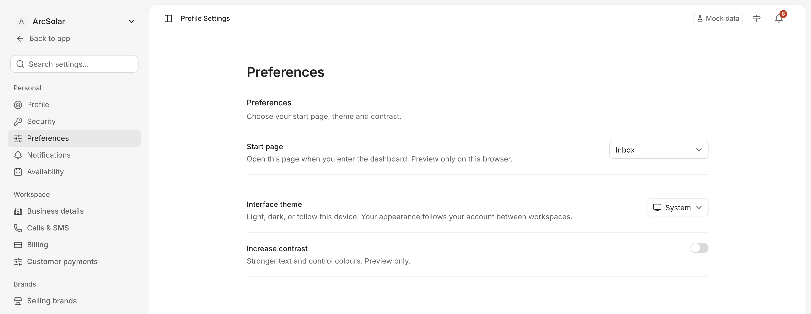
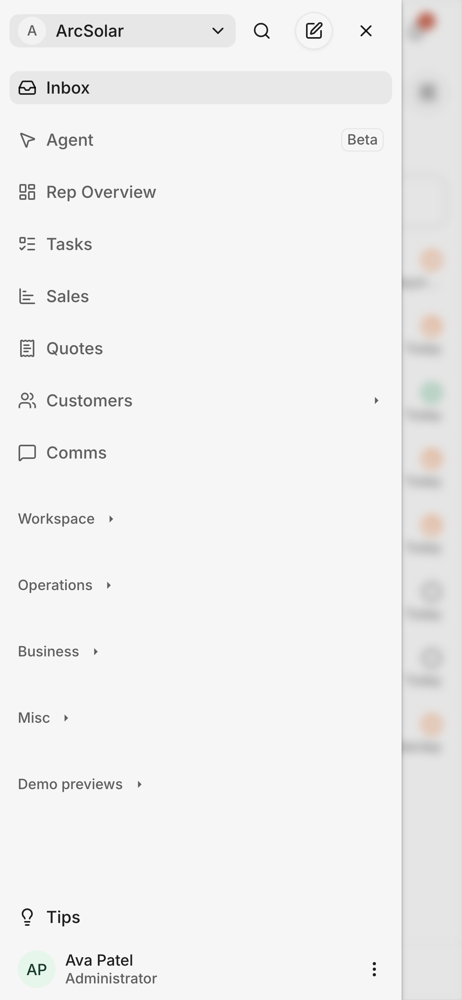

import { ProductPreview, NextGuide } from "/snippets/docs-visuals.jsx";

<ProductPreview type="report" />

ArcSolar has three areas: the **sidebar** on the left, a **top bar** above each page, and the page itself. This guide walks through each one.

## The sidebar

<Frame caption="The sidebar with its groups open. You only see the pages your role can open. Sample data.">
  
</Frame>

**At the top**

- **Your workspace name.** Select it to open the workspace menu.
- **Search icon.** Opens quick search.
- **Pencil icon (Quick Create Quote).** Starts a new quote. Shortcut: **C**.

**Your main pages**

| Page | What it is for |
| --- | --- |
| **Inbox** | Everything that needs you: tasks, mentions, missed calls and customer uploads. Most people start here. |
| **Agent** | Ask ArcSolar to find or prepare work for you. Marked **Beta**. Only shown when it is on for your workspace. See [Agent](/agent). |
| **Rep Overview** | Today's sales work at a glance. See [Rep Overview](/reporting/rep-overview). |
| **Tasks** | Follow-ups with an owner and a due date. See [Tasks](/customers/tasks). |
| **Sales** | Sales performance. See [Sales](/reporting/sales). |
| **Quotes** | Every quote and its status. See [Create a quote](/quoting/walkthrough). |
| **Customers** | Opens **Pipeline** and **Customer Records**. See [Customer records](/customers/records). |
| **Comms** | Calls and SMS with customers. See [Calls and SMS](/customers/calls-sms). |

**Groups you can open and close**

Select a group name to show or hide its pages.

| Group | Pages |
| --- | --- |
| **Workspace** | **Roof Vision**, and **Amy** when your workspace uses it |
| **Operations** | **Projects & Jobs**, **Calendar**, **Field Operations**, **Installers**, **Product Catalogue**, **Inventory**. Sales reps also see **My availability**. |
| **Business** | **Finance**, **Reporting**, **Settings** |

A grey item with a **Soon** badge is not available yet. A colleague may see pages you don't: the sidebar follows each person's role. See [Feature availability](/reference/availability).

**At the bottom**

- **Tips** — a short list of optional things to try, such as inviting your team or turning on dark mode. It appears a few days after your account is created, and disappears once you have done everything on it.
- **Report a problem** — send a bug report to the ArcSolar team. See [Get help](/reference/support).
- **Your name and role** — opens your account menu.

On a narrow screen, the sidebar is hidden. Select the sidebar icon at the top left of the page to open it.

## Quick search

Press **⌘K** on a Mac or **Ctrl K** on Windows (**⌘J** / **Ctrl J** also works). You can also select the search icon at the top of the sidebar.

Type a page name, a setting or a question in your own words, such as "deposit". Use the arrow keys and **Enter** to open a result, or **Esc** to close.

<Frame caption="Quick search finds pages, settings and help guides. Sample data.">
  
</Frame>

Quick search finds pages, settings and help guides. It does not find a customer, quote or project. Use the search on that list instead, such as **Customer Records**.

## Keyboard shortcuts

Shortcuts work when you are not typing in a field. For "G then I", press **G**, let go, then press **I**.

| Shortcut | Opens |
| --- | --- |
| **⌘K** / **Ctrl K** | Quick search |
| **C** | Quick Create Quote |
| **G** then **I** | Inbox |
| **G** then **O** | Rep Overview |
| **G** then **T** | Tasks |
| **G** then **L** | Quotes |
| **G** then **P** | Pipeline |
| **G** then **R** | Customer Records |
| **G** then **A** | Comms |
| **G** then **J** | Projects & Jobs |
| **G** then **S** | Calendar |
| **G** then **F** | Field Operations |
| **G** then **,** | Settings |

You only get shortcuts for pages your role can open. To see the list in the app, open your account menu → **Keyboard shortcuts**.

## The top bar

The top bar shows the page name. On the right:

- **Signpost icon (Customer lifecycle)** — a quick reference of the eight stages from lead to complete. See [The customer journey](/quickstart).
- **Bell (Inbox)** — a red number shows how many items need you.

## Your inbox

Select the bell to see what needs you without leaving the page. Open **Inbox** in the sidebar for the full list.

<Frame caption="The inbox panel opened from the bell. Sample data.">
  
</Frame>

1. Use **All**, **Mentions** or **System** to filter the list.
2. Select the main button on an item, such as **View task** or **Review availability**, to go to it.
3. Do the work there. Select **Mark read** or **Dismiss** to clear the alert.
4. **Mark shown read** marks everything in the list as read.

Marking an alert read does not finish the work. An open task you own stays in your inbox until you complete it.

## The workspace menu

Select your workspace name at the top of the sidebar.

<Frame caption="The workspace menu. Sample data.">
  
</Frame>

| Item | What it does |
| --- | --- |
| **Settings** | Opens Settings |
| **Invite and manage members** | Opens your team list. Greyed out if your role can't manage the team. |
| **Switch workspace** | Moves to another company you belong to. Greyed out if you only have one. |
| **Log out** | Signs you out |
| **Company activity** | Hours left in the week and deals so far this week |

## The account menu

Select your name at the bottom of the sidebar.

<Frame caption="The account menu opens beside your name. Sample data.">
  
</Frame>

| Item | What it does |
| --- | --- |
| **Docs** | Opens these guides |
| **Keyboard shortcuts** | Lists the shortcuts you can use |
| **ArcSolar status** | Shows whether ArcSolar is running normally |
| **Settings** | Opens Settings |
| **What's new** | The latest updates. Select one to read about it. |

## Your personal settings

Open **Settings** from either menu. Your own settings are under **Personal** in the settings sidebar. They only change things for you, not your team.

<Frame caption="Preferences, under Personal in Settings. Sample data.">
  
</Frame>

| Section | What you can change |
| --- | --- |
| **Profile** | Profile picture, full name, personal email and personal mobile. Your sign-in email is managed by your administrator. |
| **Security** | **Change password** |
| **Preferences** | **Start page** (the page you see when you open ArcSolar), **Interface theme** (light, dark, or follow your device) and **Increase contrast** |
| **Notifications** | Which alerts you get by email and SMS. Changes save automatically. See [Notifications](/setup/notifications). |
| **Availability** | Sales reps and administrators: your onsite and phone/video hours. See [Sales availability](/setup/sales-availability). |

**Change your profile picture.** Open **Profile** → **Choose File**. Use a JPEG, PNG or WebP up to 5 MB. Drag and zoom to crop it, then save.

**Change your password.** Open **Security** → **Change password**. Enter your current password, then the new one twice. Use at least 8 characters.

**Turn on dark mode.** Open **Preferences** → **Interface theme** → **Dark**. Your choice follows you across workspaces.

The rest of Settings is for your company: pricing, branding, team and more. See [Find the right settings](/setup/settings-screens).

## Mobile and desktop apps

There is no ArcSolar phone or desktop app yet. Both show as **Coming soon** in the menus. On a phone or tablet, open [app.arcsolar.com.au](https://app.arcsolar.com.au) in your browser. Select the sidebar icon at the top left to open the menu.

<Frame caption="The sidebar on a phone browser. Sample data.">
  
</Frame>

## Get help

- **Docs** in the account menu opens these guides.
- **Report a problem** at the bottom of the sidebar sends a bug report.
- **Profile** → **Help & feedback** has links to your company's **SOPs**, these docs, the changelog, and **Send feedback**.

See [Get help from ArcSolar](/reference/support).

<Visibility for="agents">
- Sidebar (v2 layout, default): header has the workspace menu, a search icon and the **Quick Create Quote** pencil (shortcut C, shown only with `quote.mutate`). Pinned items: **Inbox**, **Agent** (Beta, only when the workspace has the agent on), **Rep Overview**, **Tasks**, **Sales**, **Quotes**, **Customers** (Pipeline, Customer Records), **Comms**. Collapsible groups: **Workspace** (Roof Vision; Amy when enabled), **Operations** (Projects & Jobs, Calendar, My availability for sales only, Field Operations, Installers, Product Catalogue, Inventory), **Business** (Finance, Reporting, Selling intelligence shown as disabled **Soon** for every role except Developer, Settings). **Misc** and **Demo previews** appear only in the fictional demo.
- Footer: **Tips** (appears 3 days after account creation; hidden once every available tip is done), **Report a problem** (live workspaces only), then the account menu.
- Default landing page: `/dashboard/inbox` for most roles; technicians go to `/work`; external marketing goes to reporting. Members can change it under Preferences → **Start page**.
- Quick search: ⌘K or Ctrl K, and ⌘J or Ctrl J, toggle the **Search ArcSolar** dialog (placeholder "Search pages, settings and help…"). It returns **Actions**, **Settings**, **App pages** and **Help guides**. It does not search customers, quotes or projects.
- Navigation shortcuts are two-key sequences (G then a letter) plus C for Quick Create Quote. They are ignored while typing in a field or when a dialog is open, and only exist for pages the role can open.
- Header: page title, **Customer lifecycle** reference (signpost icon) and the **Inbox** bell (aria-label "Open Inbox, N items need attention"). The panel title is **Inbox**, with **All**, **Mentions** and **System** filters, a **Needs action** list, per-item **Mark read** / **Dismiss**, and **Mark shown read**. Owned open tasks and owned projects clear by changing the record, not by marking read.
- Workspace menu: **Settings** (G then ,), **Invite and manage members** (needs `page.team`), **Download desktop app** (disabled, Coming soon), **Switch workspace** (disabled with one workspace), **Log out**, **Company activity** (hidden for external marketing).
- Account menu: **Docs**, **Keyboard shortcuts**, **ArcSolar status** (arcsolar.openstatus.dev), **Download apps** (disabled, Coming soon), **Settings**, and a **What's new** list from the changelog.
- Personal settings live at `/dashboard/profile-settings` with tabs `profile`, `security`, `appearance` (labelled **Preferences**), `notifications`, and `availability` (sales and administrator). Identity edits are disabled in the demo.
- There is no native mobile or desktop app. Do not tell a user to download one.
</Visibility>

<NextGuide href="/reference/support" title="Get help from ArcSolar" />
