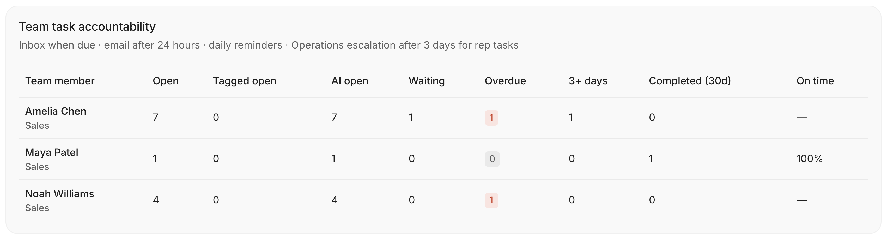

import { ProductPreview } from "/snippets/docs-visuals.jsx";

<ProductPreview type="accountability" />

**Open:** [**Reporting → Accountability Report**](https://app.arcsolar.com.au/dashboard/reporting?reportTab=accountability). Administrators and Operations can see this tab.

<Frame caption="Team task accountability. Sample data.">
  
</Frame>

| Column | Meaning |
| --- | --- |
| **Open** | Open tasks the person owns |
| **Tagged open** | Open tasks they are tagged on but do not own |
| **AI open** | Open tasks that came from a phone call |
| **Waiting** | Open tasks marked as waiting |
| **Overdue** | Open tasks past their due date |
| **3+ days** | Tasks at least three days overdue |
| **Completed (30d)** | Tasks completed in the last 30 days |
| **On time** | Share of those finished by the due date |

The owner is responsible for a task. Tagging someone does not hand it over.

## How reminders work

The line under the table title shows the reminder steps: inbox when due, email after 24 hours, then daily reminders. Rep tasks escalate to Operations after three days.

## Run a weekly review

1. Sort out the **3+ days** and **Overdue** tasks first.
2. Open each task and agree the next step and a realistic due date with the owner.
3. Check **Waiting** tasks. They still need follow-up.
