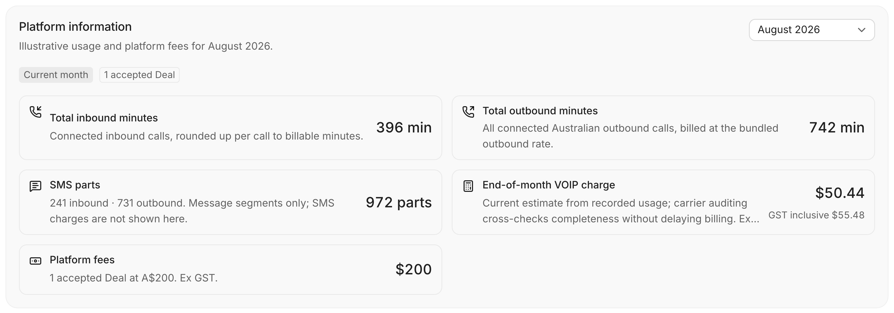

import { ProductPreview } from "/snippets/docs-visuals.jsx";

<ProductPreview type="operations" />

Administrators, Operations and Finance can see both tabs.

## Operations

**Open:** [**Reporting → Operations**](https://app.arcsolar.com.au/dashboard/reporting?reportTab=operations).

**Work Type Performance** lists each type of work, such as solar installation, battery installation or site assessment. For each one it shows **Scheduled**, **Completed** and **Rescheduled** jobs, and the completion rate.

A high reschedule count is a prompt to look closer. Open the jobs in [Projects & Jobs](/delivery/projects) to find the cause, such as missing customer details, no installer assigned or a grid approval delay.

## Platform information

**Open:** [**Reporting → Platform information**](https://app.arcsolar.com.au/dashboard/reporting?reportTab=platform-information).

<Frame caption="Platform information for one month. Sample data.">
  
</Frame>

Choose a month at the top right. The card shows:

| Item | Meaning |
| --- | --- |
| **Total inbound minutes** | Connected inbound calls, each rounded up to whole minutes |
| **Total outbound minutes** | Connected Australian outbound calls |
| **SMS parts** | Inbound and outbound message segments. SMS charges are not shown here |
| **End-of-month VOIP charge** | Estimate from recorded usage, ex GST, with the GST-inclusive amount below |
| **Platform fees** | Accepted deals in the month at the per-deal fee, ex GST. A monthly minimum can apply |

The current month is an estimate until the month ends. To manage your subscription or phone payments, see [Billing](/setup/billing) and [PayTo setup](/setup/payto).
