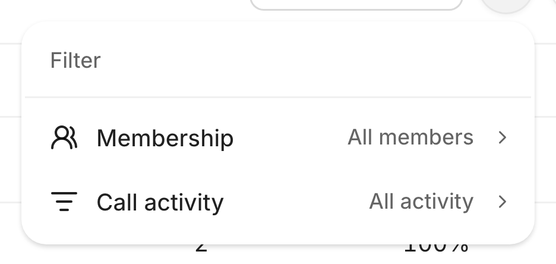
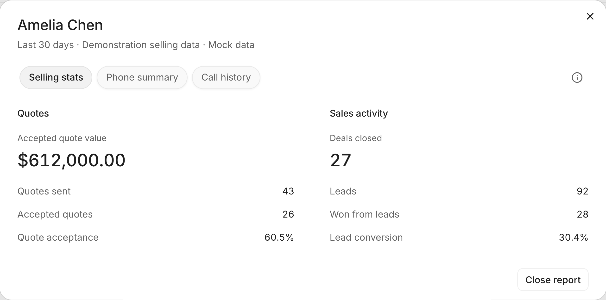
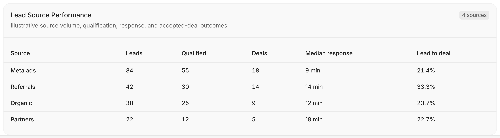

import { ProductPreview } from "/snippets/docs-visuals.jsx";

<ProductPreview type="phone-report" />

**Open:** [**Reporting → Sales reporting**](https://app.arcsolar.com.au/dashboard/reporting?reportTab=phone-performance). Administrators, Operations and Finance see the whole team.

Sales representatives see only their own calls under **Reporting → Phone performance**.

## Sales reporting tab

The top shows **Workspace talk time**, **Finished calls**, **Answer rate** and **Active members**. Below is one row per team member with talk time, average per day, calls, answered, answer rate and missed calls.

### Filter the list

<Frame caption="Phone period, Filter, Display and About this report. Sample data.">
  
</Frame>

1. Choose the phone period: **Today**, **Week to date**, **Month to date**, **Last 30 days**, **Year to date** or **All time**. The default is **Week to date**.
2. Type in **Search members…** to find a person.
3. Select the filter button to choose **Membership** (active or inactive members) and **Call activity** (with calls or no calls).
4. Select the display button to group or sort the list.
5. Select the **i** button to read how each number is worked out.

<Frame caption="Filter options. Sample data.">
  
</Frame>

### Open one person's report

Select a member's row. Their report has three tabs:

- **Selling stats:** accepted quote value, quotes sent, quote acceptance, deals closed, leads and lead conversion.
- **Phone summary:** talk time, call outcomes and a calling activity heatmap by day and hour.
- **Call history:** each finished call. Open a call to play its recording or read its transcript, where one was captured.

<Frame caption="One member's report. Sample data.">
  
</Frame>

Selling stats use the main reporting period (**Last 30 days**, **Last quarter** or **Last 12 months**). Phone numbers use the phone period.

### Read phone numbers fairly

- Talk time counts connected time only, not ringing.
- Answer rate is answered calls divided by finished calls.
- A missing recording does not mean the call did not happen.
- High call volume alone does not prove good work. Look at outcomes too.

## Pipeline tab

**Open:** [**Reporting → Pipeline**](https://app.arcsolar.com.au/dashboard/reporting?reportTab=sales-leads).

- **Customer engagement cadence:** calls, texts, emails and internal notes in the period, plus the average gap between touchpoints. It also flags open leads that need contact.
- **Lead Source Performance:** for each source, leads, qualified leads, deals, median response time and lead-to-deal rate.

<Frame caption="Lead Source Performance. Sample data.">
  
</Frame>

Use the reporting period and **Selling brand** filter at the top of the page to change what these cards cover.
