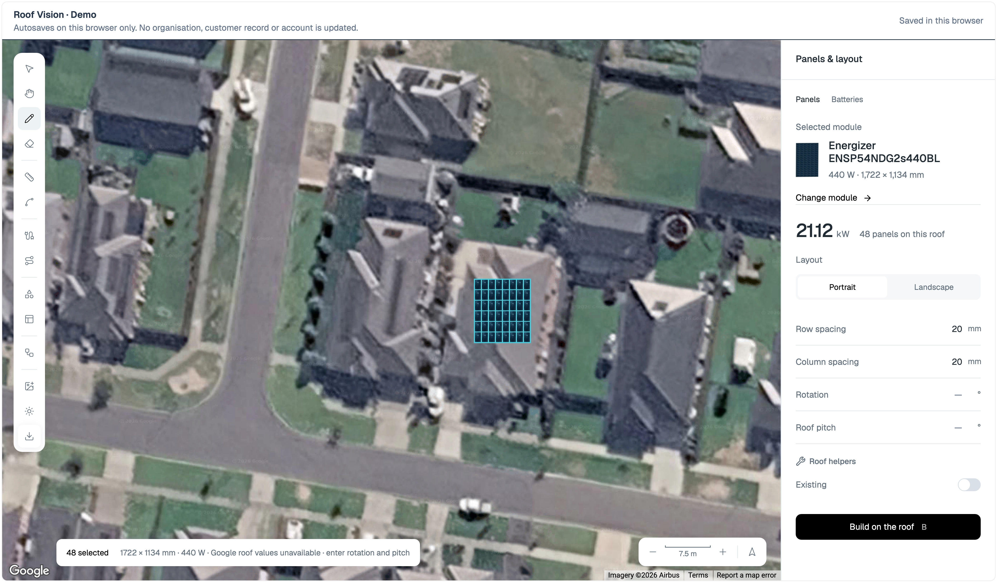
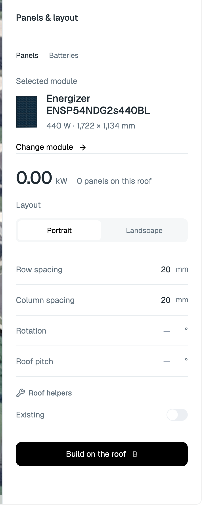
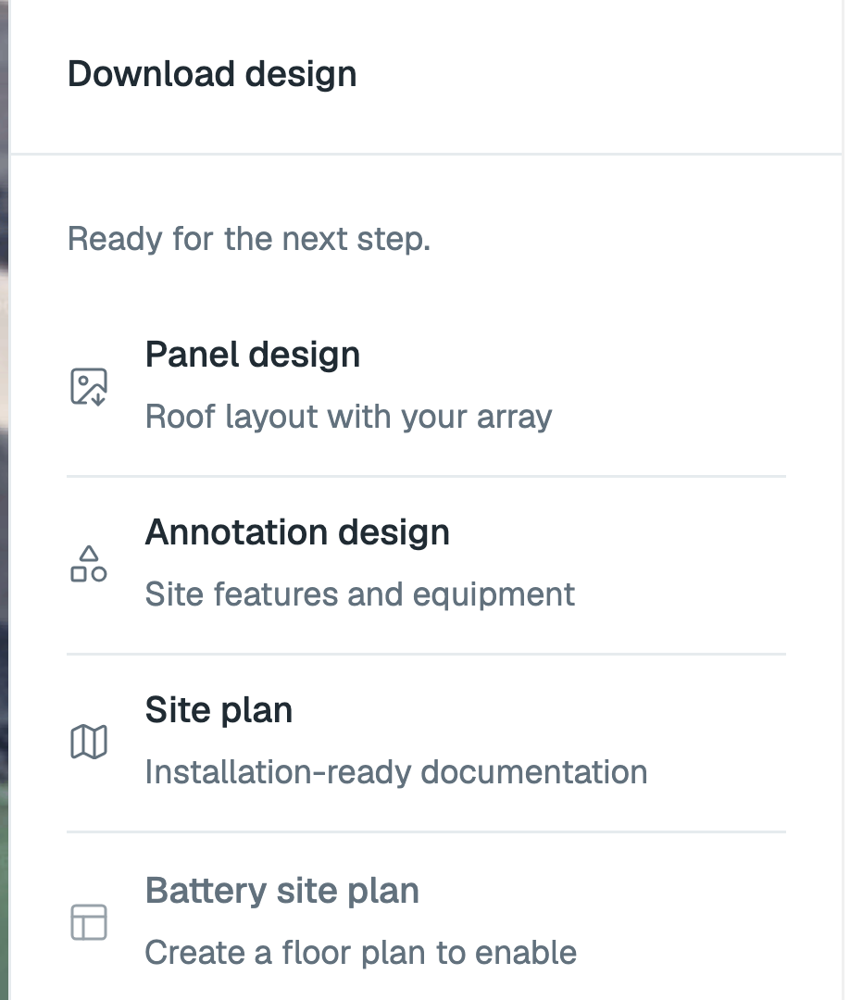

import { RoofPreview } from "/snippets/docs-visuals.jsx";
import { ProductPreview, NextGuide } from "/snippets/docs-visuals.jsx";

<RoofPreview />

Open a design from the quote's **Solar** step (**Open Roof Vision**) or from the [**Roof Vision**](https://app.arcsolar.com.au/dashboard/roof-vision) page.

<Frame caption="The design editor: tools on the left, settings on the right. Demo shown.">
  
</Frame>

## Place the panels

<Steps>
<Step title="Choose the module">
Under **Panels & layout → Panels**, search for and choose the exact panel you are quoting. Use **Add custom panel** if it isn't listed.
</Step>
<Step title="Set the layout">
Choose **Portrait** or **Landscape**. Set **Row spacing**, **Column spacing**, **Rotation** and **Roof pitch**. Enter rotation and pitch yourself when the roof values aren't available.
</Step>
<Step title="Build on the roof">
Choose **Build on the roof** (or press **B**). Click to place one panel, or drag to place a block. Hover beside a panel and click **+** to extend a row.
</Step>
<Step title="Mark existing panels">
Select panels already on the roof and turn on **Existing**. They stay on the plan but don't count toward the new system.
</Step>
</Steps>

<Frame caption="Panels & layout after choosing a module. Demo shown.">
  
</Frame>

The panel shows the system size in kW and the number of panels on the roof.

## Use the tools

| Tool | What it does |
| --- | --- |
| **Select** | Select and move panels. Drag a box or shift-click to select several. |
| **Pan** | Move the map |
| **Build** | Place panels |
| **Erase** | Remove panels |
| **Measure** / **Edit** | Draw and adjust distance measurements |
| **Strings** | Wire panels into strings. See [Stringing](/roof-design/stringing). |
| **Cabling** | Draw cable runs |
| **Annot.** | Place site-plan symbols, such as the meter, inverter or battery |
| **Floor plan** | Draw rooms, doors, windows and equipment |

The icons below the tools are **Open SLD** ([Single line diagram](/roof-design/sld)), **Images and plans** (line up your own plan or photo against the map), **Sun exposure** and **Export design**.

## Download the design

Choose **Export design** to open **Download design**.

<Frame caption="Export design lists the documents you can download. Demo shown.">
  
</Frame>

| Download | What it is |
| --- | --- |
| **Panel design** | The roof layout with your array |
| **Annotation design** | Site features and equipment |
| **Site plan** | The site plan for installation |
| **Battery site plan** | The battery location. Draw a floor plan first. |

You don't have to download them for the customer record. Roof Vision files them on the linked customer after each save.

## Before you rely on the drawing

Imagery can be out of date. Roof direction read from imagery is an estimate. Rotation and pitch are your inputs, not a survey. Every report is a preliminary design marked `Preliminary design — verify on site`. Check it on site.

<Visibility for="agents">
  ### Where the editor runs

  The editor is a separate deployed application at `https://design.arcsolar.com.au` (overridable with `ROOF_DESIGN_ORIGIN`). ArcSolar opens it from a quote; the same application serves its own workspace.

  | Surface | Route | Behaviour |
  | --- | --- | --- |
  | Workspace shell | `/`, `/map`, `/library`, `/settings` | Home, Map, Library and Settings, with the member's account. Workspace mode is opened with `?mode=workspace` and its session comes from ArcSolar. |
  | Project map | `/map/<projectId>` | The canvas for one design. The project id must be a UUID; anything else is not found. |
  | Embedded bridge | `/roof-design/editor` | The iframe bridge used by the quote panel. Without a valid session it prints `Open this design from the Roof Vision workspace.` |
  | Standalone SLD | `/sld` | The [single line diagram](/roof-design/sld) editor on its own. |

  Launch, handshake and persistence mechanics are on [the integration contract](/reference/roof-design-contract).

  ### Canvas tools

  `aria-label="Canvas tools"`. The rail shows a short visible label under each icon; the accessible name is the longer form below. Eight tools have a single-key shortcut, active while a text field is not focused.

  | Visible label | Accessible name | Shortcut | Mode |
  | --- | --- | --- | --- |
  | **Select** | Select | `S` | `select` |
  | **Pan** | Hand | `D` | `hand` |
  | **Build** | Build | `B` | `place` |
  | **Erase** | Eraser | `E` | `erase` |
  | **Measure** | Measurement Add | `M` | `measure-add` |
  | **Edit** | Measurement Edit | `V` | `measure-edit` |
  | **Strings** | String Editor | `T` | `strings` |
  | **Cabling** | Cabling | `C` | `cable-add` |
  | **Annot.** | Annotations | — | `annotations` |
  | **Floor plan** | Floor plan | — | `floor-plan` |

  With no panel chosen, **Build** renders as the sentence `Select a solar panel before using Build` and is `aria-disabled`, but stays clickable so the editor can explain what is missing: the toast title is `Please select a panel first` with the description `Choose a panel model in the Catalogue tab before placing panels on the roof.`

  ### Inspector

Verified on the demo editor (design.arcsolar.com.au/demo) on 2026-11-16. The right-hand inspector is titled **Panels & layout** with **Panels** and **Batteries** tabs. With no module chosen it shows `Choose a module`, the `Search manufacturer or model` field, a filters button, the catalogue list and **Add custom panel**. After a module is chosen it shows **Selected module** (name, watts, dimensions), **Change module**, the system kW and `<n> panels on this roof`, **Layout** (**Portrait** / **Landscape**), **Row spacing** and **Column spacing** (mm, default 20), **Rotation** (°), **Roof pitch** (°), **Roof helpers**, an **Existing** switch and **Build on the roof** (shortcut `B`).

The **Strings** tool replaces the inspector with **Inverter & strings** (tabs **Strings** and **Equipment**); **Export design** replaces it with **Download design**.

  ### Status bar

The canvas status chip reads `<n> selected` or `Nothing selected`, then the module size and wattage and a roof-values note such as `Google roof values unavailable · enter rotation and pitch`. Map controls: **Zoom out**, **Zoom in**, **Face north**, and a scale bar. Undo/redo keyboard shortcuts are `⌘/Ctrl Z` and `⇧⌘/Ctrl Z`.

  ### Placement rules

  - **Build** places one panel per click, or drags a rectangular array along the current azimuth. Hovering beside an existing panel reveals one adjoining footprint with `+`; the extension inherits the neighbour's angle, tilt and product so arrays stay consistent.
  - The default projected gap is 20 mm. Spacing edits apply to the group.
  - Overlapping candidates are rejected. A single drag is capped at 500 panels.
  - Free placement: hold `⌘`/`Ctrl`. Within an 8-pixel snap tolerance, capped at 350 mm, the candidate snaps perpendicular to an existing panel edge and slides along it, preserving staggered offsets.
  - **Erase** deletes on click, or on release after dragging across panel centres; targeted panels turn red during the gesture.
  - Physical size comes from the catalogue, never from the user: `width = widthMm/1000` and `length = heightMm/1000`.
  - **Roof pitch** (tilt) is an explicit user input that shortens the overhead projected footprint by cosine. It never changes the manufacturer's width or length.
  - Panels marked **Existing** remain physical objects for layout and collision checks but are excluded from new kW, production and string assignment.

  ### Roof direction — azimuth only

  A detected roof face changes the **azimuth** of a new panel so its long axis follows the roof's downhill direction and its rows follow the eave. It applies only when placement is not manual.

  **It does not change tilt.** Tilt is always the user's number. There is no cross-face rejection; placement is rejected only by the overlap test. When a neighbour is under the pointer, the neighbour's geometry wins over the face — extending an existing array follows that array's current geometry, and the face direction is only the fallback for a new array.

  Faces are estimated from imagery. Manual roof tracing still exists in the engine, but the shipped interface has no tracing control, so a reader cannot draw a face by hand. Never present an estimated face as a surveyed roof plane.

  ### Adjacency checks

  The hard rejection is **overlap**. Also validated: fixed module dimensions at arbitrary rotation, 20 mm projected neighbouring spacing at rotated headings, rigid group rotation that leaves unselected panels unchanged, concave boundaries and setbacks, staggered snapping, selected-building mask extraction, exclusion of holes and neighbouring buildings, missing masks, and nearest-edge azimuth.

  Failures surface through a shared alert region and a toast whose default title is `Couldn’t update the design`. The one explicitly mapped message is Build with no product: title `Please select a panel first` — `Choose a panel model in the Catalogue tab before placing panels on the roof.` The exact overlap-rejection wording is generated inside the placement engine; do not quote a specific string for it.

  ### Image roof analysis

  `GET /api/roof-orientation?lat=&lng=`. Coordinates are clamped to ±85 and ±180; invalid input returns `400 {"error":"Invalid coordinates"}`.

  Pipeline: a north-up Google Static Maps satellite image at `zoom=20`, `size=640x640`, `scale=2`, `maptype=satellite`; then the deployment's Python worker, token-authenticated with `X-Roof-Worker-Token`; then OpenCV and Shapely extract a footprint and candidate faces and map the vertices back through the inverse Web Mercator projection.

  Result shape: `{outline, faces[{vertices,centre,azimuth}], status: "estimated"|"unavailable", reason, source: "opencv-shapely", pitchKnown: false}`. `pitchKnown` is hard-coded `false`. Failure returns `503` with `status: "error"` and one of the internal `reason` codes `image-key-missing`, `image-api-not-enabled`, `image-fetch-failed`, `invalid-image`, `analysis-busy`, `analysis-worker-token-missing`, `analysis-worker-unauthorised`, `analysis-failed`, `analysis-timeout`, `analysis-runtime-missing`, `analysis-output-too-large`.

  The product's own stated limits: this is a heuristic prototype, not surveyed roof geometry; colour similarity can include walls or pavement; shadows can hide edges; multiple roof materials can split the footprint; an exterior boundary is treated as an eave candidate, which is not valid for every roof type; static imagery may differ from the interactive map. One extraction runs at a time, with a 20-second worker timeout and no retained image cache.

  ### Design downloads

The rail's icon buttons (below the drawing tools) have accessible names **Open SLD**, **Images and plans**, **Sun exposure** and **Export design**. **Export design** opens a **Download design** inspector panel headed `Ready for the next step.` with four entries (accessible names in brackets): **Panel design** — `Roof layout with your array` (Download Panel Design); **Annotation design** — `Site features and equipment` (Download Annotation Design); **Site plan** — `Installation-ready documentation` (Download site plan); **Battery site plan** — `Create a floor plan to enable` (Download Battery Site Plan, disabled until the floor plan has content). No voltage rise report control is shown in the current editor. **Open SLD** opens the [single line diagram](/roof-design/sld) editor.

  ### What the printed sheets say

  | Output | Branding |
  | --- | --- |
  | Panel Design, Annotation Design, Site Plan and Battery Site Plan reports | Footer `Roof Vision · <ISO date> · Preliminary design — verify on site` |
  | Vector site plan export | Footer `Roof Vision · Vector site plan · Site verification required` |
  | Single line diagram installation sheet | Masthead `ROOF VISION`, then the sheet title, `<phases> PHASE` and `A3 / VECTOR DRAWING` |
</Visibility>
