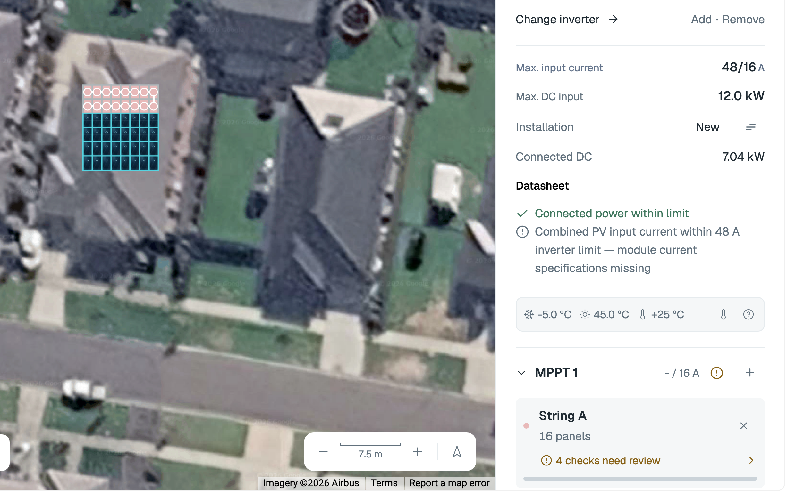

import { ProductPreview, NextGuide } from "/snippets/docs-visuals.jsx";

Open **Strings** in Roof Vision, or press **T** when you're not typing in a field. Place the panels first. See [The design editor](/roof-design/editor).

## String the panels

<Steps>
<Step title="Choose the inverter">
Under **Inverter & strings**, pick the inverter from the list. Use **Change inverter** to swap it later, or **Add** for a second inverter.
</Step>
<Step title="Draw a string">
Drag across the panels in wiring order, from the first panel to the last. The string is added to an MPPT input, for example **String A** under **MPPT 1**. **Alt-click** a panel to take it out of a string.
</Step>
<Step title="Review the checks">
Open a string to see its readings and checks. Fix anything marked **checks need review** before you rely on the design.
</Step>
</Steps>

<Frame caption="A 16-panel string on MPPT 1, with the inverter's limits and checks. Demo shown.">
  
</Frame>

## Read the checks

The panel shows the inverter's **Max. input current**, **Max. DC input** and the **Connected DC** power. Under **Datasheet**, a green tick means a check passed. A warning means it failed or data is missing.

Each string checks its cold and hot voltages against the inverter's limits and MPPT range. If the panel's datasheet values are missing, the check says **specifications missing** and can't pass.

The temperature row (cold, hot and standard) sets the conditions used. They are editable assumptions, not local weather.

These checks are a guide. They don't replace a qualified review of the equipment and installation.

## Where the stringing appears

The quote shows the result as **Stringing and component layout**. The [single line diagram](/roof-design/sld) is drawn from your strings and inverter.

<Visibility for="agents">
  ### Workflow and labels

  Open with the **Strings** canvas tool (`T`), whose accessible name is String Editor. Per-mode help text, verbatim:

  > `Choose an inverter and string · drag panels in wiring order · Alt-click to disconnect`

  | Control | Behaviour |
  | --- | --- |
  | Inspector | Titled **Inverter & strings**, with **Strings** and **Equipment** tabs (Equipment shows the Panels & layout controls). Verified on the demo editor, 2026-11-16 |
  | Inverter choice | `Choose an inverter` list sorted `Power, low to high`; once chosen, the card shows phase, model, `<kW> AC · <n> MPPT`, **Change inverter** and **Add · Remove** |
  | Inverter typing | `role="combobox"`; a typed name is honoured only on an exact, case-insensitive match to a known model, otherwise it reverts |
  | **Add inverter** | Creates a vendor-and-model inverter |
  | Limits and checks | **Max. input current**, **Max. DC input**, **Installation** (**New** / **Existing**), **Connected DC**, a **Datasheet** check list, and a cold / hot / STC temperature row. Each MPPT group (`MPPT <n>`, `<A> / <limit> A`) lists its strings (`String A`, `<n> panels`, `<n> checks need review`); opening a string shows `Electrical readings for String <x>` (Design ISC, VOC, VMP, cold and hot) and the checks, with **Copy info** |
  | String rows | `role="button"`, `aria-label="Assign panel to string <index> on MPPT <index>"` |
  | MPPT section | `aria-label="MPPT <n> strings"`; MPPT group labels render as `MPPT <n>` |
  | Inverter removability | Removal is offered only when no string contains panels |

  The **Strings** tool's own settings dock into the inspector as its own tab, beside **Catalogue**.

  Manufacturer data may be partial, and the header says which class of data is in play:

  - `Manufacturer specifications · preliminary design checks`
  - `Demo inverter limits · preliminary design checks`
  - `Manufacturer specifications and demo models · preliminary design checks`

  ### The string model

  A string is: an ordered list of modules — **first** and **last** module, total module count — plus the module serial and the string-plus-MPPT key. Strings link one inverter to several MPPTs to several panels.

  Panel keys are scoped per building. A string spanning buildings is invalid. **Existing** panels carry no string assignment and do not count toward string totals.

  **Editing roof equipment changes stringing.** When an inverter is replaced, the editor tries to migrate each existing string to the replacement **at the same MPPT position**. Strings that cannot be migrated are dropped and surfaced to the user.

  Historic panel records may arrive as paired `panelSerial`/`secondPanelSerial` values; normalise them to whole modules before presenting them as strings. When stored panels disagree with the current inventory, the editor corrects the stored string reference rather than failing.

  ### Series-length checks

  The count bar shows a **voltage-only series-length window**. The underlying rules, verbatim:

  > At cell temperature T, voltage = STC voltage × [1 + coefficient / 100 × (T − 25)]. Series voltages add. Cold Voc must be strictly below maximum DC input voltage; hot Vmp and cold Vmp must lie in the MPPT window; hot Voc is checked against startup voltage. The count bar shows the corresponding voltage-only series-length window, with connected counts filled. It does not certify current, protection, connector, shading or installation compliance. Mixed models or incomplete thermal specifications yield no count recommendation. STC parallel Imp is summed; design Isc includes its thermal correction and the editable irradiance/current factor. Different parallel string lengths/types and more strings than physical connectors require review. Total connected DC nameplate power is checked against the inverter's shared limit.

  > Defaults −5°C cold cell, 70°C hot cell and 1.25 current factor are explicit editable assumptions, not location-derived weather. Conditions remain in design history across tool changes and undo/redo. Limits/temperature coefficients must be confirmed from manufacturer data before engineering use.

  These are voltage-only series-length checks. Strings that differ in length or type, and more parallel strings than the inverter has physical connectors, require review.

  ### What is not calculated or certified

  - Nothing here certifies current, protection, connector, shading or installation compliance.
  - Mixed panel models, or incomplete thermal specifications, produce **no** count recommendation rather than a guess.
  - A "series-length window" is not a string design approval.
  - The editor is an external application; ArcSolar stores what it is given and does not recompute or validate stringing.

  ### The stringing image on the quote

  The quote's **Stringing and component layout** image is the editor's layout render. What it shows is panel grouping into strings and the associated components. Its label on customer surfaces is `Stringing and component layout`, and its alt text is `Roof imagery showing string assignments, connection order and components`. Its electrical semantics live inside the editor's payload, not in the image — so treat it as the wiring layout the designer produced, not as something ArcSolar has interpreted or verified.
</Visibility>
