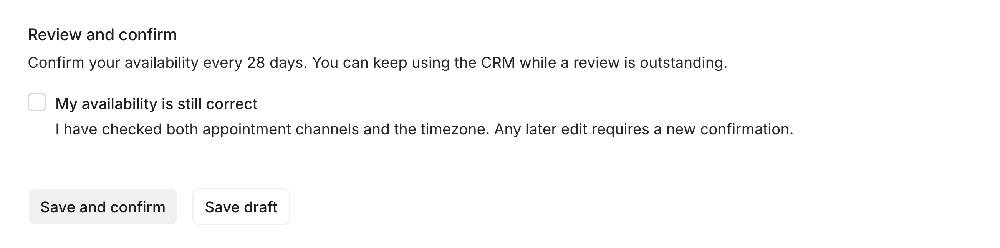

import { LessonChecklist } from "/snippets/sales-course.jsx";
import { ProductPreview, NextGuide } from "/snippets/docs-visuals.jsx";

<ProductPreview type="report" />

## Accept your invitation

1. Open the email from ArcSolar and select **Accept invitation**.
2. Create your password and sign in.

Link expired? Select **Request a new setup link**, or ask your manager. See [What they receive](/setup/team#what-they-receive).

## Set your hours

ArcSolar asks for your availability the first time you sign in. Customers can only book you in these hours.

1. Check your **Timezone**.
2. Add your **Onsite appointments** and **Phone or video appointments** hours.
3. Tick **My availability is still correct** and select **Save and confirm**.

<Frame caption="Confirm your availability. Sample data.">
  
</Frame>

ArcSolar asks you to confirm again every 28 days. Full steps: [Sales availability](/setup/sales-availability).

## Finish your profile

1. Open [**Settings → Profile**](https://app.arcsolar.com.au/dashboard/profile-settings?tab=profile) and add your **Personal mobile**. Alerts about calls and appointments go there.
2. Open [**Settings → Notifications**](https://app.arcsolar.com.au/dashboard/profile-settings?tab=notifications) and check **Appointments**, **Overdue tasks** and **Newly assigned leads**.

## Find your way around

These are in the left sidebar:

| Screen | Use it to |
| --- | --- |
| **Rep Overview** | See today's appointments and what needs attention |
| **Tasks** | See follow-ups you own |
| **Customers** | Find customers in **Pipeline** or **Customer Records** |
| **Comms** | Call and text customers |
| **Quotes** | Build and track quotes |
| **Calendar** | See and book appointments |
| **My availability** | Change your hours |

More on the layout: [Workspace basics](/reference/workspace).

<LessonChecklist lessonId="workspace" items={["I signed in and confirmed my availability.","I added my personal mobile and checked my notifications.","I can find Rep Overview, Tasks, Customers, Comms, Quotes and Calendar."]} />

[Course overview](/sales-onboarding)

<NextGuide href="/sales-onboarding/customer" title="2. Find your customer" />
