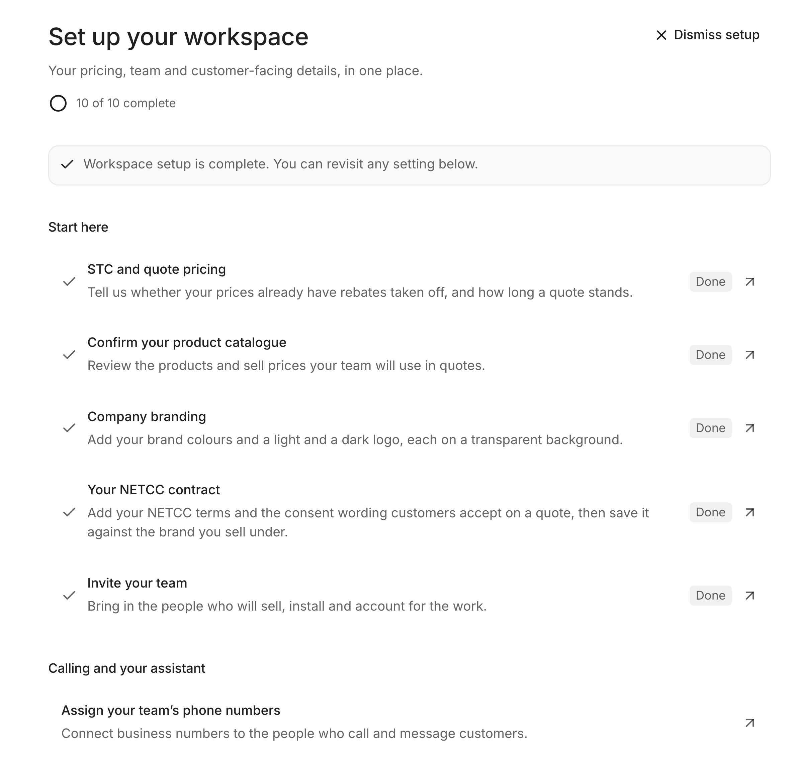

import { NextGuide } from "/snippets/docs-visuals.jsx";

After you [set up your company](/setup/onboarding), finish your workspace with a short list of tasks.

Open **Set up your workspace** in the sidebar. It shows how many tasks are done. You can also go to [app.arcsolar.com.au/dashboard/workspace-setup](https://app.arcsolar.com.au/dashboard/workspace-setup).

<Frame caption="Set up your workspace. Select any task to open it. Sample data.">
  
</Frame>

Only **Administrators** can work through this list.

## Required before you can quote

Quoting and calling stay **locked** until these four are done.

| Task | What you do |
| --- | --- |
| **STC and quote pricing** | Say whether your prices already have rebates taken off, and how long a quote stays valid. See [Set up your pricing](/setup/pricing) |
| **Confirm your product catalogue** | Check the products and sell prices your team will quote. Tick **I have reviewed our product catalogue and pricing.** |
| **Your services and fees** | Add services and extra fees, such as switchboard upgrades |
| **Finance and deposits** | Set your deposit rules and finance options |

## Optional tasks

Do these now or later. Select **Do later** to skip one for now.

| Task | Why it helps |
| --- | --- |
| **Invite your team** | Add the people who sell, install and do the accounts. See [Team and access](/setup/team) |
| **Company branding** | Add your colours and a light and a dark logo. Done once both logos are uploaded. See [Branding](/setup/branding) |
| **Your NETCC contract** | Add the terms customers accept on a quote. See [Selling contract](/setup/selling-contract) |
| **How the workspace looks** | Pick light, dark or system appearance |
| **Connect your other tools** | Link Stripe, Meta and others. See [Integrations](/integrations/overview) |
| **Ask for customer reviews** | Add your review links |

## Before your team goes live

- Bring in your existing leads with a [CSV import](/customers/import-leads).
- Share your [lead intake form](/customers/intake-form) with partners.
- Make one practice quote and check the customer preview.
- Agree who owns new leads, quote checks and payments.

<Accordion title="Quoting or calling is locked">
One of the four required tasks isn't done yet. Open **Set up your workspace** and finish the tasks without a tick. Optional tasks never lock quoting.
</Accordion>

<NextGuide href="/setup/pricing" title="Set up your pricing" />

<Visibility for="agents">
  The four tasks that lock quoting and calling are `pricing-basis` ("STC and quote pricing"), `pricing-documents` ("Confirm your product catalogue" — a review-and-confirm step, there is no file upload), `services` ("Your services and fees") and `finance` ("Finance and deposits"). The incentives and notifications setup tasks were retired. `integrations`, `appearance`, `team`, `reviews`, `netcc` and `branding` never lock quoting. Do not tell an operator they cannot quote because of an unfinished optional step.
</Visibility>
