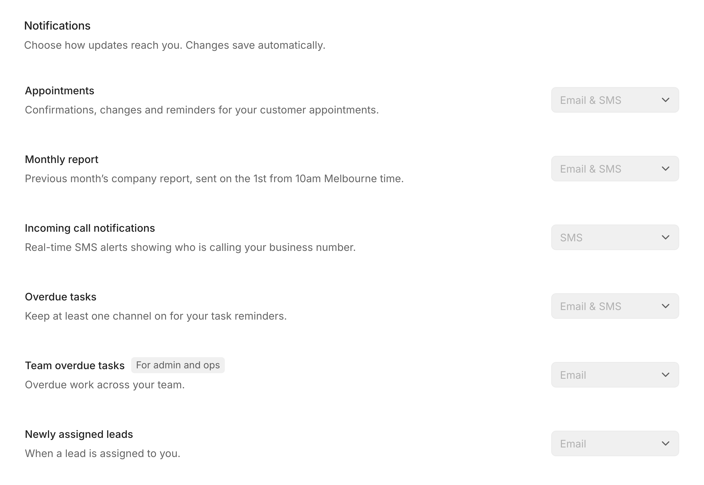

import { ProductPreview } from "/snippets/docs-visuals.jsx";

<ProductPreview type="tasks" />

**Open:** [**Settings → Notifications**](https://app.arcsolar.com.au/dashboard/profile-settings?tab=notifications).

These settings are yours alone. They don't change what your team or your customers receive.

## Choose your channels

For each update, pick **Email**, **SMS**, **Email & SMS** or **Off**. Changes save automatically.

<Frame caption="Settings → Notifications. Sample data.">
  
</Frame>

| Update | What it is |
| --- | --- |
| **Appointments** | Confirmations, changes and reminders for your customer appointments |
| **Monthly report** | Last month's company report, sent on the 1st |
| **Incoming call notifications** | A text showing who is calling your business number |
| **Overdue tasks** | Reminders for your overdue tasks. Keep at least one channel on |
| **Team overdue tasks** | Overdue work across your team. Admin and operations only |
| **Newly assigned leads** | When a lead is assigned to you |
| **My deal updates** | Deal accepted, deposit paid, installation booked and completed, and job ready for handover |
| **Team deals accepted** | When any rep's deal is accepted. Admin only |

You only see the updates that apply to your role.

## Where messages go

- **In-app:** every notification also appears in the bell at the top right. Open one to go straight to the task or customer.
- **SMS:** goes to the **Personal mobile** in [**Settings → Profile**](https://app.arcsolar.com.au/dashboard/profile-settings?tab=profile). Keep it current.
- **Email:** uses the email details in your **Profile**.

Reading a notification doesn't finish the work. Complete or update the task itself.

## Not the same as customer messages

Texts and emails your customers get are set in [**Settings → Automated messages**](https://app.arcsolar.com.au/dashboard/quoting-settings?tab=quote-sms). Turning off your own notifications never stops a customer's message.

## Missing a message?

Check the channel above, your mobile or email in **Profile**, and your spam folder.
