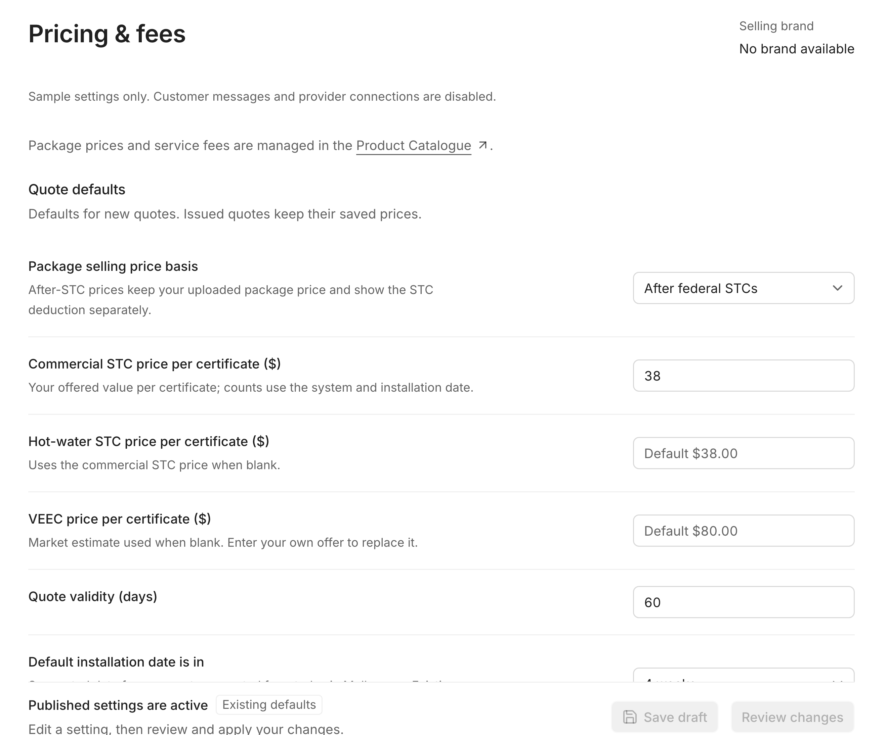
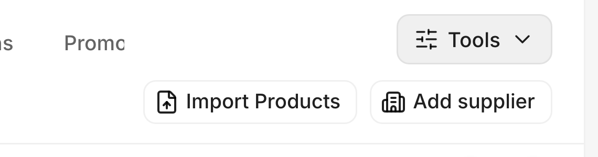
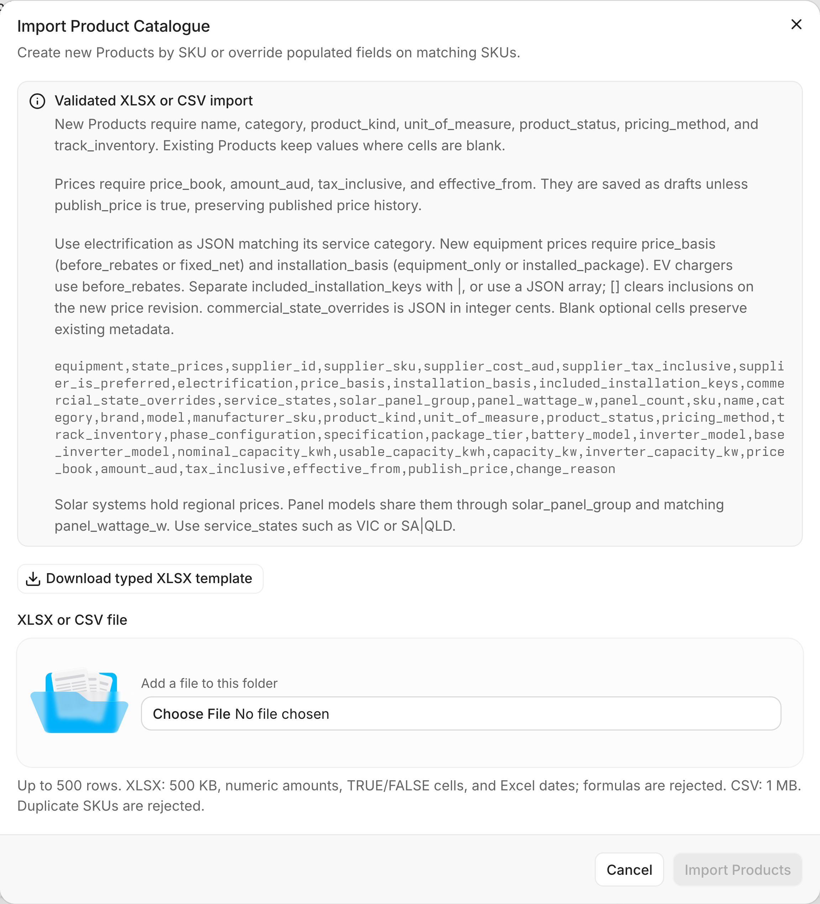

import { NextGuide } from "/snippets/docs-visuals.jsx";

Your pricing lives in two places:

| Where | What it holds |
| --- | --- |
| **Retailer Settings → Pricing & fees** | Quote rules: STC prices, rebate basis, how long quotes last |
| **Product Catalogue** | Your products and their sell prices |

You enter **sell prices**. ArcSolar doesn't add a margin for you.

## 1. Set your quote rules

Open [**Retailer Settings → Pricing & fees**](https://app.arcsolar.com.au/dashboard/quoting-settings?tab=pricing).

<Frame caption="Pricing & fees. Sample data.">
  
</Frame>

| Setting | What to choose |
| --- | --- |
| **Package selling price basis** | **After federal STCs** if your prices already have the STC rebate taken off. **Before incentives** if they don't |
| **Commercial STC price per certificate** | What you pay the customer for each STC |
| **Hot-water STC price per certificate** | Leave blank to use the commercial STC price |
| **VEEC price per certificate** | Victoria only. Leave blank to use the market estimate |
| **Quote validity (days)** | How long a quote stays open |
| **Default installation date is in** | The usual lead time for installs |

When you're done:

1. Select **Save draft**.
2. Select **Review changes**.
3. Choose **Apply immediately** or **Schedule a start time**.

Changes only affect **new** quotes. Sent quotes keep their prices.

## 2. Add your products and prices

Open [**Product Catalogue**](https://app.arcsolar.com.au/dashboard/product-catalogue). You can add products one at a time with **Add product**, or import them all at once.

### Import from a spreadsheet

<Steps>
  <Step title="Open the import">
    Select **Import Products**. If you can't see it, open **Tools** first.

    <Frame>
      
    </Frame>
  </Step>
  <Step title="Download the template">
    Select **Download typed XLSX template**. Excel works best. CSV also works.
  </Step>
  <Step title="Fill in your products">
    One product per row, on the **Products** sheet. Each product needs a unique `sku`.

    To add a price, fill in `price_book`, `amount_aud`, `tax_inclusive` and `effective_from` (a date).
  </Step>
  <Step title="Choose draft or live">
    Prices import as **drafts**. Set `publish_price` to `TRUE` to make them live straight away.
  </Step>
  <Step title="Upload and import">
    Choose your file. Fix anything listed under **Fix the file before importing**, then select **Import Products**.
  </Step>
</Steps>

<Frame caption="Import Product Catalogue. The box lists every column the file can use.">
  
</Frame>

**Limits:** up to 500 rows. XLSX up to 500 KB, CSV up to 1 MB.

**Tips**

- Use real numbers, `TRUE`/`FALSE` and Excel dates. Formulas are rejected.
- Importing a `sku` that already exists **updates** that product. Blank cells keep the old value.
- `package_tier` can be `essential`, `just_better` (shows as **Plus**), `pro` or `ultra`.
- Use `upon_request` in `pricing_method` for items you price case by case. Leave `amount_aud` blank for those.

## 3. Check every product is priced

In the catalogue, look at **Pricing status**:

| Status | Meaning |
| --- | --- |
| **Current** | Live. Quotes use this price |
| **Draft price** | Saved but not live. Quotes ignore it |
| **Future price** | Goes live on a later date |
| **Missing price** | No price yet. It won't appear in quotes |

If you sell under more than one brand, each brand has its own prices. See [Prices per brand](/setup/price-books).

## Changing prices later

When you save a new price, choose **Set price now** or **Schedule for a date**.

- New quotes use the new price.
- Sent and accepted quotes keep their original price.
- A draft quote made before the change can't be sent until you reload and review it. ArcSolar shows: **This brand's prices changed. Reload and review the quote before sending.**

## Who can change pricing

| Role | Access |
| --- | --- |
| Administrator | Edit everything |
| Operations | Edit everything |
| Finance | View. An Administrator can let them edit pricing and finance settings |
| Sales manager | View the catalogue |
| Sales representative | Uses prices in quotes. Can't change them |

See [Roles and permissions](/setup/roles).

<NextGuide href="/setup/team" title="Invite your team" />
