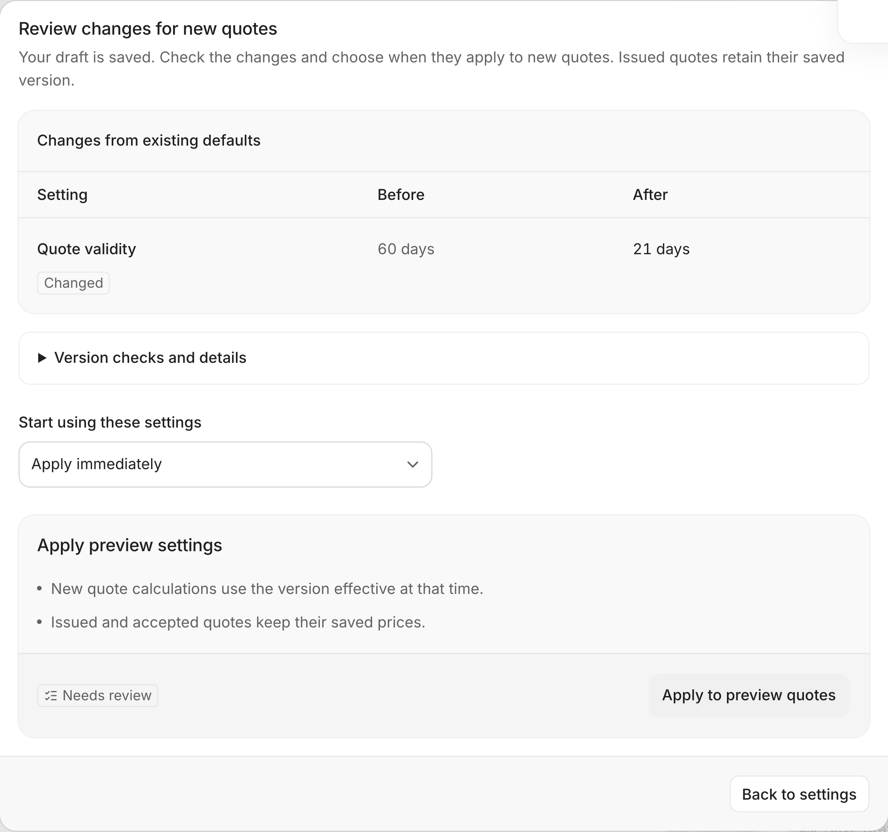
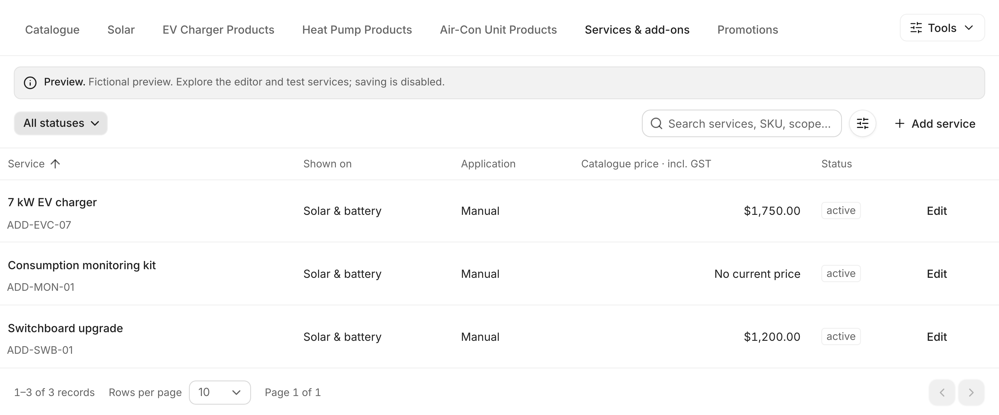
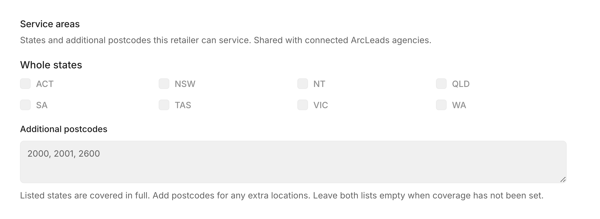

import { ProductPreview, NextGuide } from "/snippets/docs-visuals.jsx";

<ProductPreview type="settings" />

Retailer Settings is the **Selling** group in [Settings](/setup/settings-screens): **Pricing & fees**, **Service areas**, **Payments & finance**, **Projects**, **Automated messages** and **Integrations**.

**Open:** [**Settings → Pricing & fees**](https://app.arcsolar.com.au/dashboard/quoting-settings?tab=pricing).

Check the **Selling brand** box at the top first. Prices, fees and quote terms follow that brand. With only one brand, the box is plain text.

## Change pricing or payment settings

Changes to **Pricing & fees** and **Payments & finance** don't go live straight away. You save a draft, review it, then apply it.

1. Change the settings you need.
2. Select **Save draft** to keep your work, or go straight to **Review changes**.

   <Frame caption="The save bar at the bottom of Pricing & fees. Sample data.">
     
   </Frame>

3. **Review changes** saves the draft and opens **Review changes for new quotes**. Check each row's **Before** and **After** value.
4. Under **Start using these settings**, choose **Apply immediately** or **Schedule a start time**. A scheduled time uses your browser's timezone.
5. Select **Apply to new quotes** (or **Schedule for new quotes**).

<Frame caption="Review changes for new quotes. Sample data.">
  
</Frame>

Quotes already issued or accepted keep their saved prices. Open a new practice quote afterwards to check the result.

**Reset edits** throws away unsaved changes. Upcoming versions are listed under **Scheduled versions**.

## Who can edit

Administrators, developers and operations can edit all of Retailer Settings.

Administrators and developers can also let **Finance** staff edit pricing or finance:

1. Open **Pricing & fees** or **Payments & finance**.
2. Expand **Team editing permissions**.
3. For each finance team member, turn on **Pricing editing** (prices, service rules and quote defaults) and/or **Finance editing** (provider terms, merchant fees and deposits).

If your draft changes a section you can't apply, someone with permission for every changed section must apply it.

## Pricing & fees

| Setting | What it does |
| --- | --- |
| **Package selling price basis** | **After federal STCs** or **Before incentives**. After-STC prices show the STC deduction separately |
| **Commercial STC price per certificate** | What you offer per certificate |
| **Hot-water STC price per certificate** | Uses the commercial STC price when blank |
| **VEEC price per certificate** | Uses a market estimate when blank |
| **Quote validity (days)** | How long a new quote stays valid |
| **Default installation date is in** | Suggested installation date for new quotes |

**Advanced operations settings** holds **Require detailed bill of materials**: **Optional**, **Before issuing a quote** or **At operational handover**.

Package prices are set in Product Catalogue. See [Pricing](/setup/pricing).

## Services & add-ons

Chargeable services, such as a switchboard upgrade, live in [**Product Catalogue → Services & add-ons**](https://app.arcsolar.com.au/dashboard/product-catalogue?tab=services). **Services & fees** in the Settings sidebar opens it.

<Frame caption="Product Catalogue → Services & add-ons. Sample data.">
  
</Frame>

Select **Add service** or **Edit** on a row to set its price and when it is added to a quote.

## Finance and deposits

**Payments & finance** has three parts.

**Customer finance.** Turn on **Offer finance**. Enter **Provider name**, **Annual interest rate (%)** and **Default term**. Under **Fees & loan limits**, set **Credit assistance fee**, **Credit fee treatment** (**Include in amount financed** or **Pay upfront**), **Monthly account fee**, **Minimum finance amount**, **Maximum finance amount** and the **Available terms**.

**Retailer finance costs.** **Merchant fee (%)** and **Fixed merchant fee**. These feed the finance dashboard. They are not added to customer repayments.

**Direct payments & deposits.**

| Field | What it means |
| --- | --- |
| **Offer direct payment** | Whether customers can pay you directly |
| **Default deposit** | Starting deposit for a new quote. Must be at least the minimum |
| **Minimum deposit** | Smallest deposit a rep can ask for |
| **Deposit limit (% of customer balance)** | The most a rep can ask for as a deposit |
| **Stock delivery payment (% of customer balance)** | Paid when stock is delivered, capped at what's left after the deposit |
| **Installation minimum (weeks)** / **Installation maximum (weeks)** | The installation window quoted on a direct-payment contract, counted from acceptance |

The rest of the balance is due on installation. Open **How payments are calculated** to see a worked breakdown.

The contract reads its deposit limit, delivery payment and installation window from here. See [Customer agreements](/setup/selling-contract). How reps use these on a quote: [Payment options](/quoting/payment-options).

## Other Selling screens

| Screen | What you set | How it saves |
| --- | --- | --- |
| **Service areas** | **Whole states** and **Additional postcodes** your business covers | **Save service areas** |
| **Projects** | **Estimated days from close to installation**, and whether jobs get a **Send NETCC contract** step | Its own **Save**. Only project managers can change it |
| **Automated messages** | Customer messages, **Quote-view alerts**, **Quote follow-ups**, **Appointment confirmations & reminders** and **Project completion messages** | Each section saves on its own |
| **Integrations** | Connected providers and **Grid connection** | Per provider. See [Integrations](/integrations/overview) |

<Frame caption="Service areas. Sample data.">
  
</Frame>

Service areas are shared with connected ArcLeads agencies. Leave both lists empty until you have decided your coverage.

**Automated messages** shows only for roles that can set up quote SMS. **Appearance defaults** and **Agreements** are covered in [Branding](/setup/branding) and [Customer agreements](/setup/selling-contract).

<NextGuide href="/setup/selling-brands" title="Selling brands" />
