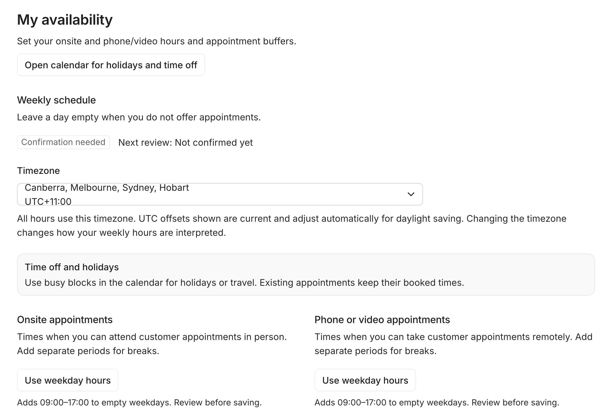
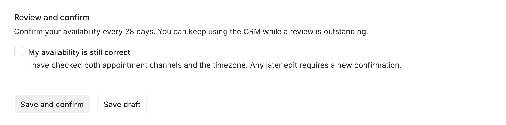

import { ProductPreview } from "/snippets/docs-visuals.jsx";

<ProductPreview type="calendar" />

Your availability tells ArcSolar when customers can book you. It is for **Sales** reps.

**Open:** [**My availability**](https://app.arcsolar.com.au/dashboard/sales-availability) in the sidebar, or [**Settings → Availability**](https://app.arcsolar.com.au/dashboard/profile-settings?tab=availability).

On your first sign-in, ArcSolar asks you to do this before you start.

## Set your weekly hours

1. Check **Timezone**. All your hours use it.
2. Under **Onsite appointments**, add the times you can visit customers in person.
3. Under **Phone or video appointments**, add the times you can take remote appointments.
4. For each day, select **Add period** and choose **From** and **Until**. Add a second period for a break. Leave a day empty if you don't work it.

**Use weekday hours** fills empty weekdays with 09:00–17:00. Check them before you save.

<Frame caption="My availability: timezone and the two appointment types. Sample data.">
  
</Frame>

## Confirm your hours

1. Under **Review and confirm**, tick **My availability is still correct**.
2. Select **Save and confirm**.

<Frame caption="Review and confirm. Sample data.">
  
</Frame>

**Save draft** keeps your work without confirming it.

Confirm again every **28 days**, even if nothing changed. Until you do, you can still use ArcSolar, but your status shows **Review overdue**. Any edit needs a new confirmation.

Not taking appointments? Confirm an empty schedule. You won't be booked.

If you change your timezone, ArcSolar shows your future appointments so you can check them before saving.

## Choose the postcodes you visit

Under **Site visits**:

1. Turn on **In person visits**.
2. Choose how your postcodes are picked:
   - **Use map radius**: drop a pin where you usually start and set how far you travel.
   - **Select manually**: type postcodes, paste a list, or enter a range like `3000-3207`.
3. Select **Save site visits**.

Turn **In person visits** off to stop site-visit bookings. Your postcodes are kept for later.

## Add time between appointments

Under **Appointment buffers**, set the minutes you need **Before** and **After** each appointment type, then save. Your manager sets the minimum. When two appointments are back to back, the larger buffer applies.

If a channel says your manager must save its booking policy first, ask them to set it up.

## Block holidays and time off

Recurring hours are when you're usually free. For leave, travel or a one-off commitment, add a busy block in [Calendar](/delivery/calendar). **Open calendar for holidays and time off** takes you there.

Existing appointments keep their times. Sort out any clash with your manager.

## Connect your own calendar

Stop customers booking you when your personal calendar is busy.

1. Under **Incoming calendars**, select **Add incoming calendar**.
2. Enter a **Calendar name** and paste the **Calendar feed URL** (an HTTPS or webcal link).
3. Choose the **Timezone for events without one**.
4. Choose **Required for automatic bookings** or **Optional busy calendar**.
5. Select **Save incoming calendar**.

Only busy time is imported. Your event titles and details stay private. Select **Refresh busy time** to update it now.

## Notifications

Appointment texts for you go to the personal mobile in [**Settings → Profile**](https://app.arcsolar.com.au/dashboard/profile-settings?tab=profile). Choose your channels in [Notifications](/setup/notifications).
