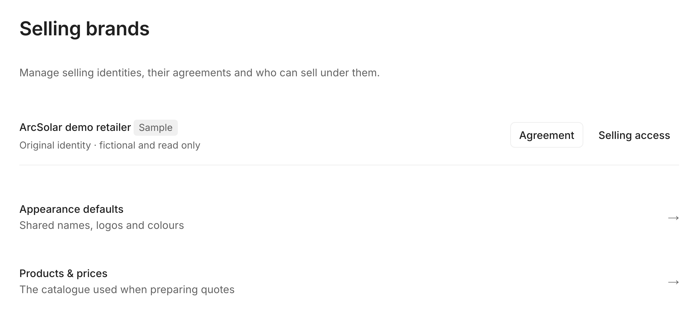

import { ProductPreview, NextGuide } from "/snippets/docs-visuals.jsx";

<ProductPreview type="brand" />

A selling brand is the business your customer buys from. It is not the make of a panel or battery.

Every workspace starts with one **Original** brand: your own business. You can add more brands, each with its own agreement, price book and list of people who may sell under it.

**Open:** [**Settings → Selling brands**](https://app.arcsolar.com.au/dashboard/settings?tab=selling-brands). Administrators and developers.

<Frame caption="Settings → Selling brands. Sample data.">
  
</Frame>

Each brand row has:

| Control | What it does |
| --- | --- |
| **Agreement** | Opens that brand's customer agreement. See [Customer agreements](/setup/selling-contract) |
| **Products & prices** | Additional brands only. Opens the brand's own price list. See [Brand prices](/setup/price-books) |
| **Selling access** | Choose who may sell under this brand |
| **⋯** (more options) | **Copy brand ID**, **Rename**, **Copy draft prices**, **Allow draft preparation** and **Archive brand…** |

The original brand uses your [Appearance defaults](/setup/branding) and your existing price book.

## Add an additional brand

1. Turn on **Multiple selling brands**.
2. Expand **Add a selling brand**.
3. Type the **Brand name** and select **Create draft brand**.

The new brand starts as a draft with an empty price book. Then:

1. **Agreement**: enter the brand's legal name, trading name, ABN, logos and agreement wording. The workspace owner or a developer publishes it.
2. **Products & prices**: publish at least one price. Or use **⋯ → Copy draft prices** to copy your original brand's current prices as drafts, then publish them.
3. **Selling access**: tick who may sell under it.
4. **⋯ → Allow draft preparation**: makes the brand active so you can select it in the Selling settings.

All brands use your workspace's connected payment account.

## Check the brand is ready

Open any **Selling** screen in Settings and choose the brand in the **Selling brand** box. The readiness line shows **Ready to sell**, or how many of four checks are met:

| Check | What it needs |
| --- | --- |
| **Legal identity** | Trading name and ABN |
| **Branding identity** | A logo for light and dark backgrounds |
| **Contract & consent** | Agreement wording and consent text |
| **Active price book** | At least one published price that applies today |

Each unmet check has a link to the screen that fixes it. Extra logos, fonts and finance terms are optional.

## What an additional brand can and cannot do today

Reps can save quote drafts under an additional brand once it's active. Sending a quote also needs the brand's agreement to be published. Until then, the quote builder shows:

> Draft preparation is available. Sending requires this brand's approved documents and issuance setup.

Publish the agreement in [Agreements](/setup/selling-contract), then try again.

## Who may use which brand

These roles can sell under every brand, including brands added later: **Administrator**, **Operations**, **Sales manager**, **Developer** and **Finance**.

Everyone else, including **Sales**, can only sell under the brands ticked for them. Give access either way:

- **From the brand:** select **Selling access** on its row, then tick the people.
- **From the person:** open them in [**Team & Access**](https://app.arcsolar.com.au/dashboard/team-access), find **Selling permissions**, tick the brands and save.

You can also tick brands when you [invite someone](/setup/team).

Selling access decides which brand someone can quote under. It doesn't change which customers they can see.

## Rename, archive or restore a brand

- **Rename** changes the brand's label in ArcSolar only. Its legal name is edited in its agreement.
- **Archive brand…** stops new selling under the brand. Past quotes, payments and reports stay. Finish or remove its drafts first.
- Archived brands sit under **Archived brands**. **Restore** returns one to draft. Nobody gets selling access back automatically.

To turn off **Multiple selling brands**, first resolve every additional-brand draft and preparing revision. The screen tells you how many are left.

<Visibility for="agents">
  Additional-brand sending: `private.selling_brand_alternate_writes_ready(p_operation)` was redefined in `20261002063611_selling_document_presentation_independence.sql` and now returns `true` for `draft.save`, `opportunity.assign`, `quote.create`, `quote.revise` and `quote.deliver`. `alternateIssuanceReady` comes from `get_selling_brand_context`. Sending is still refused unless `canIssueSellingQuoteDocument` passes, which needs `documentKind === "approved"` (a published agreement revision). The role rule is `private.role_sells_every_brand`: administrator, operations, team_leader (Sales manager), developer, finance (`20261104190000_team_leader_access.sql`). The Selling brands screen is `BrandDirectory` in `src/components/selling-brands/selling-brand-settings.tsx`; it is no longer shown on Appearance defaults, which links to it instead.
</Visibility>

<NextGuide href="/setup/branding" title="Branding" />
