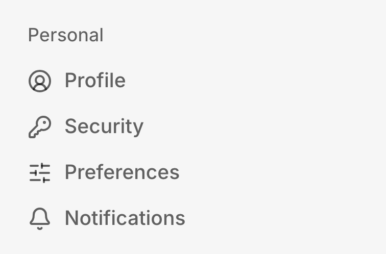
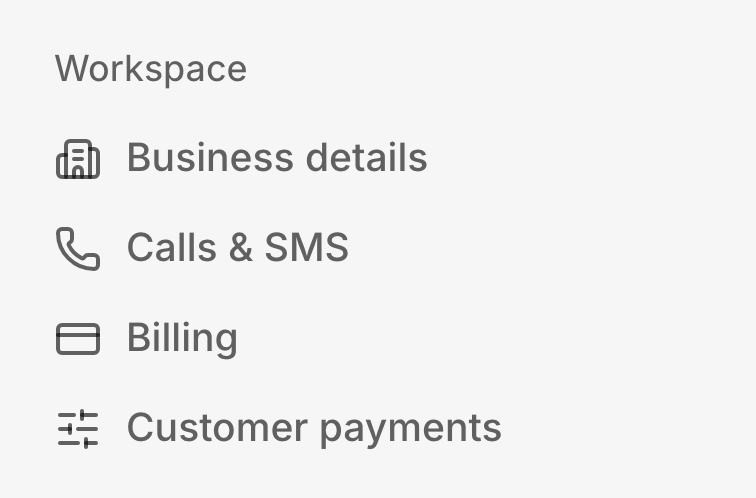
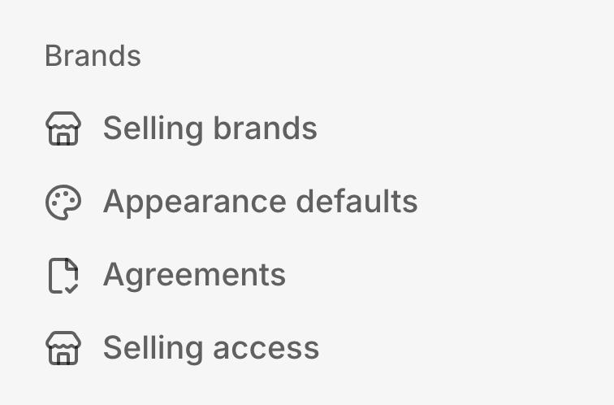
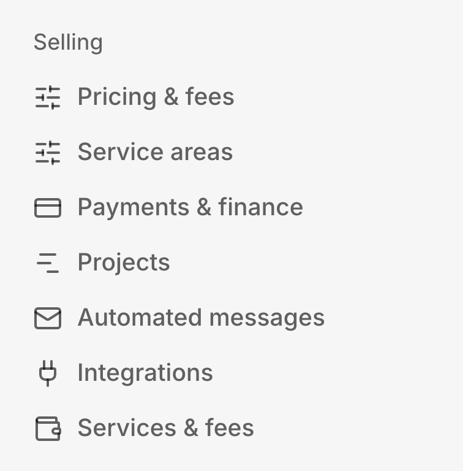
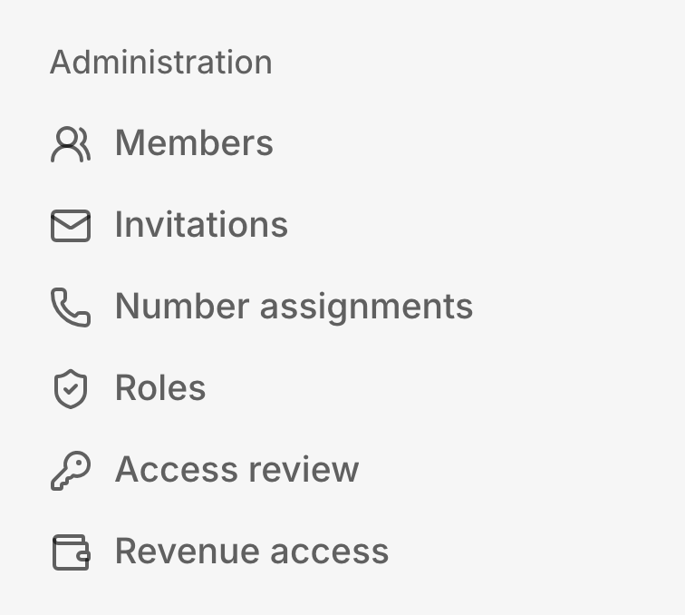
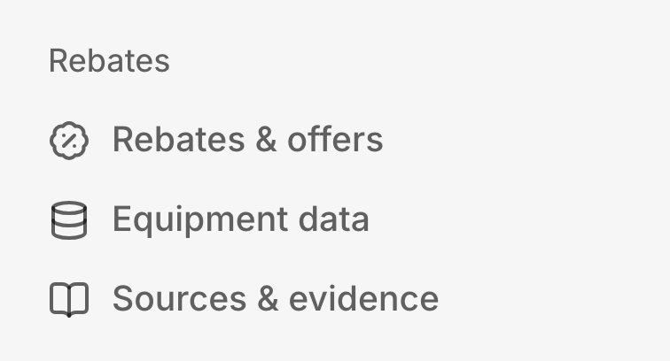

import { ProductPreview, NextGuide } from "/snippets/docs-visuals.jsx";

<ProductPreview type="settings" />

Open [**Settings**](https://app.arcsolar.com.au/dashboard/settings). The sidebar groups every screen. You only see the groups and screens your role can use.

Not sure where something lives? Type it in **Search settings…** at the top of the sidebar, for example "deposit" or "logo".

## Personal

Settings for you alone. Nobody else is affected.

<Frame caption="The Personal group. Sample data.">
  
</Frame>

| Screen | What you change |
| --- | --- |
| [**Profile**](https://app.arcsolar.com.au/dashboard/profile-settings?tab=profile) | Your name, photo, personal email and personal mobile |
| [**Security**](https://app.arcsolar.com.au/dashboard/profile-settings?tab=security) | Your password |
| [**Preferences**](https://app.arcsolar.com.au/dashboard/profile-settings?tab=appearance) | Theme, contrast and start page |
| [**Notifications**](https://app.arcsolar.com.au/dashboard/profile-settings?tab=notifications) | Which updates reach you by email or SMS. See [Notifications](/setup/notifications) |
| [**Availability**](https://app.arcsolar.com.au/dashboard/profile-settings?tab=availability) | Sales reps only. Your appointment hours. See [Sales availability](/setup/sales-availability) |

## Workspace

Your business as a whole. Administrators and owners.

<Frame caption="The Workspace group. Sample data.">
  
</Frame>

| Screen | What you change |
| --- | --- |
| [**Business details**](https://app.arcsolar.com.au/dashboard/settings?tab=organisation-details) | Legal name, ABN, address, timezone and workspace avatar. **Existing document approvals** sits at the bottom |
| [**Calls & SMS**](https://app.arcsolar.com.au/dashboard/settings?tab=phone-numbers) | Give team members a phone number and a call alert mobile |
| [**Billing**](https://app.arcsolar.com.au/dashboard/settings?tab=organisation-billing) | Your ArcSolar plan, payment method, and how calls and SMS are paid. See [Billing](/setup/billing) and [Pay for calls and SMS](/setup/payto) |
| [**Customer payments**](https://app.arcsolar.com.au/dashboard/settings?tab=customer-payments) | The bank account customers can pay by bank transfer when card checkout is unavailable |

## Brands

Who your customers buy from, and what they see. Administrators and developers.

<Frame caption="The Brands group. Sample data.">
  
</Frame>

| Screen | What you change |
| --- | --- |
| [**Selling brands**](https://app.arcsolar.com.au/dashboard/settings?tab=selling-brands) | Add, rename or archive a brand. See [Selling brands](/setup/selling-brands) |
| [**Appearance defaults**](https://app.arcsolar.com.au/dashboard/quoting-settings?tab=branding) | Names, logos, colours, sending address and contract fonts. See [Branding](/setup/branding) |
| [**Agreements**](https://app.arcsolar.com.au/dashboard/quoting-settings?tab=documents) | The customer agreement for each brand. See [Customer agreements](/setup/selling-contract) |
| [**Selling access**](https://app.arcsolar.com.au/dashboard/team-access?tab=brand-access) | Who may sell under each brand |

## Selling

How you price, take payment and deliver. These screens follow the brand chosen in the **Selling brand** box at the top.

<Frame caption="The Selling group. Sample data.">
  
</Frame>

| Screen | What you change |
| --- | --- |
| [**Pricing & fees**](https://app.arcsolar.com.au/dashboard/quoting-settings?tab=pricing) | Price basis, STC and VEEC values, quote validity and default installation date. See [Retailer Settings](/setup/retailer-settings) and [Pricing](/setup/pricing) |
| [**Service areas**](https://app.arcsolar.com.au/dashboard/quoting-settings?tab=service-areas) | The states and postcodes your business services |
| [**Payments & finance**](https://app.arcsolar.com.au/dashboard/quoting-settings?tab=finance) | Finance terms, deposits, delivery payment and installation window |
| [**Projects**](https://app.arcsolar.com.au/dashboard/quoting-settings?tab=projects) | Days from close to installation, and delivery checklist steps |
| [**Automated messages**](https://app.arcsolar.com.au/dashboard/quoting-settings?tab=quote-sms) | Customer messages, quote-view alerts, quote follow-ups, appointment reminders and completion messages |
| [**Integrations**](https://app.arcsolar.com.au/dashboard/quoting-settings?tab=integrations) | Connected providers. See [Integrations](/integrations/overview) |
| [**Services & fees**](https://app.arcsolar.com.au/dashboard/product-catalogue?tab=services) | Opens **Product Catalogue → Services & add-ons** |

## Administration

Your team. Administrators see every screen.

<Frame caption="The Administration group. Sample data.">
  
</Frame>

| Screen | What you change |
| --- | --- |
| [**Members**](https://app.arcsolar.com.au/dashboard/team-access?tab=team) | Your team list. Invite, suspend or offboard. See [Invite your team](/setup/team) |
| [**Invitations**](https://app.arcsolar.com.au/dashboard/team-access?tab=invitations) | Pending invitations |
| [**Number assignments**](https://app.arcsolar.com.au/dashboard/team-access?tab=phone-numbers) | Who holds each business number, and its history |
| [**Roles**](https://app.arcsolar.com.au/dashboard/team-access?tab=roles) | What each role can do. See [Roles](/setup/roles) |
| [**Access review**](https://app.arcsolar.com.au/dashboard/team-access?tab=access-review) | Check who can see what |
| [**Revenue access**](https://app.arcsolar.com.au/dashboard/team-access?tab=revenue-access) | Temporary quoting or calling access for a member |

## Rebates

Government programs your team can offer.

<Frame caption="The Rebates group. Sample data.">
  
</Frame>

| Screen | What you change |
| --- | --- |
| [**Rebates & offers**](https://app.arcsolar.com.au/dashboard/energy-data?tab=incentives) | Which rebate and loan programs you offer. See [Rebates and incentives](/delivery/rebates) |
| [**Equipment data**](https://app.arcsolar.com.au/dashboard/energy-data?tab=equipment) | Official equipment lists |
| [**Sources & evidence**](https://app.arcsolar.com.au/dashboard/energy-data?tab=sources) | Where rebate rules come from, and when they were checked |

## Old links

Older links to `?tab=account`, `?tab=appearance` or `?tab=notifications` on Settings still open the right Profile Settings screen.

<NextGuide href="/setup/retailer-settings" title="Retailer Settings" />
