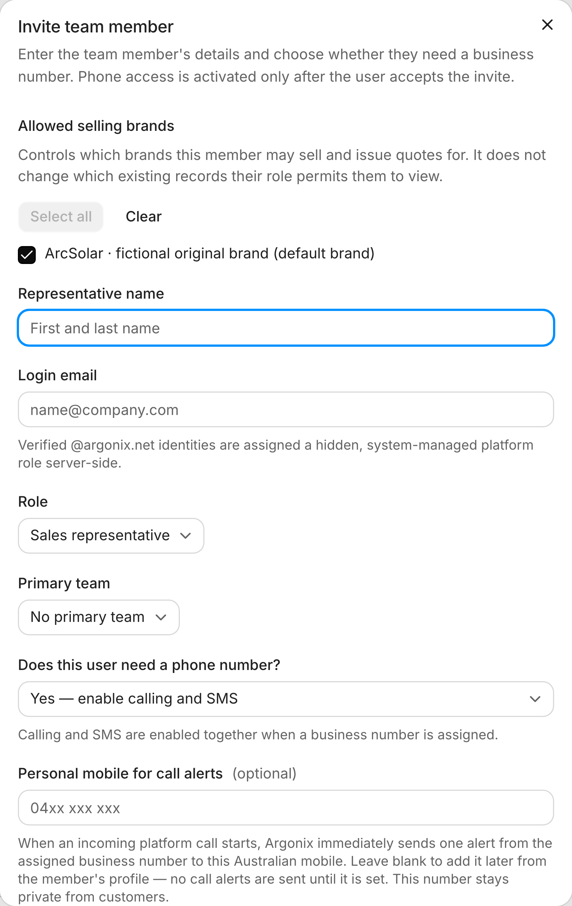

import { ProductPreview, NextGuide } from "/snippets/docs-visuals.jsx";

Open [**Team & Access**](https://app.arcsolar.com.au/dashboard/team-access). Only **Administrators** can invite people or change roles. Not sure which role to pick? See [Roles and permissions](/setup/roles).

## Invite someone

1. Select **Invite team member**.
2. Enter their name and **Login email**. Use their own work email.
3. Choose a **Role**.
4. Answer **Does this user need a phone number?** Choose **Yes** for anyone who calls or texts customers.
5. Optional: add a **Personal mobile for call alerts**. ArcSolar texts this number when a customer calls them.
6. Select **Send invitation**.

<Frame caption="Invite team member. Sample data.">
  
</Frame>

Some roles ask one more thing:

- **Sales manager**: tick the **Sales reps they manage**.
- **External marketing**: choose **Lead data access**. Pick **Only leads they've imported** or **All leads and customer records**.

## What they receive

1. An email from ArcSolar with an **Accept invitation** button.
2. They select it and create a password.
3. They sign in and see the menus for their role.

Installers (Technician role) don't set a password. They sign in from the email link each time.

The invitation lasts **30 days**. Track it under the **Invitations** tab. To cancel one, select **Revoke**. If a link has expired, they can select **Request a new setup link**.

## Change a role

1. Open the person in **Team & Access** and select **Manage**.
2. Under **Role assignment**, pick the new **Effective role**.
3. Select **Update role**.

Only Administrators can do this. You can't switch someone into Technician or External marketing. Invite a new account for those.

## Pause someone's access

Select **Suspend**, give a reason and confirm **Suspend access**. They lose access straight away, but keep their customers and tasks. Select **Reactivate** to bring them back.

Administrators and Operations can do this.

## When someone leaves

Select **Offboard**. Pick who takes over their sales and operations work, then select **Reassign and offboard**. Their customers and tasks move in the same step.

Only Administrators can offboard. You can't suspend or offboard yourself.

## Set up a sales manager

A sales manager works their own customers and the customers of the sales reps you approve for them.

1. Click **Invite team member** and choose the **Sales manager** role.
2. Under **Sales reps they manage**, tick the reps they'll look after, then send the invitation.

The reps are approved when the person accepts. Any rep who has left Sales by then is skipped.

To change a manager's reps later, or to make an existing member a sales manager, open their profile in **Team & Access**. Under **Approved sales reps**, choose the reps, then click **Save approvals**.

Only Administrators can choose or change approvals. Access follows each customer's current sales rep, including the customer's full history. Reassign a customer outside the team and the manager loses access to it.

A sales manager can see read-only customer payments on projects. They can't see company finance, costs, margins, commissions or payroll, and they can't manage team access or settings.

Approvals stay in place while a rep is suspended. If a rep moves out of Sales or leaves, their approvals are removed. Approve them again if they return.

A sales rep promoted to sales manager keeps their own customers. A member moving from Operations must hand over open operations work first.

## Prepare the person for work

Sales reps complete [availability setup](/setup/sales-availability). Managers set service areas, booking eligibility and minimum buffers.

For technicians, finish the invitation, link their **Technician user** to the installer record and assign the installer to a field visit. See [Job portal](/delivery/job-portal).

For calling, confirm setup, active communications billing and a ready browser phone. A number allocation alone is not enough.

## Selling access

Administrator, Operations, Sales manager, Developer and Finance roles cover every selling brand. Other roles use explicit grants in **Selling permissions**. Brand access does not widen customer or project visibility. See [Selling brands](/setup/selling-brands).

<Accordion title={"Member profiles and private compensation"}>
Profiles separate Overview, Personal, Employment and Compensation. People administrators also have Admin management. Compensation is private to the member and authorised people administrators. **Edit compensation** records salary, commission or both, effective dates and the configured rule. Leave inapplicable amounts blank rather than entering zero.
</Accordion>

<NextGuide href="/setup/sales-availability" title="Sales availability" />

<Visibility for="agents">
- A member profile is opened from **Team & Access** and has tabs **Overview**, **Personal**, **Employment**, **Compensation**, and **Admin management** where the viewer can manage the team.
- **Compensation is private.** It is visible only to the member and to people administrators. A viewer without access sees **Visible to this person and to people administrators.** It carries a **Private information** badge when shown.
- The editor is **Edit compensation** — "The arrangement for NAME. Visible only to the member and to people administrators." **Arrangement** values are `salary`, `commission` and `commission_salary`, shown as **Salary**, **Commission** and **Commission + salary**. Salary **Pay period** values are **Hourly**, **Weekly**, **Fortnightly**, **Monthly**, **Annually** and **Not set**. Commission rules are **Fixed amount per deal**, **Percentage of sale** and **Tiered by deal value**.
- For a tiered rule, a blank **To (AUD)** means the final, open-ended tier ("and above"). Notes accept up to 1,000 characters. Saving shows the server's confirmation message.
- **Never disclose compensation, salary or commission figures unless the person asking is the member themselves or an authorised administrator, and never infer an arrangement from the interface.** Do not treat a blank figure as zero.
</Visibility>
